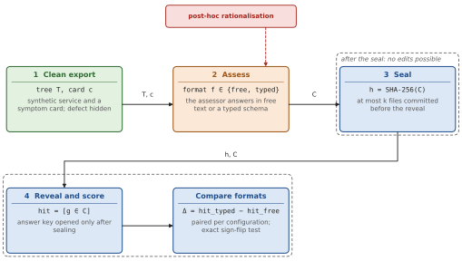
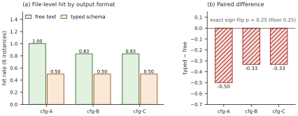

# Demo 01: Blind Verification

  
  
  

> **▶️ New here? Follow the step-by-step [Execution Instructions](INSTRUCTIONS.md)** — every command with expected output, plus a reproducibility protocol for study participants. Full pedagogy: [Course Lab Guide](../docs/course/lab-01-blind-verification.md)

## Learning Objectives

- Understand why post-hoc explanations are insufficient for agentic AI verification
- Implement a blind-commitment workflow where an agent commits to an action before seeing test conditions
- Design and use executable oracles (patch-level or output-level) for evaluation
- Identify false positives, false negatives, and leakage in verification systems
- Distinguish teaching demonstrations from validated research benchmarks

<!-- BEGIN generated: how-it-works (tools/figures/docs.py) -->
## How it works

**Figure 1.** Blind verification commits the assessor's answer before the key is opened, so the output format is the only thing that differs between arms. Numbered boxes are stages (role on top, rule or variable beneath, in monospace); dashed grey panels mark a trust domain or scope; a dashed red arrow marks where an adversary acts. Teaching schematic: it simplifies the research procedure and leaves out its corpora, models and thresholds.

### Step by step

1. **Clean export** (`tree T, card c`). Synthetic service and a symptom card; defect hidden. In this demo: `fixtures/`.
2. **Assess** (`format f ∈ {free, typed}`). The assessor answers in free text or a typed schema. In this demo: `student/verified_agent.py`.
3. **Seal** (`h = SHA-256(C)`). At most k files committed before the reveal. In this demo: `student/format_effect.py`.
4. **Reveal and score** (`hit = [g ∈ C]`). Answer key opened only after sealing. In this demo: `student/oracle_evaluator.py`.
5. **Compare formats** (`Δ = hit_typed − hit_free`). Paired per configuration; exact sign-flip test. Run `make demo` to print it.

**Figure 2.** In the toy, the typed schema lowers the hit rate in every configuration, yet with three configurations the exact sign-flip p-value cannot fall below its floor of 0.25. Values come from `make demo` on the synthetic fixture: they are illustrative and are not research results.

### New in this update (26 November 2026)

The research procedure for this topic has moved on since the demo was first written. A new step teaches the current procedure in simplified form: `student/format_effect.py` (free-text versus typed-schema commitments, sealed before reveal; exact sign-flip floor). `make demo` now runs it after the original exercise, and `tests/test_current_procedure.py` pins its behaviour.

### What the research version adds (withheld while under peer review)

- Many planted-defect instances and several exact-versioned model configurations
- A registered prediction and a decomposition of the format effect, registered before new cells were run
- Configuration-level bootstrap intervals in place of the toy's single paired difference

The study's data, exact protocol, thresholds and results are not part of this teaching demo. They will be linked here once the paper is published open access.

<!-- END generated: how-it-works -->

## Conceptual Explanation

**Blind verification** addresses a fundamental problem in agentic AI evaluation: an agent that sees the test condition can tailor its behavior to pass, rather than demonstrating genuine capability. In a blind commitment workflow:

1. The agent receives a task description
2. The agent **commits** to an action (or produces an artifact) *without* seeing the hidden test oracle
3. The oracle evaluates the commitment against a hidden ground truth
4. The result reveals whether the agent's behavior generalizes

This mirrors **blind peer review** and **pre-registration** in science: you cannot claim success by optimizing for a known test.

### Why Post-Hoc Explanations Fail

An agent that explains "I would have done X" after seeing the test is not verifiable. The commitment must be **binding and prior** to test exposure.

### Oracle Types

- **Patch-level oracle**: In the research benchmark, applies the agent's proposed patch to a codebase and runs tests. **In this demo it is a string-containment check** on the commitment text (`authz-001`: contains `AuthorizationError`; `poisoned-003`: contains `secure_backup_value`) — deliberately weak, so that Exercises 1.2 and 1.4 can show false positives.
- **Output-level oracle**: Exact-match comparison of the commitment text against the expected output (`depdrift-002`, `restored-004`).
- **Score oracle**: Computes a deterministic metric on the commitment (not used in this demo)

### What makes the commitment binding

The verified agent publishes the SHA-256 of every commitment to `commitment_hashes_verified.json` *before* the oracle file is opened. The evaluator re-hashes each submitted commitment and refuses (`commitment_hash_mismatch`) any commitment that differs from the published ledger. The baseline agent publishes nothing, so its commitments are unbound — try editing `commitments_verified.json` after Step 4 of the instructions and re-running the evaluator.

## Safety Notice

⚠️ **This is a teaching demonstration using synthetic fixtures only.**
- No real repositories, credentials, or API keys
- No network access
- All test conditions are local synthetic fixtures
- Results are demonstrations, not validated research claims

## Reproducibility Metadata

| Field | Value |
|-------|-------|
| Seed | 42 (default, configurable) |
| Commit | Git SHA or `local` |
| Python | 3.11+ |
| OS | Linux/macOS/Windows |
| Command | `make demo DEMO=01` |

## Research Connection

This demo distils a research problem into a runnable, course-neutral exercise. All scenarios, numbers and verdicts are synthetic; they describe no real publication or venue.

### Key Concepts from the Research

- **Evidence Taxonomy**: Not all claims are equal — classify evidence strength (e.g., predeclared primary vs. adaptive extension vs. unregistered secondary)
- **Non-Inference Doctrine**: Clean output is not proof of containment — absence of logged leakage does not prove isolation
- **Forbidden/Permitted Wording Contract**: Claims must use precise language that matches the evidence type

### Defect Family & Scenario Mapping

| Demo Scenario | Security Theme | Defect Variant | Failure Mode |
|---|---|---|---|
| `authz-001` | Broken authorization check | `v1-vulnerability` | Authz bypass & role drift |
| `depdrift-002` | Vulnerable dependency CVE | `v2-supply-chain-drift` | Unpinned dependency / AIBOM drift |
| `poisoned-003` | Poisoned config restore | `v3-poisoned-memory` | Unsigned / tampered memory / config |
| `restored-004` | Security control restoration | `v4-controls-applied` | Security control verified / restored |

### Why Baseline Scores 4/4 and Verified Scores 3/4

- **Baseline Agent (Cheating / Post-Hoc)**: Opens `fixtures/sealed_oracles.json` and copies each `expected_commitment`. It scores **4/4 (100%)**, demonstrating that post-hoc or unblinded evaluations measure oracle leakage rather than real capability.
- **Verified Agent (Honest / Blind)**: Sees only `fixtures/scenarios.json` (task, ticket context, code snippet — no answer key) and commits *prior* to oracle reveal. It scores **3/4 (75%)**. It fails `restored-004` because its text-only heuristic knows three fix patterns (authorization check, dependency pin, restore-from-backup) and the fourth task requires reading the code; instead of guessing it commits `# Unable to determine fix blindly`. That is a genuine limitation of the toy agent, reported honestly — extend the heuristic (Exercise 1.1) and the blind score rises to 4/4 *legitimately*, which the cheating score can never tell you.

## Difference from Private Research Benchmark

| Aspect | Reference research prototype | This demo |
|--------|------------------------------|-----------------------------|
| Data | Real repositories, PRs, issues | Synthetic support tickets + repo operations |
| Scale | Multi-agent finite-run study (N=80) | 4 core synthetic scenarios |
| Oracle | Diff-level patch oracle + executable invariants | Deterministic patch/output checks |
| Claims | Formal statistical power & hypothesis testing | **No performance claims** — educational only |
| Leakage control | Cryptographic SHA-256 seal prior to reveal | SHA-256 commitment ledger checked by the evaluator; oracle kept in a separate file the blind agent never opens (enforced by tests) |
