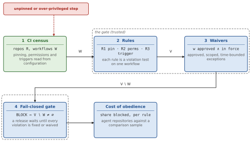
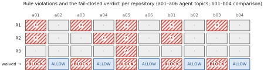

# Demo 02: Supply-Chain and AIBOM Drift

  
  
  

> **▶️ New here? Follow the step-by-step [Execution Instructions](INSTRUCTIONS.md)** — every command with expected output, plus a reproducibility protocol for study participants. Full pedagogy: [Course Lab Guide](../docs/course/lab-02-supply-chain-aibom.md)

## Learning Objectives

- Understand AI Bill of Materials (AIBOM) and component inventory concepts
- Detect when agent permissions drift from declared capabilities
- Implement fail-closed policy gates
- Design waiver mechanisms with expiration and justification
- Create GitHub Actions-compatible validation scripts

<!-- BEGIN generated: how-it-works (tools/figures/docs.py) -->
## How it works

**Figure 1.** A fail-closed gate turns each supply-chain rule into a release decision; counting what it would block is the cost of enforcing it. Numbered boxes are stages (role on top, rule or variable beneath, in monospace); dashed grey panels mark a trust domain or scope; a dashed red arrow marks where an adversary acts. Teaching schematic: it simplifies the research procedure and leaves out its corpora, models and thresholds.

### Step by step

1. **CI census** (`repos R, workflows W`). Pinning, permissions and triggers read from configuration. In this demo: `fixtures/ci_census.json`.
2. **Rules** (`R1 pin · R2 perms · R3 trigger`). Each rule is a violation test on one workflow. In this demo: `student/enforcement_cost.py`.
3. **Waivers** (`w approved ∧ in force`). Approved, scoped, time-bounded exceptions. In this demo: `fixtures/aibom.json`.
4. **Fail-closed gate** (`BLOCK ⇔ V ∖ W ≠ ∅`). A release waits until every violation is fixed or waived. In this demo: `student/policy_gate.py`.
5. **Cost of obedience** (`share blocked, per rule`). Agent repositories against a comparison sample. Run `make demo` to print it.

**Figure 2.** The gate would block 3 of 6 agent repositories and 2 of 4 comparison repositories; an approved waiver turns a04's block into an allow, and the violation is still reported. Values come from `make demo` on the synthetic fixture: they are illustrative and are not research results.

### New in this update (26 November 2026)

The research procedure for this topic has moved on since the demo was first written. A new step teaches the current procedure in simplified form: `student/enforcement_cost.py` (what a fail-closed gate would block across a census of CI configurations). `make demo` now runs it after the original exercise, and `tests/test_current_procedure.py` pins its behaviour.

### What the research version adds (withheld while under peer review)

- A census of real continuous-integration configurations with a comparison sample
- Independent scanners run in blocking mode beside the gate
- One registered hold-out test

The study's data, exact protocol, thresholds and results are not part of this teaching demo. They will be linked here once the paper is published open access.

<!-- END generated: how-it-works -->

## Conceptual Explanation

An **AIBOM (AI Bill of Materials)** declares what components, models, tools, and permissions an agentic system uses. **Drift** occurs when the running system exceeds or deviates from this declaration — e.g., an agent gains access to a new tool, a dependency is updated without review, or a privilege is escalated.

This demo teaches:
1. **Declared inventory**: What the system claims to use
2. **Runtime observation**: What the system actually uses
3. **Policy gate**: Automated check that blocks drift
4. **Waiver process**: Controlled, time-limited exceptions

## Safety Notice

⚠️ **Teaching demonstration only.**
- Synthetic package names (e.g., `secure-parser-123`)
- No real dependencies, registries, or credentials
- Local validation only — no cluster required
- One static fixture (`fixtures/aibom.json`); nothing is downloaded or generated
- The fixture pins `evaluation_time` (2025-01-14T12:00Z) so waiver validity is reproducible; `validate_aibom.py --now now` uses the real clock

## Reproducibility

| Field | Value |
|-------|-------|
| Seed | 42 |
| Commit | Git SHA or `local` |
| Python | 3.11+ |
## Research Connection

This demo distils a research problem into a runnable, course-neutral exercise. All scenarios, numbers and verdicts are synthetic; they describe no real publication or venue.

### Defect Family & Scenario Mapping

| Demo Scenario | Drift Type | Security Hazard | Drift? | Policy Gate Decision |
|---|---|---|---|---|
| `compliant-001` | Baseline Alignment | No drift — declared matches runtime | no | **ALLOW (PASS)** |
| `drifted-002` | Capability Escalation | Undeclared `scanner` tool added at runtime | yes | **BLOCK** (`exec:tools:scanner` explicitly denied) |
| `invalid-waiver-003` | Unapproved Scope Waiver | Unapproved `exec:shell:*` waiver for a scope that is not waivable | yes | **REJECT WAIVER (Block)** |
| `valid-waiver-004` | Approved Scoped Waiver | Approved, 24-hour waiver for `scanner` | yes | **ACCEPT WAIVER (Allow)** — drift is still reported |

### Core Primitives Demonstrated

1. **Declared vs. Observed Invariants**: the AIBOM's `agent_capabilities` is the declaration; every runtime capability outside it is reported as drift (`undeclared_capabilities`), independently of whether policy permits it. Composite tool lists (`exec:tools:parser,validator`) are matched per tool, so a runtime with *fewer* tools than declared is not drift.
2. **Fail-Closed Default Deny**: capabilities not explicitly permitted by the policy or by a valid waiver are blocked. Decision order: explicit allow → valid waiver → explicit deny → default deny. (A specific allow such as `net:http:api.internal/*` therefore beats the broad `net:http:*` deny because it is checked first, not because it is more specific.)
3. **Time-Bounded, Approved Waivers**: a waiver is honoured only if it is approved *and names an approver*, its scope is in `waiver_rules.allowed_scopes`, it is in force at evaluation time, and `expires − issued ≤ max_duration_hours`. Approval is a recorded field, not a cryptographic signature (signatures are Demo 05's topic). A waiver lifts a deny; it does not remove the drift from the report.

Not checked by this demo: the `components` list and its hashes (component-level verification is covered in Demo 05), and path normalisation of resource scopes (`read:files:/workspace/../etc/passwd` matches `read:files:/workspace/*` — see the Extension exercise).

## Difference from Private Research Benchmark

| Aspect | Reference research prototype | This demo |
|--------|------------------------------|-----------------------------|
| Enforcement | Kubernetes Admission Controller & eBPF | Standalone Python Policy Gate |
| Inventory | Full cyclonedx/SPDX AIBOM with model weights | Synthetic JSON component declaration |
| Waivers | Multi-signature hardware key approval | Structured waiver records with a recorded approver (no signature) |
| CI/CD | Real GitHub Actions / GitLab CI runner gates | Local validation script (`validate_aibom.py --scenario ID` / `--runtime observed.json`; exit 0 compliant, 1 non-compliant, 2 error) |
