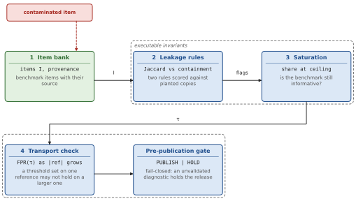
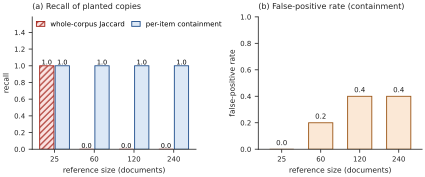

# Demo 03: Evaluation Invariants

  
  
  

> **▶️ New here? Follow the step-by-step [Execution Instructions](INSTRUCTIONS.md)** — every command with expected output, plus a reproducibility protocol for study participants. Full pedagogy: [Course Lab Guide](../docs/course/lab-03-eval-invariants.md)

## Learning Objectives

- Design evaluations using executable invariants, not just headline scores
- Detect test leakage (train/test contamination)
- Measure task difficulty and saturation
- Verify scoring stability across runs
- Classify failure modes correctly
- Capture reproducible evaluation metadata

<!-- BEGIN generated: how-it-works (tools/figures/docs.py) -->
## How it works

**Figure 1.** An evaluation's own diagnostics are checked against planted, labelled items before they are trusted. Numbered boxes are stages (role on top, rule or variable beneath, in monospace); dashed grey panels mark a trust domain or scope; a dashed red arrow marks where an adversary acts. Teaching schematic: it simplifies the research procedure and leaves out its corpora, models and thresholds.

### Step by step

1. **Item bank** (`items I, provenance`). Benchmark items with their source. In this demo: `fixtures/`.
2. **Leakage rules** (`Jaccard vs containment`). Two rules scored against planted copies. In this demo: `student/leakage_rules.py`.
3. **Saturation** (`share at ceiling`). Is the benchmark still informative? In this demo: `student/eval_invariants.py`.
4. **Transport check** (`FPR(τ) as |ref| grows`). A threshold set on one reference may not hold on a larger one. In this demo: `student/leakage_rules.py`.
5. **Pre-publication gate** (`PUBLISH | HOLD`). Fail-closed: an unvalidated diagnostic holds the release. Run `make demo` to print it.

**Figure 2.** The whole-corpus Jaccard rule finds the planted copies only while the reference is tiny; per-item containment keeps finding them, but at a fixed threshold its false-positive rate rises as the reference grows. Values come from `make demo` on the synthetic fixture: they are illustrative and are not research results.

### New in this update (26 November 2026)

The research procedure for this topic has moved on since the demo was first written. A new step teaches the current procedure in simplified form: `student/leakage_rules.py` (whole-corpus Jaccard against per-item containment, and threshold transport as the reference grows). `make demo` now runs it after the original exercise, and `tests/test_current_procedure.py` pins its behaviour.

### What the research version adds (withheld while under peer review)

- A large item bank with per-item provenance and a response matrix re-derived from published runs
- A natural experiment in which a released benchmark declares the source task of each item
- Item-response models validated against labelled data

The study's data, exact protocol, thresholds and results are not part of this teaching demo. They will be linked here once the paper is published open access.

<!-- END generated: how-it-works -->

## Conceptual Explanation

Headline scores (e.g., "95% accuracy") are misleading without context. **Evaluation invariants** are executable checks that validate the evaluation itself:

1. **No leakage**: Test items don't appear in training data
2. **Adequate difficulty**: Tasks aren't trivially solvable
3. **Stable scoring**: Same input yields same score
4. **Correct failure classification**: Failures categorized accurately
5. **Reproducible metadata**: Seed, environment, command recorded

This demo implements a miniature evaluation suite with synthetic tasks and five invariant checks. Every check computes its verdict from the fixture, and every check has a test that shows an input on which it fails — none of them passes by construction.

| # | Invariant | What the code computes | Fails when |
|---|-----------|------------------------|------------|
| 1 | `no_leakage` | Word 3-gram containment of each task prompt in `training_corpus`, plus the dataset's declared `in_training` flag | any task is declared in training or overlaps > 0.10 |
| 2 | `adequate_difficulty` | Mean, sample variance, share of scores ≥ 0.95, saturated items | variance < 0.05, more than 30% of scores at ceiling, or mean > 0.9 |
| 3 | `stable_scoring` | Spread of the recorded scoring `runs` per item (or of an injected scorer re-run N times) | any item spreads > 0.01, its `score` is not the mean of its runs, or it has fewer than two observations |
| 4 | `correct_failure_classification` | Every output below `pass_threshold` against the card's `failure_taxonomy` | a failure has no category, an unknown category, or a passing output is labelled as a failure |
| 5 | `reproducible_metadata` | Presence of `seed`, `commit`, `environment`, `command` in `run_metadata` | any field is missing or empty |

## Safety Notice

⚠️ **Teaching demonstration only.**
- Synthetic tasks and model outputs — every number in the fixture is invented
- No external dataset downloads
- No model API calls
- Results are demonstrations, not research claims

## Reproducibility

| Field | Value |
|-------|-------|
| Seed | 42 |
| Commit | Git SHA or `local` (written to `results/invariant_results.json` under `summary.run_metadata`) |
| Python | 3.11+ |
| Command | `make demo DEMO=03` |

## Research Connection

This demo distils a research problem into a runnable, course-neutral exercise. All scenarios, numbers and verdicts are synthetic; they describe no real publication or venue.

### The 5 Executable Invariants

| # | Evaluation Invariant | Failure Mode Caught | Benchmark Risk Prevented |
|---|---|---|---|
| **1** | **No Test Leakage** | N-gram / semantic overlap between train & test | Memorization masquerading as reasoning |
| **2** | **Adequate Difficulty** | Low variance / score saturation ($100\%$ ceiling) | Construct invalidity / trivial benchmark |
| **3** | **Scoring Stability** | High score variance across deterministic re-evals | Non-deterministic / flaking evaluation harness |
| **4** | **Failure Classification** | Unclassified / misattributed agent failure modes | Erroneous safety / performance attribution |
| **5** | **Reproducible Metadata** | Missing seeds, software versions, command strings | Irreproducible empirical evaluation |

### Key Takeaway: Invariants qualify the *evaluation*, not the model

Invariants are properties of the evaluation (its items, its scorer, its records), so a failed invariant taints every model's headline number on that evaluation. What the demo computes:

| Arm | Headline | Invariants run? | What the number means |
|-----|----------|-----------------|-----------------------|
| baseline, invariants ignored | 0.88 | no | unqualified |
| baseline, invariants run | 0.88 → **0.85** on clean items | 3/5 pass; leakage localized to `task-003` | inflated: the leaked item is the baseline's best score |
| verified, invariants ignored | 0.81 | no | unqualified |
| verified, invariants run | 0.81 → **0.84** on clean items | 3/5 pass | not inflated: it scored *below* its average on the leaked item |

The headline gap between the two agents (0.07) shrinks to 0.01 once the leaked task is excluded. A high headline score with failed invariants is a weak evaluation; the invariant does not just say "bad", it localizes which item inflated whom.

## Difference from Private Research Benchmark

| Aspect | Reference research prototype | This demo |
|--------|------------------------------|-----------------------------|
| Scale | 500+ multi-step agent trajectories | Synthetic 5-task evaluation fixture |
| Invariant 1 | Token-level minhash + semantic embeddings | Word 3-gram containment against a 4-document synthetic corpus, plus declared `in_training` flags |
| Invariant 2 | Item Response Theory (IRT) difficulty curves | Empirical mean, variance and share-at-ceiling checks |
| Invariant 3 | Bootstrapped confidence interval stability | Spread across three recorded scoring runs per item (an injected scorer can be re-run instead) |
