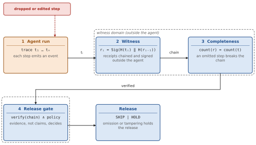
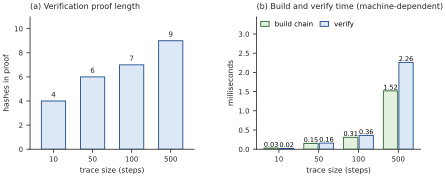

# Demo 05: Evidence-Backed Release Assurance (EVIAssure)

  
  
  

> **▶️ New here? Follow the step-by-step [Execution Instructions](INSTRUCTIONS.md)** — every command with expected output, plus a reproducibility protocol for study participants. Full pedagogy: [Course Lab Guide](../docs/course/lab-05-eviassure.md)

## Learning Objectives

- Build cryptographically verifiable evidence pipelines
- Implement sequence-bound witness receipts
- Create hash chains and Merkle trees for integrity
- Verify inclusion proofs
- Design fail-closed release gates
- Detect tampering and omission

<!-- BEGIN generated: how-it-works (tools/figures/docs.py) -->
## How it works

**Figure 1.** Witnessed receipts make an omitted or altered step detectable before release. Numbered boxes are stages (role on top, rule or variable beneath, in monospace); dashed grey panels mark a trust domain or scope; a dashed red arrow marks where an adversary acts. Teaching schematic: it simplifies the research procedure and leaves out its corpora, models and thresholds.

### Step by step

1. **Agent run** (`trace t₁ … tₙ`). Each step emits an event. In this demo: `fixtures/`.
2. **Witness** (`rᵢ = Sig(H(tᵢ) ‖ H(rᵢ₋₁))`). Receipts chained and signed outside the agent. In this demo: `student/eviassure.py`.
3. **Completeness** (`count(r) = count(t)`). An omitted step breaks the chain. In this demo: `student/eviassure.py`.
4. **Release gate** (`verify(chain) ∧ policy`). Evidence, not claims, decides. In this demo: `student/benchmark.py`.
5. **Release** (`SHIP | HOLD`). Omission or tampering holds the release. Run `make demo` to print it.

**Figure 2.** Proof length grows logarithmically with the trace while build and verification time grow roughly linearly; the verdicts on tampered and incomplete traces do not depend on the machine. Values come from `make demo` on the synthetic fixture: they are illustrative and are not research results.

### What the research version adds (withheld while under peer review)

- Formal statements of witnessed trace completeness with proofs
- A fault model, fault injection and an availability analysis
- Adversarial-collector campaigns and integrity baselines

The study's data, exact protocol, thresholds and results are not part of this teaching demo. They will be linked here once the paper is published open access.

<!-- END generated: how-it-works -->

## Conceptual Explanation

**Evidence-backed release assurance** uses cryptographic evidence to support release decisions. Instead of trusting "it passed tests," you verify a tamper-evident chain of evidence:

1. **Witness receipts**: Attestations of each step (step, action, hash of the step's data, previous hash, timestamp)
2. **Hash chaining**: Each receipt includes the hash of the previous one (sequence-bound)
3. **Merkle tree**: Efficient inclusion proofs for large evidence sets
4. **Signed receipts**: Each receipt signed (Ed25519) by the release key
5. **Release gate**: Rebuilds the chain from the trace and accepts only if every rebuilt receipt is exactly what an authorised key signed

This demo implements a minimal pipeline with synthetic agent traces.

**The lesson**: the hash chain alone proves only that a trace is *self-consistent*. A forger who edits a step and rebuilds the chain consistently passes every chain check (sub-demo 2 prints `Tampered trace: PASS` on purpose). Tampering is detected only where the gate holds something the forger cannot edit — the receipts signed by the release key (sub-demo 7: `receipt_mismatch_step_3_data_hash`).

## Safety Notice

⚠️ **Teaching demonstration only.**
- Demo Ed25519 keys generated in memory at runtime (labeled `DEMO_KEY_*`), never written to disk or committed
- **Not production signing keys** — do not use for real releases
- No persisted private keys, certificates, or real PKI
- Synthetic traces only

## Reproducibility

| Field | Value |
|-------|-------|
| Seed | 42 |
| Commit | Git SHA or `local` |
| Python | 3.11+ (requires `cryptography`) |
| Command | `make demo DEMO=05` |

## Research Connection

This demo distils a research problem into a runnable, course-neutral exercise. All scenarios, numbers and verdicts are synthetic; they describe no real publication or venue.

### Key Concepts from the Research

- **Multi-Provider Architecture**: The reference paper now uses 3 providers (Groq, Lagrange, OpenRouter) with 72 sessions across 6 models
- **Container Isolation**: The reference paper reports 17 of 72 sessions using container-isolated witnesses (own namespaces, non-root, read-only, no network)
- **Provider Independence**: The reference paper reports that the witness architecture works across different inference providers

### Threat Model & Verification Guarantees

| Attack Vector | Attacker Capability | EVIAssure Defense Primitive | Verification Result |
|---|---|---|---|
| **Event Modification** | Attacker edits an intermediate test score and rebuilds the chain consistently | Hash chain alone: **not detected** (`Tampered trace: PASS`). Signed receipts compared with the rebuilt chain | **FAIL**: `receipt_mismatch_step_3_data_hash` |
| **Event Omission** | Attacker drops the security-scan step (and fixes the count) | Step count held by the verifier; step numbering; sequence-bound previous hashes | **FAIL**: `step_count_mismatch: 5 != 6` |
| **Closing Count Spoofing** | Attacker fabricates the final summary counter | Closing count re-derived from the rebuilt chain | **FAIL**: `closing_count_mismatch` |
| **Re-signing with a rogue key** | Attacker signs the forged trace with a key of their own | Gate's authorised-signer set | **FAIL**: `unauthorized_signer_DEMO_KEY_ATTACKER` |
| **Missing evidence** | Package carries no signed receipts | Fail-closed gate | **FAIL**: `no_signed_receipts` |
| **Selective Inclusion** | Auditor wants to check one step without the whole trace | Merkle inclusion proof ($O(\log N)$ siblings) against a root they already trust | **VALID** for the real leaf, **INVALID** for a forged one |

### Core Primitives Demonstrated

1. **WitnessReceipt**: Structured attestations bound by step index, action, data payload hash, previous hash, and ISO-8601 timestamp.
2. **Sequential Hash Chain**: Detects any *inconsistent* edit — a receipt that does not link to its predecessor. It cannot detect a forgery that was rebuilt consistently; that needs an anchor the forger cannot edit.
3. **Merkle Inclusion Trees**: Compact logarithmic inclusion proofs for selective verification against a trusted root. (The gate does not "prove" its own leaves against a root it just computed from the same file — that can never fail.)
4. **Release Gate**: Recomputes the chain, checks step count and numbering, verifies one signed receipt per step under an authorised key, and requires each signed receipt to equal the rebuilt one field by field, before authorising deployment.

## Difference from Private Research Benchmark

| Aspect | Reference research prototype | This demo |
|--------|------------------------------|-----------------------------|
| Cryptography | Production Hardware HSM & KMS signing | Ephemeral Ed25519 in-memory demo keys |
| Scale | Continuous pipeline traces ($N=10^5$ events) | 6-step synthetic deployment trace |
| Ledger | Distributed append-only transparency log (Rekor/Sigstore) | Local JSON receipt records |
