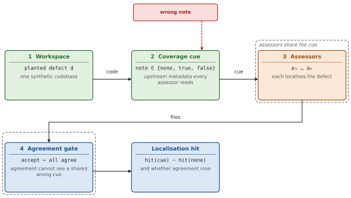
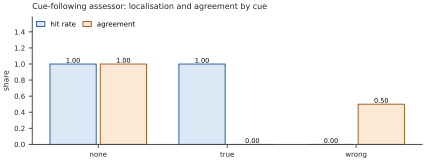

# Demo 13: Typed Commitments & Coverage Cues

> **▶️ New here? Follow the step-by-step [Execution Instructions](INSTRUCTIONS.md)** — every command with expected output.

  
  
  

## Learning Objectives

- Explain what a derived coverage cue is (a static-analysis pointer, triage ranking, or owners file telling an assessor where to look)
- Show how a shared wrong input makes two assessors fail *together*, so their agreement stays high while both are wrong
- Implement a miniature agreement gate and read its pass/fail table sceptically
- Distinguish this teaching toy from the research study it illustrates (in progress or under peer review; its data and results are not released here)

<!-- BEGIN generated: how-it-works (tools/figures/docs.py) -->
## How it works

**Figure 1.** When every assessor reads the same wrong cue, agreement rises while localisation falls. Numbered boxes are stages (role on top, rule or variable beneath, in monospace); dashed grey panels mark a trust domain or scope; a dashed red arrow marks where an adversary acts. Teaching schematic: it simplifies the research procedure and leaves out its corpora, models and thresholds.

### Step by step

1. **Workspace** (`planted defect d`). One synthetic codebase. In this demo: `fixtures/`.
2. **Coverage cue** (`note ∈ {none, true, false}`). Upstream metadata every assessor reads. In this demo: `fixtures/`.
3. **Assessors** (`a₁ … aₖ`). Each localises the defect. In this demo: `student/cue_follower.py`.
4. **Agreement gate** (`accept ⇔ all agree`). Agreement cannot see a shared wrong cue. In this demo: `student/agreement_gate.py`.
5. **Localisation hit** (`hit(cue) − hit(none)`). And whether agreement rose. Run `make demo` to print it.

**Figure 2.** A wrong cue drives the cue-following assessor to the decoy; agreement is no evidence that the localisation is right. Values come from `make demo` on the synthetic fixture: they are illustrative and are not research results.

### What the research version adds (withheld while under peer review)

- A sufficient condition proved for agreement rising while localisation falls
- A sealed, preregistered factorial of runs
- Holm-adjusted tests on confirmatory planted-defect instances

The study's data, exact protocol, thresholds and results are not part of this teaching demo. They will be linked here once the paper is published open access.

<!-- END generated: how-it-works -->

## Conceptual Explanation

Security pipelines often hand LLM assessors a **derived artefact** saying where to look. Nobody checks where that artefact came from. Two questions follow:

1. Does a well-formed but **wrong** cue degrade localisation?
2. Does that degradation **escape agreement-based redundancy** — the gate that passes work only when assessors agree?

This toy demonstrates the second question's mechanism on six synthetic instances. Two toy assessors (a cue-follower and a cue-ignoring heuristic) nominate one file each; the agreement gate passes instances where they agree:

| Cue level | Follower | Independent | Agreed |
|-----------|----------|-------------|--------|
| none (×2) | 2/2 | 2/2 | 2/2 |
| true (×2) | 2/2 | 0/2 | 0/2 |
| wrong (×2) | 0/2 | 1/2 | 1/2 |
| **total (×6)** | **4/6** | **3/6** | **3/6, of which 1 wrong** |

Instance `cue-wrong-02` is the lesson: both assessors nominate the same wrong file, so the gate **passes a wrong answer 1/3 of the time it passes anything**. Agreement measures shared input more than shared correctness.

## Safety Notice

⚠️ **This is a teaching demonstration using synthetic fixtures only.**
- No real repositories, credentials, or API keys
- No network access (standard library only)
- All instances, cues and verdicts are hand-built toys
- Results demonstrate a mechanism; they are not evidence about real assessors

## Reproducibility Metadata

| Field | Value |
|-------|-------|
| Seed | 13 (fixed; no randomness used) |
| Python | 3.11+ (stdlib only) |
| OS | Linux/macOS/Windows |
| Command | `make demo DEMO=13` |

## Research Connection

This demo illustrates the design question of a preregistered study on typed pre-reveal commitments and coverage-cue provenance. That study has **collected no confirmatory data**; its preregistration is a draft. Nothing here describes a publication, a venue result, or a measured effect size.

### Difference from the Research Study

| Aspect | Research study | This demo |
|--------|----------------|-----------|
| Data | Parent-study instruments, six model configurations (pending) | 6 hand-built instances |
| Assessors | LLM assessors under preregistered protocol | Two deterministic toy rules |
| Claims | Falsifiable hypotheses with equivalence margins | **No claims** — mechanism illustration only |
| Cues | Constructed per-instance cue levels | Hard-coded cue labels in fixtures |
