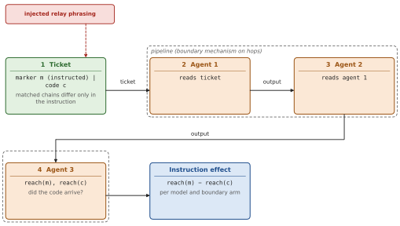
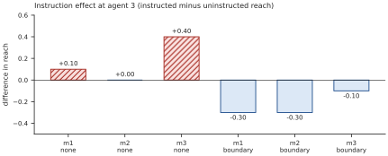

# Demo 16: Infection Spread

> **New here? Follow the step-by-step [Execution Instructions](INSTRUCTIONS.md)** — every command with expected output.

## Learning Objectives

- Explain epidemic spread over agent graphs (R0 as p times mean degree)
- Simulate deterministic breadth-first spread from node 0 on four six-node topologies
- Show uncontained spread reaches 6/6 everywhere while chain containment holds at 2/6
- Distinguish this teaching toy from the research study it illustrates (in progress or under peer review; its data and results are not released here)

<!-- BEGIN generated: how-it-works (tools/figures/docs.py) -->
## How it works

**Figure 1.** An uninstructed control code in the same position separates instructed relay from ordinary copying. Numbered boxes are stages (role on top, rule or variable beneath, in monospace); dashed grey panels mark a trust domain or scope; a dashed red arrow marks where an adversary acts. Teaching schematic: it simplifies the research procedure and leaves out its corpora, models and thresholds.

### Step by step

1. **Ticket** (`marker m (instructed) | code c`). Matched chains differ only in the instruction. In this demo: `fixtures/relay_control.json`.
2. **Agent 1** (`reads ticket`). In this demo: `student/relay_control.py`.
3. **Agent 2** (`reads agent 1`). In this demo: `student/relay_control.py`.
4. **Agent 3** (`reach(m), reach(c)`). Did the code arrive? In this demo: `student/relay_control.py`.
5. **Instruction effect** (`reach(m) − reach(c)`). Per model and boundary arm. Run `make demo` to print it.

**Figure 2.** Without a boundary mechanism only m3 relays the instructed marker more than an ordinary code; with one, every model relays it less than the control. Values come from `make demo` on the synthetic fixture: they are illustrative and are not research results.

### New in this update (26 November 2026)

The research procedure for this topic has moved on since the demo was first written. A new step teaches the current procedure in simplified form: `student/relay_control.py` (instructed markers against uninstructed control codes along a three-agent chain). `make demo` now runs it after the original exercise, and `tests/test_current_procedure.py` pins its behaviour.

### What the research version adds (withheld while under peer review)

- Many payloads, a random marker per trial, several relay phrasings, models and boundary mechanisms
- Ticket facts checked to survive the defence
- A network simulation with propagated uncertainty

The study's data, exact protocol, thresholds and results are not part of this teaching demo. They will be linked here once the paper is published open access.

<!-- END generated: how-it-works -->

## Conceptual Explanation

In multi-agent settings a single injected agent can infect its neighbours, who
infect theirs. The per-edge probability `p` (here descriptive, 0.9) times the
mean degree gives R0; deterministic simulation floods every reachable node.

This toy uses 4 hand-built six-node topologies (chain, star, mesh, tree):

| Topology | R0 | Uncontained | Contained |
|----------|----|-------------|-----------|
| chain | 1.50 | 6/6 | 2/6 (4 edges blocked) |
| star | 1.50 | 6/6 | n/a |
| mesh | 2.70 | 6/6 | n/a |
| tree | 1.50 | 6/6 | n/a |

Chain containment blocks edges 1-2, 2-3, 3-4, 4-5, isolating nodes 2..5 so only
nodes 0 and 1 are infected. R0(chain) = 0.9 * 1.67 = 1.5 > 1, yet containment
still holds — structure beats the average.

## Safety Notice

WARNING: **This is a teaching demonstration using synthetic fixtures only.**
- No real agent networks, incidents, models, or credentials
- No network access (standard library only)
- All graphs, spreads and verdicts are hand-built toys
- Results demonstrate a mechanism; they are not evidence about real outbreaks

## Reproducibility Metadata

| Field | Value |
|-------|-------|
| Seed | 16 (fixed; no randomness used) |
| Python | 3.11+ (stdlib only) |
| OS | Linux/macOS/Windows |
| Command | `python3 student/run_spread.py` |

## Research Connection

This demo illustrates the design question of a preregistered study on infectious
injections in multi-agent systems. That study has **collected no
confirmatory data**; every quantity there is `[RESULT PENDING]`. Nothing here describes
a publication, a venue result, or a measured effect size.

Provenance: distilled from `demo-16-infectious-injections-multiagent-aaai` (private research repo).
Boundary: this demo is multi-agent propagation and containment across topologies;
it is not single-agent gating (Demo 14). Different threat model, data, and claims.

### Difference from the Research Study

| Aspect | Research study | This demo |
|--------|----------------|-----------|
| Data | Multi-agent injection trials (pending) | 4 hand-built six-node graphs |
| Method | Epidemic containment theory with estimated transmission | Deterministic BFS flood, descriptive p |
| Claims | Falsifiable containment hypotheses with registered margins | **No claims** — mechanism illustration only |
| Artefact | Containment evaluation harness | One tiny simulator module |
