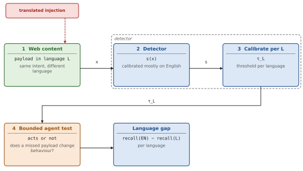
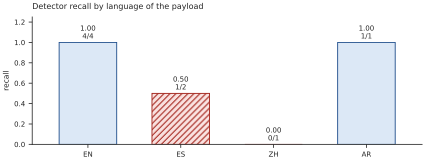

# Demo 18: Crosslingual Gap

> **New here? Follow the step-by-step [Execution Instructions](INSTRUCTIONS.md)** — every command with expected output.

## Learning Objectives

- Explain the crosslingual injection gap (English-tuned detectors miss non-English payloads)
- Apply one English-centric rule plus a single marker to 10 synthetic payloads
- Show recall EN 4/4 vs non-EN 2/6 (total 6/10)
- Distinguish this teaching toy from the research study it illustrates (in progress or under peer review; its data and results are not released here)

<!-- BEGIN generated: how-it-works (tools/figures/docs.py) -->
## How it works

**Figure 1.** A detector tuned on English phrasing misses the same intent in another language unless it is calibrated per language. Numbered boxes are stages (role on top, rule or variable beneath, in monospace); dashed grey panels mark a trust domain or scope; a dashed red arrow marks where an adversary acts. Teaching schematic: it simplifies the research procedure and leaves out its corpora, models and thresholds.

### Step by step

1. **Web content** (`payload in language L`). Same intent, different language. In this demo: `fixtures/`.
2. **Detector** (`s(x)`). Calibrated mostly on English. In this demo: `student/detector.py`.
3. **Calibrate per L** (`τ_L`). Threshold per language. In this demo: `student/run_lang.py`.
4. **Bounded agent test** (`acts or not`). Does a missed payload change behaviour? In this demo: `student/run_lang.py`.
5. **Language gap** (`recall(EN) − recall(L)`). Per language. Run `make demo` to print it.

**Figure 2.** Every English payload is caught; translated payloads are caught inconsistently, three of six in total. Values come from `make demo` on the synthetic fixture: they are illustrative and are not research results.

### What the research version adds (withheld while under peer review)

- Detector calibration across many languages
- A bounded agent test on web content

The study's data, exact protocol, thresholds and results are not part of this teaching demo. They will be linked here once the paper is published open access.

<!-- END generated: how-it-works -->

## Conceptual Explanation

Many detectors key on English phrasing. Paraphrase or translate the payload and
the same intent slips through. One language-agnostic marker catches a fraction
of the transfer cases but not all.

This toy uses 10 hand-built payloads (EN 4, ES 2, ZH 2, AR 2):

| Group | Payloads | Flagged |
|-------|----------|---------|
| EN | en1-en4 (all carry the English phrase) | 4/4 |
| ES | es1 (marker, flagged), es2 (translation, missed) | 1/2 |
| ZH | zh1 (translation, missed), zh2 (benign, clean) | 0/2 |
| AR | ar1 (marker, flagged), ar2 (benign, clean) | 1/2 |

Total flagged: 6/10. English recall is perfect; non-English recall is 2/6.

## Safety Notice

WARNING: **This is a teaching demonstration using synthetic fixtures only.**
- No real payloads, models, or credentials
- No network access (standard library only)
- All payloads, detections and verdicts are hand-built toys
- Results demonstrate a mechanism; they are not evidence about real detectors

## Reproducibility Metadata

| Field | Value |
|-------|-------|
| Seed | 18 (fixed; no randomness used) |
| Python | 3.11+ (stdlib only) |
| OS | Linux/macOS/Windows |
| Command | `python3 student/run_lang.py` |

## Research Connection

This demo illustrates the design question of a preregistered study on
crosslingual prompt injection. That study has **collected no
confirmatory data**; every quantity there is `[RESULT PENDING]`. Nothing here describes
a publication, a venue result, or a measured effect size.

Provenance: distilled from `demo-18-crosslingual-injection-acl` (private research repo).
Boundary: this demo is language transfer of fixed payloads; it is not detector
tuning or cost analysis (Demo 37). Different question, data, and claims.

### Difference from the Research Study

| Aspect | Research study | This demo |
|--------|----------------|-----------|
| Data | Multilingual injection benchmark (pending) | 10 hand-built payloads |
| Method | Controlled translation-equivalent evaluation | One English phrase plus one marker |
| Claims | Falsifiable transfer hypotheses with registered margins | **No claims** — mechanism illustration only |
| Artefact | Multilingual evaluation harness | One tiny detector function |
