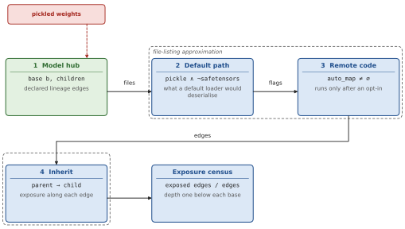
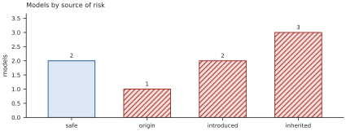

# Demo 19: Lineage Risk

> **New here? Follow the step-by-step [Execution Instructions](INSTRUCTIONS.md)** — every command with expected output.

## Learning Objectives

- Explain inherited supply-chain risk (a clean child of a flagged parent is still risky)
- Classify 8 synthetic models by own flags vs inherited risk
- Show 6/8 risky: 1 origin, 2 introduced, 3 inherited
- Distinguish this teaching toy from the research study it illustrates (in progress or under peer review; its data and results are not released here)

<!-- BEGIN generated: how-it-works (tools/figures/docs.py) -->
## How it works

**Figure 1.** What a client fetches by default is decided by file-precedence rules, so exposure is read from file listings along lineage edges. Numbered boxes are stages (role on top, rule or variable beneath, in monospace); dashed grey panels mark a trust domain or scope; a dashed red arrow marks where an adversary acts. Teaching schematic: it simplifies the research procedure and leaves out its corpora, models and thresholds.

### Step by step

1. **Model hub** (`base b, children`). Declared lineage edges. In this demo: `fixtures/`.
2. **Default path** (`pickle ∧ ¬safetensors`). What a default loader would deserialise. In this demo: `student/lineage.py`.
3. **Remote code** (`auto_map ≠ ∅`). Runs only after an opt-in. In this demo: `student/lineage.py`.
4. **Inherit** (`parent → child`). Exposure along each edge. In this demo: `student/run_lineage.py`.
5. **Exposure census** (`exposed edges / edges`). Depth one below each base. Run `make demo` to print it.

**Figure 2.** 6 of 8 models carry risk, most of it inherited from a parent rather than introduced. Values come from `make demo` on the synthetic fixture: they are illustrative and are not research results.

### What the research version adds (withheld while under peer review)

- A depth-one census of declared edges below foundational base models
- Parent states recorded at retrieval

The study's data, exact protocol, thresholds and results are not part of this teaching demo. They will be linked here once the paper is published open access.

<!-- END generated: how-it-works -->

## Conceptual Explanation

Models derive from parents: fine-tunes, merges, re-uploads. A pickled parent,
a remote-code parent, or a licence problem flows downhill even when the child
looks clean.

This toy uses 8 hand-built models:

| Model | Parent | Own flags | Verdict |
|-------|--------|-----------|---------|
| A | none | clean | safe |
| B | none | pickle | origin (risky) |
| a1 | A | clean | safe |
| a2 | A | remote code | introduced (risky) |
| b1 | B | clean | inherited (risky) |
| b2 | B | clean | inherited (risky) |
| c1 | a2 | clean | inherited (risky) |
| c2 | a1 | licence problem | introduced (risky) |

Risky total: 6/8 (B, a2, b1, b2, c1, c2); inherited 3 (b1, b2, c1);
introduced 2 (a2, c2); origin 1 (B).

## Safety Notice

WARNING: **This is a teaching demonstration using synthetic fixtures only.**
- No real model hub data, weights, models, or credentials
- No network access (standard library only)
- All models, flags and verdicts are hand-built toys
- Results demonstrate a mechanism; they are not evidence about real hubs

## Reproducibility Metadata

| Field | Value |
|-------|-------|
| Seed | 19 (fixed; no randomness used) |
| Python | 3.11+ (stdlib only) |
| OS | Linux/macOS/Windows |
| Command | `python3 student/run_lineage.py` |

## Research Connection

This demo illustrates the design question of a preregistered study on model
lineage inherited risk (Hub lineage corpus). That study has
**collected no confirmatory data**; every quantity there is `[RESULT PENDING]`.
Nothing here describes a publication, a venue result, or a measured effect size.

Provenance: distilled from `demo-19-model-lineage-inherited-risk-icse` (private research repo).
Boundary: this demo is weight-supply-chain inheritance; it is not model-card
disclosure analysis (Demo 36). Different question, data, and claims.

### Difference from the Research Study

| Aspect | Research study | This demo |
|--------|----------------|-----------|
| Data | Hub lineage corpus (pending) | 8 hand-built models |
| Method | Lineage-wide risk propagation measurement | Depth-ordered flag inheritance |
| Claims | Falsifiable inheritance hypotheses with registered margins | **No claims** — mechanism illustration only |
| Artefact | Lineage risk scanner | One tiny classifier module |
