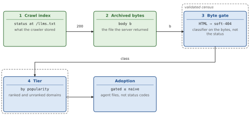
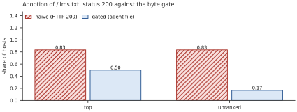

# Demo 20: Agent Web Census

> **New here? Follow the step-by-step [Execution Instructions](INSTRUCTIONS.md)** — every command with expected output.

## Learning Objectives

- Explain agent-facing web measurement (which sites publish agent directives, which carry injections)
- Tally adoption (either directive flag) and exposure (injection text) over 10 synthetic sites
- Show adoption 4/10 and injections 2/10, both injections on low-popularity sites
- Distinguish this teaching toy from the research study it illustrates (in progress or under peer review; its data and results are not released here)

<!-- BEGIN generated: how-it-works (tools/figures/docs.py) -->
## How it works

**Figure 1.** An HTTP 200 at an agent-facing path is a claim by the server; the archived bytes decide whether a file exists. Numbered boxes are stages (role on top, rule or variable beneath, in monospace); dashed grey panels mark a trust domain or scope; a dashed red arrow marks where an adversary acts. Teaching schematic: it simplifies the research procedure and leaves out its corpora, models and thresholds.

### Step by step

1. **Crawl index** (`status at /llms.txt`). What the crawler stored. In this demo: `fixtures/soft404_gate.json`.
2. **Archived bytes** (`body b`). The file the server returned. In this demo: `fixtures/soft404_gate.json`.
3. **Byte gate** (`HTML ⇒ soft-404`). Classifier on the bytes, not the status. In this demo: `student/soft404_gate.py`.
4. **Tier** (`by popularity`). Ranked and unranked domains. In this demo: `student/soft404_gate.py`.
5. **Adoption** (`gated ≤ naive`). Agent files, not status codes. Run `make demo` to print it.

**Figure 2.** Counting HTTP 200s overstates adoption; many 200s are HTML soft-404s, more so among unranked hosts. Values come from `make demo` on the synthetic fixture: they are illustrative and are not research results.

### New in this update (26 November 2026)

The research procedure for this topic has moved on since the demo was first written. A new step teaches the current procedure in simplified form: `student/soft404_gate.py` (HTTP 200 at an agent-facing path checked byte by byte for soft-404s). `make demo` now runs it after the original exercise, and `tests/test_current_procedure.py` pins its behaviour.

### What the research version adds (withheld while under peer review)

- Every partition of both columnar index subsets of one crawl
- A live random-path probe and human labels to validate the gate
- A fixed-seed sample of registered domains across popularity tiers

The study's data, exact protocol, thresholds and results are not part of this teaching demo. They will be linked here once the paper is published open access.

<!-- END generated: how-it-works -->

## Conceptual Explanation

Sites increasingly ship agent directives alongside human pages. A census asks two
independent questions: who publishes directives, and whose copy carries
injection text.

This toy uses 10 hand-built sites:

| Site | Popularity | Adopted | Exposed |
|------|------------|---------|---------|
| s01 | high | yes | no |
| s02 | high | yes | no |
| s03 | medium | yes | no |
| s04 | low | yes | yes |
| s05 | low | no | yes |
| s06-s10 | mixed | no | no |

Adoption: 4/10. Exposure: 2/10, both on low-popularity sites.

## Safety Notice

WARNING: **This is a teaching demonstration using synthetic fixtures only.**
- No real crawl data, sites, models, or credentials
- No network access (standard library only)
- All sites, directives and verdicts are hand-built toys
- Results demonstrate a mechanism; they are not evidence about the real web

## Reproducibility Metadata

| Field | Value |
|-------|-------|
| Seed | 20 (fixed; no randomness used) |
| Python | 3.11+ (stdlib only) |
| OS | Linux/macOS/Windows |
| Command | `python3 student/run_web.py` |

## Research Connection

This demo illustrates the design question of a preregistered study on the
agent-facing web (Common Crawl corpus). That study has
**collected no confirmatory data**; every quantity there is `[RESULT PENDING]`.
Nothing here describes a publication, a venue result, or a measured effect size.

Provenance: distilled from `demo-20-agent-facing-web-commoncrawl-www` (private research repo).
Boundary: this demo is web measurement over page directives; it is not an MCP
registry census (Demo 21). Different corpus, data, and claims.

### Difference from the Research Study

| Aspect | Research study | This demo |
|--------|----------------|-----------|
| Data | Common Crawl agent-facing sample (pending) | 10 hand-built sites |
| Method | Large-scale directive and injection census | Two boolean tallies |
| Claims | Falsifiable prevalence hypotheses with registered margins | **No claims** — mechanism illustration only |
| Artefact | Census measurement pipeline | Two tiny helper functions |
