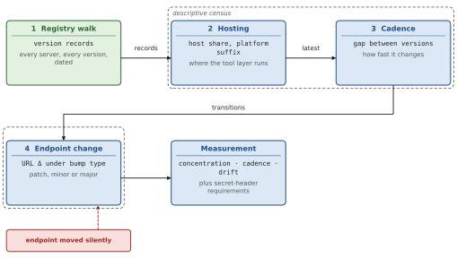
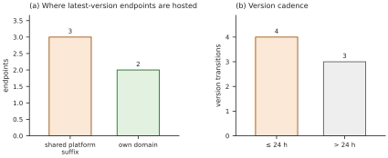

# Demo 21: MCP Ecosystem Census

> **▶️ New here? Follow the step-by-step [Execution Instructions](INSTRUCTIONS.md)** — every command with expected output.

  
  
  

## Learning Objectives

- Explain what tool poisoning is (a tool description carrying instructions to the model, not the user)
- Define a rug pull (a version update that silently adds capabilities or rewrites the description)
- Run a miniature census: poisoning prevalence, version drift, capability bundling, maintainer concentration
- Distinguish this teaching toy from the research study it illustrates (in progress or under peer review; its data and results are not released here)

<!-- BEGIN generated: how-it-works (tools/figures/docs.py) -->
## How it works

**Figure 1.** A dated registry walk shows where agent tool servers are hosted and how their endpoints change between versions. Numbered boxes are stages (role on top, rule or variable beneath, in monospace); dashed grey panels mark a trust domain or scope; a dashed red arrow marks where an adversary acts. Teaching schematic: it simplifies the research procedure and leaves out its corpora, models and thresholds.

### Step by step

1. **Registry walk** (`version records`). Every server, every version, dated. In this demo: `fixtures/registry_hosting.json`.
2. **Hosting** (`host share, platform suffix`). Where the tool layer runs. In this demo: `student/registry_hosting.py`.
3. **Cadence** (`gap between versions`). How fast it changes. In this demo: `student/registry_hosting.py`.
4. **Endpoint change** (`URL Δ under bump type`). Patch, minor or major. In this demo: `student/registry_hosting.py`.
5. **Measurement** (`concentration · cadence · drift`). Plus secret-header requirements. Run `make demo` to print it.

**Figure 2.** Endpoints sit under a few platform suffixes, most new versions follow within a day, and both endpoint changes in the toy arrive under a patch bump. Values come from `make demo` on the synthetic fixture: they are illustrative and are not research results.

### New in this update (26 November 2026)

The research procedure for this topic has moved on since the demo was first written. A new step teaches the current procedure in simplified form: `student/registry_hosting.py` (hosting concentration, version cadence and endpoint changes in a registry walk). `make demo` now runs it after the original exercise, and `tests/test_current_procedure.py` pins its behaviour.

### What the research version adds (withheld while under peer review)

- The complete official registry walk on a fixed date
- Intervals for every share
- Description poisoning and capability tallies (the toy's first part)

The study's data, exact protocol, thresholds and results are not part of this teaching demo. They will be linked here once the paper is published open access.

<!-- END generated: how-it-works -->

## Conceptual Explanation

The Model Context Protocol registry lists tens of thousands of tool servers. This toy
models twelve synthetic servers with downloads, maintainers, descriptions, two versions
and capability labels:

| Finding | Toy result |
|---------|------------|
| Poisoned descriptions | 4/12 (high 1/4, low 3/8 — concentrated low) |
| Material version drift | 3/11 pairs (`srv-02`, `srv-06`, `srv-09`) |
| Shell/network bundling | 4/4 shell servers also expose network |
| Maintainer concentration | top-4 servers held by 2 maintainers |

Server `srv-06` is the lesson in one row: a poisoned description plus a version that
adds network and file-write while rewriting its text — a rug pull a user would not
re-approve.

## Safety Notice

⚠️ **This is a teaching demonstration using synthetic fixtures only.**
- No real registry data, packages, maintainers, or downloads
- No network access (standard library only)
- All servers, descriptions and verdicts are hand-built toys
- Results demonstrate a census mechanism; they are not evidence about the real MCP ecosystem

## Reproducibility Metadata

| Field | Value |
|-------|-------|
| Seed | 21 (fixed; no randomness used) |
| Python | 3.11+ (stdlib only) |
| OS | Linux/macOS/Windows |
| Command | `make demo DEMO=21` |

## Research Connection

This demo illustrates the design question of a preregistered measurement study of the
MCP ecosystem. That study has **collected no confirmatory
data**; every quantity there is `[RESULT PENDING]`. Nothing here describes a
publication, a venue result, or a measured prevalence.

Provenance: distilled from `demo-21-mcp-ecosystem-measurement-eurosp` (private research
repo), numbered Demo 21 to match its research counterpart. It shares no
topic with Demo 14 (conformal action gating): this demo is a registry census over
manifests; Demo 14 is statistical gating over action scores. Different data and claims.

### Difference from the Research Study

| Aspect | Research study | This demo |
|--------|----------------|-----------|
| Data | 36k+ registry entries, Smithery, npm/PyPI (pending) | 12 hand-built servers |
| Classifier | Pattern + open-model audit with agreement checks | Three literal substrings |
| Claims | Audited prevalence with strata and falsification floors | **No claims** — mechanism illustration only |
| Artefact | Census pipeline + MCPScope auditor | Three tiny detectors |
