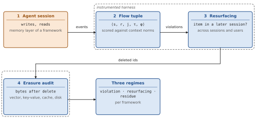
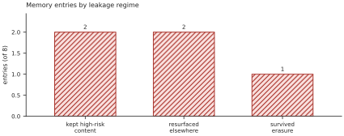

# Demo 22: Agent Memory Leakage

> **▶️ New here? Follow the step-by-step [Execution Instructions](INSTRUCTIONS.md)** — every command with expected output.

## Learning Objectives

- Explain the three memory-privacy failure modes: persisting high-sensitivity content, resurfacing entries across sessions/users, and failing to honour deletion
- Run a tiny leakage screen over 8 synthetic memory entries and read its counts
- Distinguish memory PRIVACY (leakage: what is kept, reshown, or not erased) from memory INTEGRITY (poisoning: what is planted), the topic of the sibling Demo 28
- Distinguish this teaching toy from the research study it illustrates (in progress or under peer review; its data and results are not released here)

<!-- BEGIN generated: how-it-works (tools/figures/docs.py) -->
## How it works

**Figure 1.** Contextual integrity is measured as flows; erasure is measured as bytes that remain after a delete. Numbered boxes are stages (role on top, rule or variable beneath, in monospace); dashed grey panels mark a trust domain or scope; a dashed red arrow marks where an adversary acts. Teaching schematic: it simplifies the research procedure and leaves out its corpora, models and thresholds.

### Step by step

1. **Agent session** (`writes, reads`). Memory layer of a framework. In this demo: `fixtures/`.
2. **Flow tuple** (`⟨s, r, j, τ, φ⟩`). Scored against context norms. In this demo: `student/memory.py`.
3. **Resurfacing** (`item in a later session?`). Across sessions and users. In this demo: `student/memory.py`.
4. **Erasure audit** (`bytes after delete`). Vector, key-value, cache, disk. In this demo: `student/run_memory.py`.
5. **Three regimes** (`violation · resurfacing · residue`). Per framework. Run `make demo` to print it.

**Figure 2.** The three regimes are separate failures; one of 3 deletions left its content behind. Values come from `make demo` on the synthetic fixture: they are illustrative and are not research results.

### What the research version adds (withheld while under peer review)

- Three pinned production memory frameworks
- Privacy vignettes interleaved with a large benign filler corpus
- Storage-level audits of every persistence layer

The study's data, exact protocol, thresholds and results are not part of this teaching demo. They will be linked here once the paper is published open access.

<!-- END generated: how-it-works -->

## Conceptual Explanation

Agents with persistent memory can leak in three quiet ways: they store
content they should not keep, they resurface one session's content in
another session or user, and they keep content the user asked to delete.

This toy uses 8 hand-built entries:

| Check | Result | Lesson |
|-------|--------|--------|
| Persists high-sensitivity (`m1`, `m2`) | 2 | high-sensitivity content should never persist |
| Resurfaces across sessions (`m3`, `m4`) | 2 | entries reappear under another session/user |
| Erasure failures (`m7` of 3 deleted) | 1/3 | deletion is requested but the entry stays |

Entries `m5`/`m6` are the contrast: deleted and actually gone.

## Safety Notice

⚠️ **This is a teaching demonstration using synthetic fixtures only.**
- No real memory stores, users, sessions, or personal data
- No network access (standard library only)
- All entries and verdicts are hand-built toys
- Results demonstrate a mechanism; they are not evidence about real memory systems

## Reproducibility Metadata

| Field | Value |
|-------|-------|
| Seed | 22 (fixed; no randomness used) |
| Python | 3.11+ (stdlib only) |
| OS | Linux/macOS/Windows |
| Command | `make demo DEMO=22` |

## Research Connection

This demo illustrates the design question of a pending study on agent
memory leakage. That study has **collected no
confirmatory data**; every quantity there is `[RESULT PENDING]`. Nothing here describes
a publication, a venue result, or a measured effect size.

Provenance: distilled from `demo-22-agent-memory-leakage-pets` (private research repo).
Boundary: this demo is memory PRIVACY (leakage: retention, resurfacing,
erasure); the sibling Demo 28 is memory INTEGRITY (poisoning: planted
instructions and audit). Different failure modes, fixtures, and checks.

### Difference from the Research Study

| Aspect | Research study | This demo |
|--------|----------------|-----------|
| Data | Agent memory-store observations (pending) | 8 hand-built entries |
| Method | Privacy measurement across sessions/users | Three tiny predicates |
| Claims | Falsifiable leakage hypotheses with registered margins | **No claims** — mechanism illustration only |
| Artefact | Leakage screen over real stores | `memory.py` predicates over JSON toys |
