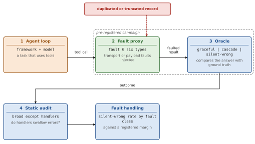
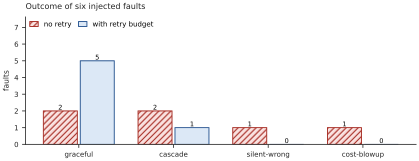

# Demo 23: Agent Pipeline Fault Injection

> **▶️ New here? Follow the step-by-step [Execution Instructions](INSTRUCTIONS.md)** — every command with expected output.

## Learning Objectives

- Explain four pipeline failure modes: graceful handling, cascade, silent-wrong output, and cost blowup
- Show how a retry budget of 2 absorbs transient faults but not permanent ones
- Read a dependability scorecard: graceful 2/6 without retries, 5/6 with retries
- Distinguish this teaching toy from the research study it illustrates (in progress or under peer review; its data and results are not released here)

<!-- BEGIN generated: how-it-works (tools/figures/docs.py) -->
## How it works

**Figure 1.** Payload faults that look like valid data produce silent wrong answers more often than transport faults that raise errors. Numbered boxes are stages (role on top, rule or variable beneath, in monospace); dashed grey panels mark a trust domain or scope; a dashed red arrow marks where an adversary acts. Teaching schematic: it simplifies the research procedure and leaves out its corpora, models and thresholds.

### Step by step

1. **Agent loop** (`framework + model`). A task that uses tools. In this demo: `fixtures/`.
2. **Fault proxy** (`fault ∈ six types`). Transport or payload faults injected. In this demo: `student/faults.py`.
3. **Oracle** (`graceful | cascade | silent-wrong`). Compares the answer with ground truth. In this demo: `student/run_faults.py`.
4. **Static audit** (`broad except handlers`). Do handlers swallow errors? In this demo: `student/faults.py`.
5. **Fault handling** (`silent-wrong rate by fault class`). Against a registered margin. Run `make demo` to print it.

**Figure 2.** A bounded retry budget turns most faults into graceful outcomes; a permanent fault still cascades. Values come from `make demo` on the synthetic fixture: they are illustrative and are not research results.

### What the research version adds (withheld while under peer review)

- A pre-registered campaign over several frameworks and local models
- A blinded check of the oracle
- A static census of exception handlers across many frameworks

The study's data, exact protocol, thresholds and results are not part of this teaching demo. They will be linked here once the paper is published open access.

<!-- END generated: how-it-works -->

## Conceptual Explanation

Agent pipelines meet six classic faults: timeouts, transient errors,
permanent failures, malformed inputs, partial writes, and duplicate
deliveries. How the pipeline ends depends on whether retries are allowed.

This toy uses 6 hand-built faults:

| Mode | Graceful | Cascade | Silent-wrong | Cost-blowup |
|------|----------|---------|--------------|-------------|
| No retry | 2/6 | 2/6 | 1/6 | 1/6 |
| Retry budget 2 | 5/6 | 1/6 | 0/6 | 0/6 |

Fault `f3` (permanent) is the lesson: retries absorb everything except
the fault that will never succeed on re-execution.

## Safety Notice

⚠️ **This is a teaching demonstration using synthetic fixtures only.**
- No real pipelines, services, faults, or outages
- No network access (standard library only)
- All faults and outcomes are hand-built toys
- Results demonstrate a mechanism; they are not evidence about real systems

## Reproducibility Metadata

| Field | Value |
|-------|-------|
| Seed | 23 (fixed; no randomness used) |
| Python | 3.11+ (stdlib only) |
| OS | Linux/macOS/Windows |
| Command | `make demo DEMO=23` |

## Research Connection

This demo illustrates the design question of a pending study on agent
pipeline fault injection. That study has **collected no
confirmatory data**; every quantity there is `[RESULT PENDING]`. Nothing here describes
a publication, a venue result, or a measured effect size.

Provenance: distilled from `demo-23-agent-pipeline-fault-injection-dsn` (private research repo).
It shares no topic with Demo 22 (memory leakage): this demo is a
dependability scorecard over pipeline faults; Demo 22 is a privacy
screen over memory entries. Different data and claims.

### Difference from the Research Study

| Aspect | Research study | This demo |
|--------|----------------|-----------|
| Data | Injected faults in agent pipelines (pending) | 6 hand-built faults |
| Method | Fault-injection harness with retry budgets | Single deterministic outcome table |
| Claims | Falsifiable dependability hypotheses with registered margins | **No claims** — mechanism illustration only |
| Artefact | Injection harness plus scorecard | `faults.py` outcome table over JSON toys |
