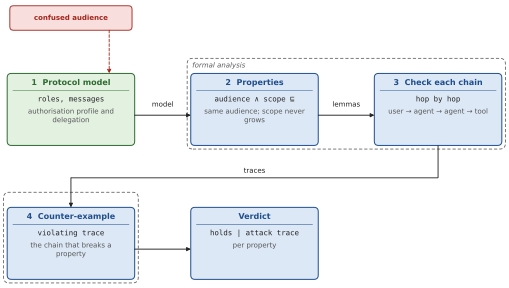
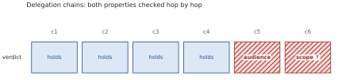

# Demo 24: Delegation Checks

> **▶️ New here? Follow the step-by-step [Execution Instructions](INSTRUCTIONS.md)** — every command with expected output.

## Learning Objectives

- Explain the two delegation properties: audience binding (one audience per chain) and no scope amplification (scope never grows)
- Check 6 synthetic delegation chains and read which two violate which property
- Distinguish delegation-property checking from OAuth scope measurement (the topic of Demo 31)
- Distinguish this teaching toy from the research study it illustrates (in progress or under peer review; its data and results are not released here)

<!-- BEGIN generated: how-it-works (tools/figures/docs.py) -->
## How it works

**Figure 1.** Delegation is safe only if every hop names the same audience and no hop widens the scope. Numbered boxes are stages (role on top, rule or variable beneath, in monospace); dashed grey panels mark a trust domain or scope; a dashed red arrow marks where an adversary acts. Teaching schematic: it simplifies the research procedure and leaves out its corpora, models and thresholds.

### Step by step

1. **Protocol model** (`roles, messages`). Authorisation profile and delegation. In this demo: `fixtures/`.
2. **Properties** (`audience ∧ scope ⊑`). Same audience; scope never grows. In this demo: `student/authz.py`.
3. **Check each chain** (`hop by hop`). User → agent → agent → tool. In this demo: `student/run_authz.py`.
4. **Counter-example** (`violating trace`). The chain that breaks a property. In this demo: `student/run_authz.py`.
5. **Verdict** (`holds | attack trace`). Per property. Run `make demo` to print it.

**Figure 2.** One chain changes audience and one widens its scope; each is caught at the hop where it happens. Values come from `make demo` on the synthetic fixture: they are illustrative and are not research results.

### What the research version adds (withheld while under peer review)

- A symbolic model checked in a protocol prover
- Agent-to-agent delegation modelled beside the authorisation profile
- Design stage: lemmas and traces still pending

The study's data, exact protocol, thresholds and results are not part of this teaching demo. They will be linked here once the paper is published open access.

<!-- END generated: how-it-works -->

## Conceptual Explanation

When agents delegate — user to agent to tool — each hop carries a scope
and an audience. Two properties must hold: every hop must name the same
audience, and scope must never increase along the chain.

This toy uses 6 hand-built chains:

| Chains | Verdict | Lesson |
|--------|---------|--------|
| `c1`–`c4` | clean | both properties hold |
| `c5` | audience mismatch at hop 2 | audience flips `shop` → `evil` |
| `c6` | scope amplification 2→5 | downstream hop gains authority |

Chain `c3` is the contrast: a three-hop chain that stays clean.

## Safety Notice

⚠️ **This is a teaching demonstration using synthetic fixtures only.**
- No real principals, tokens, scopes, or authorisation servers
- No network access (standard library only)
- All chains and verdicts are hand-built toys
- Results demonstrate a mechanism; they are not evidence about real delegation systems

## Reproducibility Metadata

| Field | Value |
|-------|-------|
| Seed | 24 (fixed; no randomness used) |
| Python | 3.11+ (stdlib only) |
| OS | Linux/macOS/Windows |
| Command | `make demo DEMO=24` |

## Research Connection

This demo illustrates the design question of a pending formal study of
delegation authorisation (Tamarin models). That study has
**collected no confirmatory data**; every quantity there is `[RESULT PENDING]`.
Nothing here describes a publication, a venue result, or a measured effect size.

Provenance: distilled from `demo-24-mcp-authorization-formal-csf` (private research repo).
Boundary: this demo checks delegation properties (audience binding,
no amplification); it is not an OAuth scope census — that is Demo 31.
Different questions, fixtures, and claims.

### Difference from the Research Study

| Aspect | Research study | This demo |
|--------|----------------|-----------|
| Data | Delegation protocols (pending) | 6 hand-built chains |
| Method | Formal modelling with machine-checked proofs | One small property checker |
| Claims | Falsifiable authorisation hypotheses with registered margins | **No claims** — mechanism illustration only |
| Artefact | Formal models plus checker | `authz.py` checker over JSON toys |
