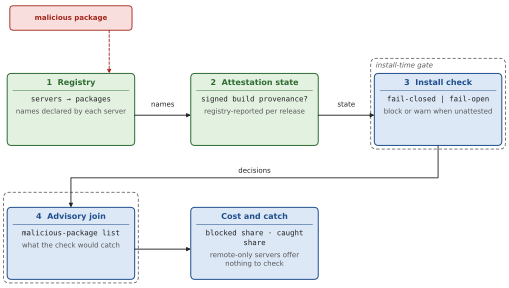
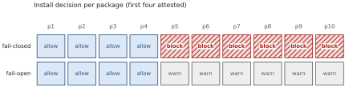

# Demo 25: Attestation Verifier

> **▶️ New here? Follow the step-by-step [Execution Instructions](INSTRUCTIONS.md)** — every command with expected output.

## Learning Objectives

- Explain install-time attestation verification: install a package only when its provenance is attested
- Contrast fail-closed (block 6/10 unattested) with fail-open (warn instead of blocking)
- State clearly that the 4-attested / 6-unattested split is a hand-picked toy, not an ecosystem measurement
- Distinguish this teaching toy from the research study it illustrates (in progress or under peer review; its data and results are not released here)

<!-- BEGIN generated: how-it-works (tools/figures/docs.py) -->
## How it works

**Figure 1.** A fail-closed provenance check blocks every unattested package; its cost is what it blocks and its value is what it catches. Numbered boxes are stages (role on top, rule or variable beneath, in monospace); dashed grey panels mark a trust domain or scope; a dashed red arrow marks where an adversary acts. Teaching schematic: it simplifies the research procedure and leaves out its corpora, models and thresholds.

### Step by step

1. **Registry** (`servers → packages`). Names declared by each server. In this demo: `fixtures/`.
2. **Attestation state** (`signed build provenance?`). Registry-reported per release. In this demo: `fixtures/`.
3. **Install check** (`fail-closed | fail-open`). Block or warn when unattested. In this demo: `student/verifier.py`.
4. **Advisory join** (`malicious-package list`). What the check would catch. In this demo: `student/run_verify.py`.
5. **Cost and catch** (`blocked share · caught share`). Remote-only servers offer nothing to check. Run `make demo` to print it.

**Figure 2.** Fail-closed blocks all 6 unattested packages; fail-open installs them with a warning. Values come from `make demo` on the synthetic fixture: they are illustrative and are not research results.

### What the research version adds (withheld while under peer review)

- The official registry joined to attestation state for all declared names
- Coverage by release count
- Cluster bootstrap intervals

The study's data, exact protocol, thresholds and results are not part of this teaching demo. They will be linked here once the paper is published open access.

<!-- END generated: how-it-works -->

## Conceptual Explanation

Supply-chain defences check a package's attestation before install.
Under fail-closed, every unattested package is blocked; under fail-open,
the same packages install with a warning.

This toy uses 10 hand-built packages (4 attested, 6 not):

| Policy | Blocked | Warned | Allowed |
|--------|---------|--------|---------|
| Fail-closed | 6/10 | 0/10 | 4/10 |
| Fail-open | 0/10 | 6/10 | 10/10 |

Note: real probes have seen wide attestation gaps, but THESE numbers are
toys — they illustrate verifier behaviour, not the ecosystem.

## Safety Notice

⚠️ **This is a teaching demonstration using synthetic fixtures only.**
- No real packages, registries, attestations, or installs
- No network access (standard library only)
- All packages and verdicts are hand-built toys
- Results demonstrate a mechanism; they are not evidence about real supply chains

## Reproducibility Metadata

| Field | Value |
|-------|-------|
| Seed | 25 (fixed; no randomness used) |
| Python | 3.11+ (stdlib only) |
| OS | Linux/macOS/Windows |
| Command | `make demo DEMO=25` |

## Research Connection

This demo illustrates the design question of a pending study on
install-time attestation verification. That study has
**collected no confirmatory data**; every quantity there is `[RESULT PENDING]`.
Nothing here describes a publication, a venue result, or a measured effect size.

Provenance: distilled from `demo-25-agent-supply-chain-attestations-acns` (private research repo).
Boundary: this demo is provenance verification (allow vs block at
install time); it is not an ecosystem census — that is Demo 21.
Different questions, data, and claims.

### Difference from the Research Study

| Aspect | Research study | This demo |
|--------|----------------|-----------|
| Data | Registry attestation observations (pending) | 10 hand-built packages |
| Method | Install-time verifier plus measurement | One tiny policy predicate |
| Claims | Falsifiable verification hypotheses with registered margins | **No claims** — mechanism illustration only |
| Artefact | Verifier prototype | `verifier.py` predicate over JSON toys |
