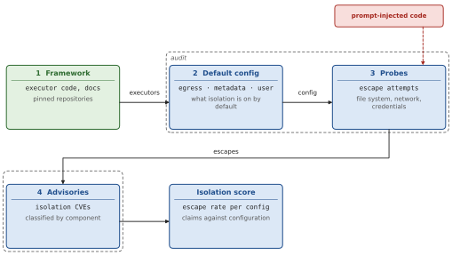
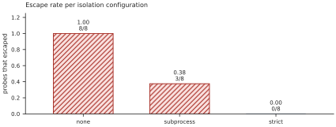

# Demo 26: Sandbox Probes

> **▶️ New here? Follow the step-by-step [Execution Instructions](INSTRUCTIONS.md)** — every command with expected output.

## Learning Objectives

- Explain sandbox isolation as an escape-rate ladder over 8 probes and 3 configs
- Show that no sandbox means 8/8 escapes, a subprocess boundary still leaks 3/8, and strict isolation holds at 0/8
- Name the 3 subprocess leakers (net-egress, dns, env-read) and why process boundaries miss them
- Distinguish this teaching toy from the research study it illustrates (in progress or under peer review; its data and results are not released here)

<!-- BEGIN generated: how-it-works (tools/figures/docs.py) -->
## How it works

**Figure 1.** Isolation claims are checked against the configuration that actually ships and against escape probes. Numbered boxes are stages (role on top, rule or variable beneath, in monospace); dashed grey panels mark a trust domain or scope; a dashed red arrow marks where an adversary acts. Teaching schematic: it simplifies the research procedure and leaves out its corpora, models and thresholds.

### Step by step

1. **Framework** (`executor code, docs`). Pinned repositories. In this demo: `fixtures/`.
2. **Default config** (`egress · metadata · user`). What isolation is on by default. In this demo: `student/sandbox.py`.
3. **Probes** (`escape attempts`). File system, network, credentials. In this demo: `student/run_sandbox.py`.
4. **Advisories** (`isolation CVEs`). Classified by component. In this demo: `student/sandbox.py`.
5. **Isolation score** (`escape rate per config`). Claims against configuration. Run `make demo` to print it.

**Figure 2.** Only the strict configuration contains every probe; the default subprocess setting still leaks network and environment. Values come from `make demo` on the synthetic fixture: they are illustrative and are not research results.

### What the research version adds (withheld while under peer review)

- Executor files mined across pinned framework repositories
- Advisories classified across the stack
- Container paths coded for user, capabilities and mounts

The study's data, exact protocol, thresholds and results are not part of this teaching demo. They will be linked here once the paper is published open access.

<!-- END generated: how-it-works -->

## Conceptual Explanation

Execution isolation is tested with probes: each probe tries one escape
(filesystem, network, persistent state, and so on). The escape rate per
config is the isolation score.

This toy uses 8 hand-built probes over 3 configs:

| Config | Escaped | Rate | Lesson |
|--------|---------|------|--------|
| `none` | 8/8 | 1.00 | no boundary, everything escapes |
| `subprocess` | 3/8 | 0.38 | net-egress, dns, env-read still leak |
| `strict` | 0/8 | 0.00 | full isolation holds |

The subprocess row is the lesson: process boundaries stop local
escapes (filesystem, persistence) but not network and environment reads.

## Safety Notice

⚠️ **This is a teaching demonstration using synthetic fixtures only.**
- No real sandboxes, escapes, payloads, or privileged operations
- No network access (standard library only); probes are table entries, never executed
- All probes and verdicts are hand-built toys
- Results demonstrate a mechanism; they are not evidence about real sandboxes

## Reproducibility Metadata

| Field | Value |
|-------|-------|
| Seed | 26 (fixed; no randomness used) |
| Python | 3.11+ (stdlib only) |
| OS | Linux/macOS/Windows |
| Command | `make demo DEMO=26` |

## Research Connection

This demo illustrates the design question of a pending study on agent
sandbox isolation (an associated research project, in preparation). That study has **collected no
confirmatory data**; every quantity there is `[RESULT PENDING]`. Nothing here describes
a publication, a venue result, or a measured effect size.

Provenance: distilled from an associated research project.
Boundary: this demo is execution isolation (can code reach outside its
box); it is not network reconnaissance — that is Demo 06.
Different questions, fixtures, and claims.

### Difference from the Research Study

| Aspect | Research study | This demo |
|--------|----------------|-----------|
| Data | Sandbox escape experiments (pending) | 8 hand-built probes × 3 configs |
| Method | Isolation harness with real boundaries | Escape-rate lookup over a JSON matrix |
| Claims | Falsifiable isolation hypotheses with registered margins | **No claims** — mechanism illustration only |
| Artefact | Probe harness | `sandbox.py` scorer over JSON toys |
