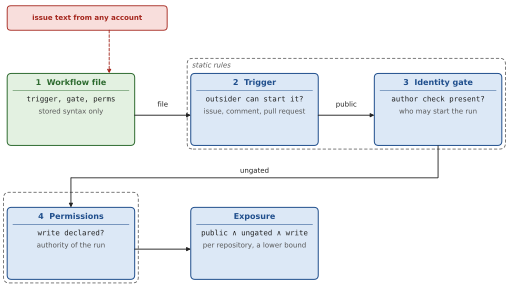
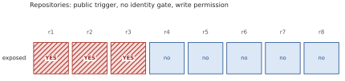

# Demo 27: CI Trigger Scan

> **▶️ New here? Follow the step-by-step [Execution Instructions](INSTRUCTIONS.md)** — every command with expected output.

## Learning Objectives

- Explain the CI trigger-injection wiring: public trigger plus write permission without required review is vulnerable
- Scan 8 synthetic repos and confirm exactly 3 are vulnerable (`r1`–`r3`)
- Show how each guard (private trigger, read-only permission, required review) blocks one vector
- Distinguish this teaching toy from the research study it illustrates (in progress or under peer review; its data and results are not released here)

<!-- BEGIN generated: how-it-works (tools/figures/docs.py) -->
## How it works

**Figure 1.** An agent job is exposed when an outside account can start it, nothing gates the author, and the run can write. Numbered boxes are stages (role on top, rule or variable beneath, in monospace); dashed grey panels mark a trust domain or scope; a dashed red arrow marks where an adversary acts. Teaching schematic: it simplifies the research procedure and leaves out its corpora, models and thresholds.

### Step by step

1. **Workflow file** (`trigger, gate, perms`). Stored syntax only. In this demo: `fixtures/`.
2. **Trigger** (`outsider can start it?`). Issue, comment, pull request. In this demo: `student/scanner.py`.
3. **Identity gate** (`author check present?`). Who may start the run. In this demo: `student/scanner.py`.
4. **Permissions** (`write declared?`). Authority of the run. In this demo: `student/run_scan.py`.
5. **Exposure** (`public ∧ ungated ∧ write`). Per repository, a lower bound. Run `make demo` to print it.

**Figure 2.** Three repositories let an outside account start an agent run that can write. Values come from `make demo` on the synthetic fixture: they are illustrative and are not research results.

### What the research version adds (withheld while under peer review)

- A stored pilot pack of repositories found by code search
- Conservative and permissive rules side by side
- Every count stated as a lower bound for the search space

The study's data, exact protocol, thresholds and results are not part of this teaching demo. They will be linked here once the paper is published open access.

<!-- END generated: how-it-works -->

## Conceptual Explanation

Coding agents that run on CI can be injected through workflow wiring:
when a public trigger fires a workflow with write permission and nobody
must review it, an outsider's input can drive privileged automation.

This toy uses 8 hand-built repos:

| Repos | Verdict | Lesson |
|-------|---------|--------|
| `r1`–`r3` | VULNERABLE (3/8) | public trigger + write + no review |
| `r4` | ok | review required saves it |
| `r5` | ok | read-only permission saves it |
| `r6` | ok | private trigger saves it |

Repos `r7`/`r8` are doubly safe contrasts.

## Safety Notice

⚠️ **This is a teaching demonstration using synthetic fixtures only.**
- No real repos, workflows, triggers, or permissions
- No network access (standard library only)
- All repos and verdicts are hand-built toys
- Results demonstrate a mechanism; they are not evidence about real CI systems

## Reproducibility Metadata

| Field | Value |
|-------|-------|
| Seed | 27 (fixed; no randomness used) |
| Python | 3.11+ (stdlib only) |
| OS | Linux/macOS/Windows |
| Command | `make demo DEMO=27` |

## Research Connection

This demo illustrates the design question of a pending census plus live
demo of coding-agent CI injection. That work has
**collected no confirmatory data**; every quantity there is `[RESULT PENDING]`.
Nothing here describes a publication, a venue result, or a measured effect size.

Provenance: distilled from `demo-27-coding-agent-ci-injection-blackhat` (private research repo).
Boundary: this demo is CI wiring (triggers, permissions, review); it is
not agent memory — that is Demo 28. Different questions, fixtures, and claims.

### Difference from the Research Study

| Aspect | Research study | This demo |
|--------|----------------|-----------|
| Data | CI wiring census over live repos (pending) | 8 hand-built repos |
| Method | Census scanner plus live injection demo | One small wiring predicate |
| Claims | Falsifiable prevalence hypotheses with registered margins | **No claims** — mechanism illustration only |
| Artefact | Census scanner | `scanner.py` predicate over JSON toys |
