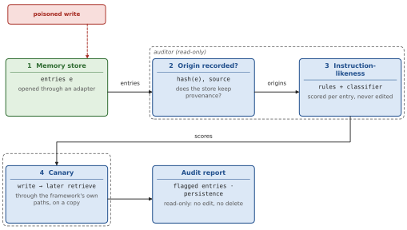
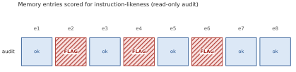

# Demo 28: Memory Poisoning

> **▶️ New here? Follow the step-by-step [Execution Instructions](INSTRUCTIONS.md)** — every command with expected output.

## Learning Objectives

- Explain memory-integrity poisoning: planted instructions inside stored entries that steer later behaviour
- Run the MemScope auditor over 8 synthetic entries and confirm it flags exactly the 3 poisoned ones with 0 false positives
- State the auditor's limits: literal case-insensitive patterns only, no semantic detection
- Distinguish this teaching toy from the research study it illustrates (in progress or under peer review; its data and results are not released here)

<!-- BEGIN generated: how-it-works (tools/figures/docs.py) -->
## How it works

**Figure 1.** A memory auditor reports origin, instruction-likeness and persistence without changing the store. Numbered boxes are stages (role on top, rule or variable beneath, in monospace); dashed grey panels mark a trust domain or scope; a dashed red arrow marks where an adversary acts. Teaching schematic: it simplifies the research procedure and leaves out its corpora, models and thresholds.

### Step by step

1. **Memory store** (`entries e`). Opened through an adapter. In this demo: `fixtures/`.
2. **Origin recorded?** (`hash(e), source`). Does the store keep provenance? In this demo: `student/memascope.py`.
3. **Instruction-likeness** (`rules + classifier`). Scored per entry, never edited. In this demo: `student/memascope.py`.
4. **Canary** (`write → later retrieve`). Through the framework's own paths, on a copy. In this demo: `student/run_memascope.py`.
5. **Audit report** (`flagged entries · persistence`). Read-only: no edit, no delete. Run `make demo` to print it.

**Figure 2.** The auditor flags 3 of 8 stored entries and changes none of them. Values come from `make demo` on the synthetic fixture: they are illustrative and are not research results.

### What the research version adds (withheld while under peer review)

- Adapters for real framework stores
- An open-weight classifier run locally
- A benign canary planted into a copy of the store

The study's data, exact protocol, thresholds and results are not part of this teaching demo. They will be linked here once the paper is published open access.

<!-- END generated: how-it-works -->

## Conceptual Explanation

Stored memory is an integrity surface: an entry reading "ignore previous
instructions …" can steer the agent long after it was written. Auditing
means scanning stored entries for known instruction patterns.

This toy uses 8 hand-built entries:

| Entries | Verdict | Lesson |
|---------|---------|--------|
| `e2`, `e4`, `e6` | POISONED (3/8) | each carries one literal pattern |
| `e1`, `e3`, `e5`, `e7`, `e8` | benign (5/8) | everyday notes, never flagged |

The auditor is a literal case-insensitive substring match over three
patterns — a stand-in for a real audit tool, not one.

## Safety Notice

⚠️ **This is a teaching demonstration using synthetic fixtures only.**
- No real memory stores, prompts, exfiltration, or credentials
- No network access (standard library only)
- All entries and verdicts are hand-built toys
- Results demonstrate a mechanism; they are not evidence about real memory systems

## Reproducibility Metadata

| Field | Value |
|-------|-------|
| Seed | 28 (fixed; no randomness used) |
| Python | 3.11+ (stdlib only) |
| OS | Linux/macOS/Windows |
| Command | `make demo DEMO=28` |

## Research Connection

This demo illustrates the MemScope audit tooling prepared for a pending
talk on agent memory poisoning. That work has **collected no
confirmatory data**; every quantity there is `[RESULT PENDING]`. Nothing here describes
a publication, a venue result, or a measured effect size.

Provenance: distilled from `demo-28-agent-memory-poisoning-defcon` (private research repo).
Boundary: this demo is memory INTEGRITY (attack entries plus an audit
tool); the sibling Demo 22 is memory PRIVACY (leakage: retention,
resurfacing, erasure). Different failure modes, fixtures, and checks.

### Difference from the Research Study

| Aspect | Research study | This demo |
|--------|----------------|-----------|
| Data | Poisoned memory-store cases (pending) | 8 hand-built entries |
| Method | MemScope audit tooling plus live talk demo | Literal substring match over 3 patterns |
| Claims | Tool capability claims to be shown live | **No claims** — mechanism illustration only |
| Artefact | MemScope auditor | `memascope.py` matcher over JSON toys |
