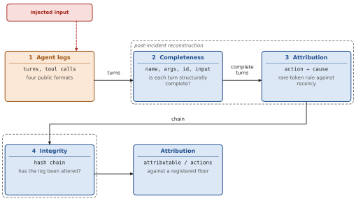
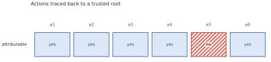

# Demo 29: Provenance Graphs

> **▶️ New here? Follow the step-by-step [Execution Instructions](INSTRUCTIONS.md)** — every command with expected output.

## Learning Objectives

- Explain what an agent action provenance graph is (nodes are actions, edges are cause links, roots need authority)
- Reconstruct attribution over six synthetic actions and flag the orphan with no cause
- Show a sha256 chain over ordered records verifies cleanly but breaks when a copy is tampered
- Distinguish post-incident reconstruction from release assurance (Demo 05)

<!-- BEGIN generated: how-it-works (tools/figures/docs.py) -->
## How it works

**Figure 1.** Attribution after an incident needs each action to point back to the input that caused it. Numbered boxes are stages (role on top, rule or variable beneath, in monospace); dashed grey panels mark a trust domain or scope; a dashed red arrow marks where an adversary acts. Teaching schematic: it simplifies the research procedure and leaves out its corpora, models and thresholds.

### Step by step

1. **Agent logs** (`turns, tool calls`). Four public formats. In this demo: `fixtures/`.
2. **Completeness** (`name, args, id, input`). Is each turn structurally complete? In this demo: `student/provenance.py`.
3. **Attribution** (`action → cause`). Rare-token rule against recency. In this demo: `student/provenance.py`.
4. **Integrity** (`hash chain`). Has the log been altered? In this demo: `student/run_prov.py`.
5. **Attribution** (`attributable / actions`). Against a registered floor. Run `make demo` to print it.

**Figure 2.** 5 of 6 actions trace to their cause; the hash chain verifies and a tampered copy is detected. Values come from `make demo` on the synthetic fixture: they are illustrative and are not research results.

### What the research version adds (withheld while under peer review)

- Four public trajectory formats
- Post-injection actions from successful injection runs
- A registered accuracy floor

The study's data, exact protocol, thresholds and results are not part of this teaching demo. They will be linked here once the paper is published open access.

<!-- END generated: how-it-works -->

## Conceptual Explanation

After an incident, investigators rebuild who caused what: each action should
point at its cause, back to a trusted root. One orphan with a null cause that
is not the root cannot be attributed — here `a5`, so attribution is 5/6.

A separate integrity layer chains the ordered records with sha256. The clean
chain verifies; a copy with one edited authority field fails verification.

| Check | Result |
|-------|--------|
| Attributable | 5/6 (unattributable: a5) |
| Chain over clean records | verified |
| Chain over tampered copy | tamper detected |

## Safety Notice

⚠️ **This is a teaching demonstration using synthetic fixtures only.**
- No real incidents, logs, models, or credentials
- No network access (standard library only)
- All actions, authorities and hashes are hand-built toys
- Results demonstrate a mechanism; they are not evidence about real forensics

## Reproducibility Metadata

| Field | Value |
|-------|-------|
| Seed | 29 (fixed; no randomness used) |
| Python | 3.11+ (stdlib only) |
| OS | Linux/macOS/Windows |
| Command | `make demo DEMO=29` |

## Research Connection

This demo illustrates the reconstruction question of a pending study
of post-incident provenance (an associated research project, in preparation). That study has **collected no confirmatory data**;
every quantity there is `[RESULT PENDING]`. Nothing here describes a
publication, a venue result, or a measured effect size. Boundary: this demo is
post-incident reconstruction, not release assurance (Demo 05).

Provenance: distilled from an associated research project.

### Difference from the Research Study

| Aspect | Research study | This demo |
|--------|----------------|-----------|
| Data | Agent execution traces (pending) | 6 hand-built actions |
| Method | Provenance graph recovery + integrity checks | Cause-link partition + sha256 chain over ordered records |
| Claims | Falsifiable attribution hypotheses with registered margins | **No claims** — mechanism illustration only |
| Artefact | Forensic reconstruction toolkit | Two tiny provenance helpers |
