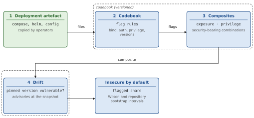
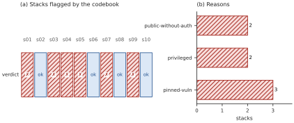

# Demo 30: Insecure Defaults

> **▶️ New here? Follow the step-by-step [Execution Instructions](INSTRUCTIONS.md)** — every command with expected output.

## Learning Objectives

- Explain what an insecure default is (public bind without auth, privileged run, pinned vulnerable dependency)
- Apply the three-clause rule to ten synthetic stacks and count 6/10 insecure
- Show pinned vulns account for 3/10 of the sample
- Distinguish deployment config review from vulnerability lifecycle work (Demo 42)

<!-- BEGIN generated: how-it-works (tools/figures/docs.py) -->
## How it works

**Figure 1.** Defaults in shipped configuration become the operator's posture; a codebook makes them countable. Numbered boxes are stages (role on top, rule or variable beneath, in monospace); dashed grey panels mark a trust domain or scope; a dashed red arrow marks where an adversary acts. Teaching schematic: it simplifies the research procedure and leaves out its corpora, models and thresholds.

### Step by step

1. **Deployment artefact** (`compose, helm, config`). Copied by operators. In this demo: `fixtures/`.
2. **Codebook** (`flag rules`). Bind, auth, privilege, versions. In this demo: `student/checker.py`.
3. **Composites** (`exposure · privilege`). Security-bearing combinations. In this demo: `student/checker.py`.
4. **Drift** (`pinned version vulnerable?`). Advisories at the snapshot. In this demo: `student/run_defaults.py`.
5. **Insecure by default** (`flagged share`). Wilson and repository bootstrap intervals. Run `make demo` to print it.

**Figure 2.** 6 of 10 stacks ship an insecure default; the most frequent reason in the toy is pinned vuln. Values come from `make demo` on the synthetic fixture: they are illustrative and are not research results.

### What the research version adds (withheld while under peer review)

- Deduplicated configurations across several serving stacks
- A versioned codebook and snapshot date
- Repository-level bootstrap

The study's data, exact protocol, thresholds and results are not part of this teaching demo. They will be linked here once the paper is published open access.

<!-- END generated: how-it-works -->

## Conceptual Explanation

Language-model stacks ship with example configs that operators copy. This toy
checks ten hand-built stacks with a fixed rule: insecure when publicly bound
without auth, or privileged, or pinning a vuln.

| Check | Result |
|-------|--------|
| Insecure | 6/10 (s01, s03, s04, s05, s07, s09) |
| Pinned vuln | 3/10 (s04, s07, s09) |
| Secure | 4/10 |

Stacks `s02`, `s06`, `s08`, `s10` are the secure contrast: no public-without-auth,
no privileged flag, no pinned vuln.

## Safety Notice

⚠️ **This is a teaching demonstration using synthetic fixtures only.**
- No real stacks, registries, images, or credentials
- No network access (standard library only) and no live scanning
- All stacks and verdicts are hand-built toys
- Results demonstrate a mechanism; they are not evidence about real deployments

## Reproducibility Metadata

| Field | Value |
|-------|-------|
| Seed | 30 (fixed; no randomness used) |
| Python | 3.11+ (stdlib only) |
| OS | Linux/macOS/Windows |
| Command | `make demo DEMO=30` |

## Research Connection

This demo illustrates the measurement question of a pending study of
insecure defaults in self-hosted stacks (an associated research project, in preparation). That study has **collected no confirmatory data**; every
quantity there is `[RESULT PENDING]`. Nothing here describes a publication, a
venue result, or a measured effect size. No live scanning is performed here;
all inputs are synthetic. Boundary: this demo covers deployment configs, not
the vulnerability lifecycle (Demo 42).

Provenance: distilled from an associated research project.

### Difference from the Research Study

| Aspect | Research study | This demo |
|--------|----------------|-----------|
| Data | IaC manifests and stack configs (pending) | 10 hand-built stacks |
| Method | Config census with scanner triangulation | Three-clause rule returning reason lists |
| Claims | Falsifiable prevalence hypotheses with registered margins | **No claims** — mechanism illustration only |
| Artefact | Scanner + labelling kit | One tiny checker module |
