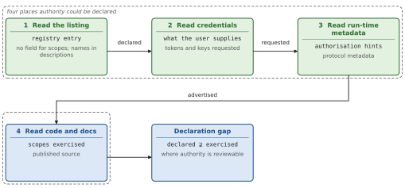
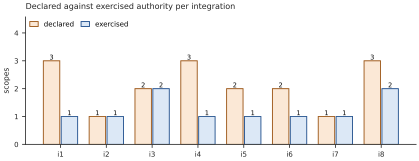

# Demo 31: Declaration Gap

  
  
  

> **▶️ New here? Follow the step-by-step [Execution Instructions](INSTRUCTIONS.md)** — every command with expected output, plus a reproducibility protocol for study participants.

## Learning Objectives

- Explain the declaration gap (an integration declares authority it does not exercise)
- Compare declared authority against exercised authority in MCP registry listings
- Identify integrations whose declared authority exceeds their exercised authority
- Distinguish declared authority from capability classes (Demo 21) and delegation properties (Demo 24)
- Distinguish teaching demonstrations from validated research benchmarks

<!-- BEGIN generated: how-it-works (tools/figures/docs.py) -->
## How it works

**Figure 1.** Authority is reviewable only where it is declared; the four places are compared per integration. Numbered boxes are stages (role on top, rule or variable beneath, in monospace); dashed grey panels mark a trust domain or scope; a dashed red arrow marks where an adversary acts. Teaching schematic: it simplifies the research procedure and leaves out its corpora, models and thresholds.

### Step by step

1. **Read the listing** (`registry entry`). No field for scopes; names in descriptions. In this demo: `fixtures/`.
2. **Read credentials** (`what the user supplies`). Tokens and keys requested. In this demo: `fixtures/`.
3. **Read run-time metadata** (`authorisation hints`). Protocol metadata. In this demo: `fixtures/`.
4. **Read code and docs** (`scopes exercised`). Published source. In this demo: `student/declarations.py`.
5. **Declaration gap** (`declared ⊋ exercised`). Where authority is reviewable. Run `make demo` to print it.

**Figure 2.** 5 of 8 integrations declare more authority than they exercise. Values come from `make demo` on the synthetic fixture: they are illustrative and are not research results.

### What the research version adds (withheld while under peer review)

- Every latest version in the official registry
- Provider scope catalogues for four identity providers
- Strict and lenient matching rules

The study's data, exact protocol, thresholds and results are not part of this teaching demo. They will be linked here once the paper is published open access.

<!-- END generated: how-it-works -->

## Conceptual Explanation

Agent integrations in the MCP registry declare authority through listings,
credentials, and run-time authorisation metadata. This toy checks eight
hand-built integrations: a declaration gap exists when declared authority
strictly supersedes exercised authority.

| Check | Result |
|-------|--------|
| Declaration gap | 5/8 (i1, i4, i5, i6, i8) |
| Declared equals exercised | 3/8 (i2, i3, i7) |
| Full exercise | 8 authority items (union of all exercised) |

Equal declarations such as `i2` (`read`/`read`) are tight; `i8` declaring
`drive.admin` it never exercises is the classic gap case.

### Why declaring more does not close the gap

Adding exercised authority to the declared list (Step 5 of the instructions)
leaves every other unused declaration in place: the verdict stays gapped while
the exercised union grows. Only declaring less closes the gap. That asymmetry
is the least-declaration lesson.

## Safety Notice

⚠️ **This is a teaching demonstration using synthetic fixtures only.**
- No real providers, tokens, or credentials
- No network access (standard library only)
- All integrations and authority declarations are hand-built toys
- Results demonstrate a mechanism; they are not evidence about real integrations

## Reproducibility Metadata

| Field | Value |
|-------|-------|
| Seed | 31 (fixed; no randomness used) |
| Python | 3.11+ (stdlib only) |
| OS | Linux/macOS/Windows |
| Tests | `python3 -m pytest tests/ -v` → 21 passed |
| Command | `make demo DEMO=31` |
| Results | `results/declarations.json` (standardized schema: demo, experiment, seed, totals, rows, notes) |

## Research Connection

This demo illustrates the measurement question of a pending study of agent
integration authority declarations. That study has **collected no
confirmatory data**; every quantity there is `[RESULT PENDING]`. Nothing here
describes a publication, a venue result, or a measured effect size. Boundary:
this demo covers MCP registry declarations only, not capability classes (Demo
21) nor delegation properties (Demo 24).

Provenance: distilled from `demo-31-agent-integration-scope-creep-tops` (private research repo).

### Difference from the Research Study

| Aspect | Research study | This demo (benchmark) |
|--------|----------------|----------------------|
| Data | MCP registry declarations from a registry census (pending) | 8 hand-built integrations |
| Method | Declared-versus-exercised authority gap measurement | Strict-superset check + union of exercised |
| Claims | Falsifiable declaration-gap hypotheses with registered margins | **No claims** — mechanism illustration only |
| Verdicts | Sealed confirmatory runs after AD-90 registration | Fixed toy answers (5/8 gapped, 8-scope union) |
| Artefact | Declaration analyser | Two tiny authority helpers |
