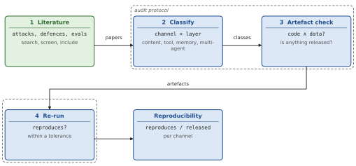
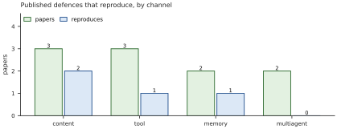

# Demo 32: Reproducibility Audit

> **▶️ New here? Follow the step-by-step [Execution Instructions](INSTRUCTIONS.md)** — every command with expected output.

## Learning Objectives

- Explain what a reproducibility audit checks (code, data, and whether the claim reproduces)
- Audit ten synthetic papers: 6/10 share code+data, 4/10 reproduce
- Verify the invariant that reproducing implies sharing code+data
- Distinguish auditing the field from making new attack claims

<!-- BEGIN generated: how-it-works (tools/figures/docs.py) -->
## How it works

**Figure 1.** A systematisation counts what was published and then what can still be run. Numbered boxes are stages (role on top, rule or variable beneath, in monospace); dashed grey panels mark a trust domain or scope; a dashed red arrow marks where an adversary acts. Teaching schematic: it simplifies the research procedure and leaves out its corpora, models and thresholds.

### Step by step

1. **Literature** (`attacks, defences, evals`). Search, screen, include. In this demo: `fixtures/`.
2. **Classify** (`channel × layer`). Content, tool, memory, multi-agent. In this demo: `student/audit.py`.
3. **Artefact check** (`code ∧ data?`). Is anything released? In this demo: `student/audit.py`.
4. **Re-run** (`reproduces?`). Within a tolerance. In this demo: `student/run_audit.py`.
5. **Reproducibility** (`reproduces / released`). Per channel. Run `make demo` to print it.

**Figure 2.** 6 of 10 papers release code and data; 4 reproduce, none in the multi-agent channel. Values come from `make demo` on the synthetic fixture: they are illustrative and are not research results.

### What the research version adds (withheld while under peer review)

- A registered search and screening protocol
- Artefact re-execution under a time budget
- Design stage

The study's data, exact protocol, thresholds and results are not part of this teaching demo. They will be linked here once the paper is published open access.

<!-- END generated: how-it-works -->

## Conceptual Explanation

Surveys of agent security report many defences with few shared artefacts.
This toy audits ten hand-built papers across four channels (content, tool,
memory, multiagent).

| Check | Result |
|-------|--------|
| Code+data | 6/10 |
| Reproduces | 4/10 |
| Invariant | every reproducing paper shares code+data |

Per-channel reproduction: content 2/3, tool 1/3, memory 1/2, multiagent 0/2.

## Safety Notice

⚠️ **This is a teaching demonstration using synthetic fixtures only.**
- No real papers, benchmarks, models, or credentials
- No network access (standard library only)
- All papers and verdicts are hand-built toys
- Results demonstrate a mechanism; they are not evidence about the field

## Reproducibility Metadata

| Field | Value |
|-------|-------|
| Seed | 32 (fixed; no randomness used) |
| Python | 3.11+ (stdlib only) |
| OS | Linux/macOS/Windows |
| Command | `make demo DEMO=32` |

## Research Connection

This demo illustrates the audit question of a pending survey of agent
security. That survey has **collected no confirmatory
data**; every quantity there is `[RESULT PENDING]`. Nothing here describes a
publication, a venue result, or a measured effect size. Boundary: this demo
is an audit of the field, with no new attack claims.

Provenance: distilled from `demo-32-agent-security-sok-reproducibility-csur` (private research repo).

### Difference from the Research Study

| Aspect | Research study | This demo |
|--------|----------------|-----------|
| Data | Published papers and artefacts (pending) | 10 hand-built papers |
| Method | Survey coding + reproduction checks | Count code+data and reproduces by channel |
| Claims | Falsifiable audit hypotheses with registered margins | **No claims** — mechanism illustration only |
| Artefact | Coding guide + audit dataset | One tiny audit module |
