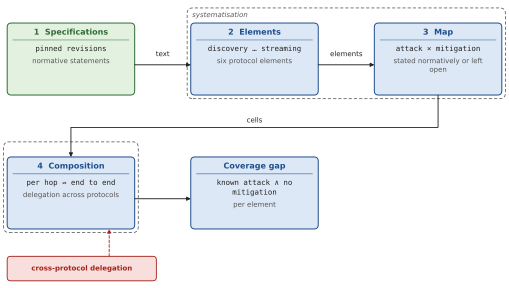
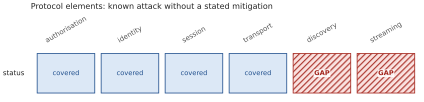

# Demo 33: Protocol Coverage

> **▶️ New here? Follow the step-by-step [Execution Instructions](INSTRUCTIONS.md)** — every command with expected output.

## Learning Objectives

- Explain protocol coverage mapping (each element has a stated mitigation flag and a known-attack flag)
- Flag gaps where a known attack has no stated mitigation: discovery and streaming (2/6)
- List the four covered elements and why each escapes the gap rule
- Distinguish a survey mapping exercise from formal analysis (Demo 24)

<!-- BEGIN generated: how-it-works (tools/figures/docs.py) -->
## How it works

**Figure 1.** Per-hop guarantees stated by each protocol do not compose into an end-to-end guarantee. Numbered boxes are stages (role on top, rule or variable beneath, in monospace); dashed grey panels mark a trust domain or scope; a dashed red arrow marks where an adversary acts. Teaching schematic: it simplifies the research procedure and leaves out its corpora, models and thresholds.

### Step by step

1. **Specifications** (`pinned revisions`). Normative statements. In this demo: `fixtures/`.
2. **Elements** (`discovery … streaming`). Six protocol elements. In this demo: `student/coverage.py`.
3. **Map** (`attack × mitigation`). Stated normatively or left open. In this demo: `student/coverage.py`.
4. **Composition** (`per hop ⇏ end to end`). Delegation across protocols. In this demo: `student/run_coverage.py`.
5. **Coverage gap** (`known attack ∧ no mitigation`). Per element. Run `make demo` to print it.

**Figure 2.** Discovery and streaming carry known attacks that neither specification mitigates normatively. Values come from `make demo` on the synthetic fixture: they are illustrative and are not research results.

### What the research version adds (withheld while under peer review)

- Pinned specification revisions and their OAuth foundations
- Normative text coded per element
- The compositional reading challenged

The study's data, exact protocol, thresholds and results are not part of this teaching demo. They will be linked here once the paper is published open access.

<!-- END generated: how-it-works -->

## Conceptual Explanation

Agent protocols name similar elements (discovery, identity, streaming) with
uneven mitigations. This toy maps six hand-built elements: a gap is
`known_attack and not stated_mitigation`.

| Element | Mitigation | Attack | Gap |
|---------|------------|--------|-----|
| discovery | no | yes | **yes** |
| identity | yes | yes | no |
| authorisation | yes | no | no |
| session | yes | yes | no |
| transport | yes | no | no |
| streaming | no | yes | **yes** |

Gaps: 2/6 (discovery, streaming).

## Safety Notice

⚠️ **This is a teaching demonstration using synthetic fixtures only.**
- No real protocols, implementations, models, or credentials
- No network access (standard library only)
- All elements and verdicts are hand-built toys
- Results demonstrate a mechanism; they are not evidence about real protocols

## Reproducibility Metadata

| Field | Value |
|-------|-------|
| Seed | 33 (fixed; no randomness used) |
| Python | 3.11+ (stdlib only) |
| OS | Linux/macOS/Windows |
| Command | `make demo DEMO=33` |

## Research Connection

This demo illustrates the mapping question of a pending survey
of agent protocol security (an associated research project, in preparation). That survey has **collected
no confirmatory data**; every quantity there is `[RESULT PENDING]`. Nothing
here describes a publication, a venue result, or a measured effect size.
Boundary: this demo is a survey mapping exercise, not formal analysis
(Demo 24).

Provenance: distilled from an associated research project.

### Difference from the Research Study

| Aspect | Research study | This demo |
|--------|----------------|-----------|
| Data | Protocol specs and advisories (pending) | 6 hand-built elements |
| Method | Tutorial mapping of mitigations to attacks | Gap rule over two booleans |
| Claims | Falsifiable coverage hypotheses with registered margins | **No claims** — mechanism illustration only |
| Artefact | Survey tables | One tiny coverage module |
