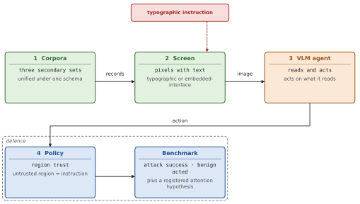
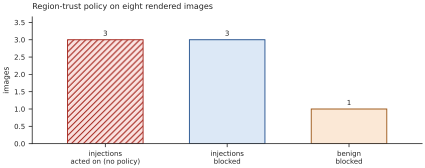

# Demo 34: Visual Prompt Injection

> **▶️ New here? Follow the step-by-step [Execution Instructions](INSTRUCTIONS.md)** — every command with expected output.

## Learning Objectives

- Explain typographic visual injection (rendered text in an image the agent acts on)
- Show the baseline acts on all 3/3 injections in the untrusted region
- Show a region defense (ignore untrusted) blocks 3/3 injections at a cost of 1 benign
- Distinguish the visual channel from text detectors (Demo 37)

<!-- BEGIN generated: how-it-works (tools/figures/docs.py) -->
## How it works

**Figure 1.** Text rendered in pixels reaches a vision-language agent as an instruction unless the region is treated as untrusted. Numbered boxes are stages (role on top, rule or variable beneath, in monospace); dashed grey panels mark a trust domain or scope; a dashed red arrow marks where an adversary acts. Teaching schematic: it simplifies the research procedure and leaves out its corpora, models and thresholds.

### Step by step

1. **Corpora** (`three secondary sets`). Unified under one schema. In this demo: `fixtures/`.
2. **Screen** (`pixels with text`). Typographic or embedded-interface. In this demo: `fixtures/`.
3. **VLM agent** (`reads and acts`). Acts on what it reads. In this demo: `student/visual.py`.
4. **Policy** (`region trust`). Untrusted region ⇏ instruction. In this demo: `student/run_visual.py`.
5. **Benchmark** (`attack success · benign acted`). Plus a registered attention hypothesis. Run `make demo` to print it.

**Figure 2.** Treating the untrusted region as data blocks all three typographic injections, at the cost of one benign image. Values come from `make demo` on the synthetic fixture: they are illustrative and are not research results.

### What the research version adds (withheld while under peer review)

- A registered benchmark from three corpora with a seeded split
- An attention-capture hypothesis per layer and head
- Falsification criteria fixed in advance

The study's data, exact protocol, thresholds and results are not part of this teaching demo. They will be linked here once the paper is published open access.

<!-- END generated: how-it-works -->

## Conceptual Explanation

Vision-language agents read text rendered inside images. This toy uses eight
hand-built images: three injections (typographic, untrusted, acted) and five
benign, of which one benign in the untrusted region is also acted upon.

| Policy | Injections blocked | Benign cost |
|--------|--------------------|-------------|
| Baseline (act on all typographic) | 0/3 (3/3 succeed) | 0 |
| Region defense (ignore untrusted) | 3/3 | 1 (v07) |

The defense is perfect on injections but not free: it also drops one benign
image the baseline handled.

## Safety Notice

⚠️ **This is a teaching demonstration using synthetic fixtures only.**
- No real images, models, screenshots, or credentials
- No network access (standard library only)
- All images and verdicts are hand-built toys
- Results demonstrate a mechanism; they are not evidence about real agents

## Reproducibility Metadata

| Field | Value |
|-------|-------|
| Seed | 34 (fixed; no randomness used) |
| Python | 3.11+ (stdlib only) |
| OS | Linux/macOS/Windows |
| Command | `make demo DEMO=34` |

## Research Connection

This demo illustrates the benchmark question of a pending study unifying
visual prompt-injection tests. That study has
**collected no confirmatory data**; every quantity there is `[RESULT
PENDING]`. Nothing here describes a publication, a venue result, or a
measured effect size. Boundary: this demo covers the visual channel only, not
text detectors (Demo 37).

Provenance: distilled from `demo-34-visual-prompt-injection-vlm-agents-tpami` (private research repo).

### Difference from the Research Study

| Aspect | Research study | This demo |
|--------|----------------|-----------|
| Data | VLM benchmark suite (pending) | 8 hand-built images |
| Method | Benchmark unification across renderers | Baseline-vs-region-defense count |
| Claims | Falsifiable robustness hypotheses with registered margins | **No claims** — mechanism illustration only |
| Artefact | Unified harness | Two tiny visual helpers |
