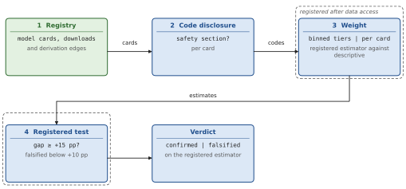
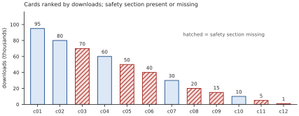

# Demo 36: Model Card Debt

> **▶️ New here? Follow the step-by-step [Execution Instructions](INSTRUCTIONS.md)** — every command with expected output.

## Learning Objectives

- Explain documentation debt (model cards missing safety, provenance, or license sections)
- Count 7/12 synthetic cards missing a safety section
- Show the popularity gap: top-4 miss 1/4 while bottom-8 miss 6/8
- Distinguish card disclosure from lineage risk (Demo 19)

<!-- BEGIN generated: how-it-works (tools/figures/docs.py) -->
## How it works

**Figure 1.** Whether popular models disclose more is decided on the registered estimator; a different weighting can say otherwise. Numbered boxes are stages (role on top, rule or variable beneath, in monospace); dashed grey panels mark a trust domain or scope; a dashed red arrow marks where an adversary acts. Teaching schematic: it simplifies the research procedure and leaves out its corpora, models and thresholds.

### Step by step

1. **Registry** (`model cards, downloads`). And derivation edges. In this demo: `fixtures/`.
2. **Code disclosure** (`safety section?`). Per card. In this demo: `student/cards.py`.
3. **Weight** (`binned tiers | per card`). Registered estimator against descriptive. In this demo: `student/cards.py`.
4. **Registered test** (`gap ≥ +15 pp?`). Falsified below +10 pp. In this demo: `student/run_cards.py`.
5. **Verdict** (`confirmed | falsified`). On the registered estimator. Run `make demo` to print it.

**Figure 2.** Missing safety sections cluster in the long tail; whether that makes the download-weighted rate higher depends on the estimator. Values come from `make demo` on the synthetic fixture: they are illustrative and are not research results.

### What the research version adds (withheld while under peer review)

- A census of model cards and derivation edges
- A fixed-weight blend of download-tier rates
- The descriptive per-card estimate reported beside it

The study's data, exact protocol, thresholds and results are not part of this teaching demo. They will be linked here once the paper is published open access.

<!-- END generated: how-it-works -->

## Conceptual Explanation

Model cards should disclose safety-relevant facts, but the long tail often
skips them. This toy audits twelve hand-built cards ranked by downloads.

| Tier | Missing safety |
|------|----------------|
| All (12) | 7/12 |
| Top-4 by downloads | 1/4 (c03) |
| Bottom-8 by downloads | 6/8 (c05, c06, c08, c09, c11, c12) |

Popular cards disclose more often; the tail carries the debt.

## Safety Notice

⚠️ **This is a teaching demonstration using synthetic fixtures only.**
- No real cards, registries, models, or credentials
- No network access (standard library only)
- All cards and verdicts are hand-built toys
- Results demonstrate a mechanism; they are not evidence about real cards

## Reproducibility Metadata

| Field | Value |
|-------|-------|
| Seed | 36 (fixed; no randomness used) |
| Python | 3.11+ (stdlib only) |
| OS | Linux/macOS/Windows |
| Command | `make demo DEMO=36` |

## Research Connection

This demo illustrates the disclosure question of a pending Analysis of model
card debt. That study has **collected no confirmatory
data**; every quantity there is `[RESULT PENDING]`. Nothing here describes a
publication, a venue result, or a measured effect size. Boundary: this demo
covers card disclosure only, not lineage risk (Demo 19).

Provenance: distilled from `demo-36-model-card-documentation-debt-nmi` (private research repo).

### Difference from the Research Study

| Aspect | Research study | This demo |
|--------|----------------|-----------|
| Data | Registry cards (pending) | 12 hand-built cards |
| Method | Disclosure coding by download tier | Missing-safety count split top-4 vs bottom-8 |
| Claims | Falsifiable debt hypotheses with registered margins | **No claims** — mechanism illustration only |
| Artefact | Coding guide + card sample | Two tiny card helpers |
