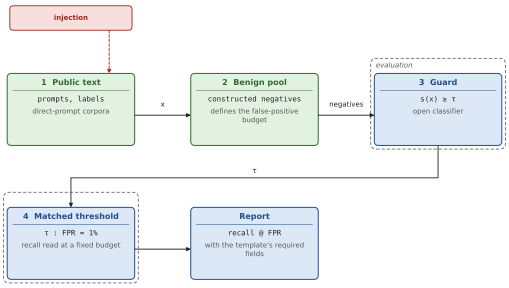
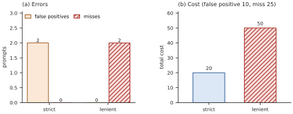

# Demo 37: Detector Cost

  
  
  

> **▶️ New here? Follow the step-by-step [Execution Instructions](INSTRUCTIONS.md)** — every command with expected output, plus a reproducibility protocol for study participants.

## Learning Objectives

- Explain why detector choice is an operating-point decision, not an accuracy contest
- Score a strict substring detector and a lenient exact-phrase detector on the same 10 synthetic prompts
- Price false positives at 10 and false negatives at 25, and show the strict detector wins on cost (20 vs 50)
- Distinguish this teaching toy from the pending practitioner evaluation it illustrates

<!-- BEGIN generated: how-it-works (tools/figures/docs.py) -->
## How it works

**Figure 1.** A recall figure means little until the false-positive budget behind it is stated. Numbered boxes are stages (role on top, rule or variable beneath, in monospace); dashed grey panels mark a trust domain or scope; a dashed red arrow marks where an adversary acts. Teaching schematic: it simplifies the research procedure and leaves out its corpora, models and thresholds.

### Step by step

1. **Public text** (`prompts, labels`). Direct-prompt corpora. In this demo: `fixtures/`.
2. **Benign pool** (`constructed negatives`). Defines the false-positive budget. In this demo: `fixtures/`.
3. **Guard** (`s(x) ≥ τ`). Open classifier. In this demo: `student/detectors.py`.
4. **Matched threshold** (`τ : FPR = 1%`). Recall read at a fixed budget. In this demo: `student/run_cost.py`.
5. **Report** (`recall @ FPR`). With the template's required fields. Run `make demo` to print it.

**Figure 2.** Which detector is better depends on what a false alarm costs relative to a miss; recall alone cannot say. Values come from `make demo` on the synthetic fixture: they are illustrative and are not research results.

### What the research version adds (withheld while under peer review)

- Two open guards on public text
- Bootstrap intervals for matched-threshold recall
- Partly registered, partly post hoc, stated as such

The study's data, exact protocol, thresholds and results are not part of this teaching demo. They will be linked here once the paper is published open access.

<!-- END generated: how-it-works -->

## Conceptual Explanation

A detector that catches everything also cries wolf. On these 10 hand-built
prompts (4 injected, 6 benign), the strict rule (`ignor*` substring) catches
4/4 injections but false-alarms on 2/6 benign prompts, including two tricky
ones: a request to "ignore the previous email thread" (benign context) and a
mention of "the ignore button". The lenient rule (exact phrase "ignore
previous instructions") misses the 2 paraphrased injections but never
false-alarms.

| Detector | TP | FP | FN | Cost (FP=10, FN=25) |
|----------|----|----|----|----------------------|
| Strict | 4/4 | 2/6 | 0/4 | 2×10 + 0×25 = 20 |
| Lenient | 2/4 | 0/6 | 2/4 | 0×10 + 2×25 = 50 |

Lesson: under asymmetric costs, the noisier detector is the cheaper one.
Tune the threshold with costs, not accuracy.

## Safety Notice

⚠️ **This is a teaching demonstration using synthetic fixtures only.**
- No real prompts, models, detectors, or credentials
- No network access (standard library only)
- All prompts, flags and costs are hand-built toys
- Results demonstrate a mechanism; they are not evidence about real detectors

## Reproducibility Metadata

| Field | Value |
|-------|-------|
| Seed | 37 (fixed; no randomness used) |
| Python | 3.11+ (stdlib only) |
| OS | Linux/macOS/Windows |
| Command | `make demo DEMO=37` |

## Reproducibility Table (fill in your run)

| Field | Your run |
|-------|----------|
| Python version | |
| `pytest` result | 21 passed / ___ failed |
| Strict cost / Lenient cost | ___ / ___ |
| Winner | ___ |
| Winner after Step 4 experiment (`fn_cost=5`) | ___ |
| Commit | Git SHA or `local` |

## Research Connection

This demo illustrates the design question of a practitioner evaluation of
prompt-injection detectors. That evaluation
is **pending**; every quantity there is `[RESULT PENDING]`. Nothing here
describes a publication, a venue result, or a measured effect size.

Provenance: distilled from `demo-37-prompt-injection-detectors-evaluation-cose` (private research repo; the `-cose` suffix is the old working title — Computers & Security is out of scope for AI/ML since early 2024, so the venue plan in the root README now targets FAccT'27 → TIFS → TDSC).
It shares no topic with Demo 18 (language transfer): this demo is detector
OPERATION priced with false-positive cost; Demo 18 studies cross-language
transfer. Different questions, data, and claims.

### Difference from the Research Study

| Aspect | Research study | This demo |
|--------|----------------|-----------|
| Data | Practitioner detector benchmark (pending) | 10 hand-built prompts |
| Method | Multi-detector evaluation with cost modelling | Two substring rules, fixed FP=10/FN=25 |
| Claims | Falsifiable detector-ranking hypotheses | **No claims** — mechanism illustration only |
| Artefact | Evaluation harness over real detectors | Two tiny detector functions |
