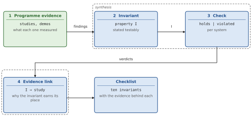
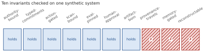

# Demo 41: Ten Invariants

> **▶️ New here? Follow the step-by-step [Execution Instructions](INSTRUCTIONS.md)** — every command with expected output.

## Learning Objectives

- Explain what a security invariant checklist is (properties every deployment should hold)
- Evaluate 10 synthetic invariant checks: 7 hold, 3 are violated
- Name the violated three: provenance-travels, memory-gated, reconstructable
- Apply the synthesis rule: no invariant without accepted evidence (all evidence here is synthetic)

<!-- BEGIN generated: how-it-works (tools/figures/docs.py) -->
## How it works

**Figure 1.** A checklist turns scattered findings into testable properties, each tied to the evidence that motivates it. Numbered boxes are stages (role on top, rule or variable beneath, in monospace); dashed grey panels mark a trust domain or scope; a dashed red arrow marks where an adversary acts. Teaching schematic: it simplifies the research procedure and leaves out its corpora, models and thresholds.

### Step by step

1. **Programme evidence** (`studies, demos`). What each one measured. In this demo: `fixtures/`.
2. **Invariant** (`property I`). Stated testably. In this demo: `student/invariants.py`.
3. **Check** (`holds | violated`). Per system. In this demo: `student/invariants.py`.
4. **Evidence link** (`I → study`). Why the invariant earns its place. In this demo: `student/run_inv.py`.
5. **Checklist** (`ten invariants`). With the evidence behind each. Run `make demo` to print it.

**Figure 2.** Seven invariants hold and three fail: provenance does not travel, memory is not gated, and the run cannot be reconstructed. Values come from `make demo` on the synthetic fixture: they are illustrative and are not research results.

### What the research version adds (withheld while under peer review)

- A synthesis across the programme's studies
- Design stage: each invariant awaits its evidence

The study's data, exact protocol, thresholds and results are not part of this teaching demo. They will be linked here once the paper is published open access.

<!-- END generated: how-it-works -->

## Conceptual Explanation

A checklist turns scattered guidance into testable properties. On 10
hand-built checks, 7 hold (authority-bound, typed-commitments, action-gated,
scan-bound, eval-pinned, human-approval, artifact-bom) and 3 fail:

| Violated invariant | Meaning |
|--------------------|---------|
| provenance-travels | Labels do not follow data across tool hops |
| memory-gated | Memory reads ignore the current task context |
| reconstructable | Incidents cannot be rebuilt from logs |

The lesson is the synthesis rule: an invariant earns its place only with
accepted evidence behind it — and every verdict here is backed solely by a
synthetic fixture, so none qualifies.

## Safety Notice

⚠️ **This is a teaching demonstration using synthetic fixtures only.**
- No real deployments, audits, or credentials
- No network access (standard library only)
- All checks and verdicts are hand-built toys
- Results demonstrate a mechanism; they are not evidence about real systems

## Reproducibility Metadata

| Field | Value |
|-------|-------|
| Seed | 41 (fixed; no randomness used) |
| Python | 3.11+ (stdlib only) |
| OS | Linux/macOS/Windows |
| Command | `make demo DEMO=41` |

## Research Connection

This demo illustrates a synthesis argument about agent-security invariants.
It contributes **checklist synthesis, not new evidence**:
every invariant stated here rests on synthetic checks only.

Provenance: distilled from `demo-41-agent-security-invariants-cacm` (private research repo).
The synthesis rule applies throughout: no invariant without accepted
evidence — and all evidence in this demo is synthetic, so the checklist
illustrates the form of the argument without making it.

### Difference from the Research Study

| Aspect | Research study | This demo |
|--------|----------------|-----------|
| Data | Survey of accepted evidence (pending) | 10 hand-built checks |
| Method | Evidence-backed synthesis | Single fixed checklist |
| Claims | Candidate invariant set with stated rule | **No claims** — mechanism illustration only |
| Artefact | Synthesis with evidence table | One tiny evaluate function |
