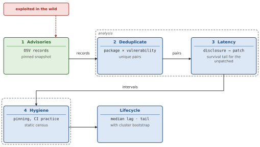
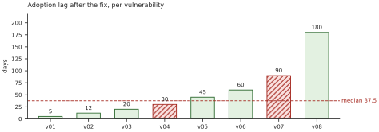

# Demo 42: Patch Lifecycle

> **▶️ New here? Follow the step-by-step [Execution Instructions](INSTRUCTIONS.md)** — every command with expected output.

## Learning Objectives

- Explain the fix-to-adoption gap (a fix exists; deployments lag behind)
- Compute the median adoption lag over 8 synthetic vulns: exactly 37.5 days
- Show 2/8 fixes blocked by version pins
- Distinguish this teaching toy from the pending study it illustrates

<!-- BEGIN generated: how-it-works (tools/figures/docs.py) -->
## How it works

**Figure 1.** Patch latency is a distribution with a tail, not a single number. Numbered boxes are stages (role on top, rule or variable beneath, in monospace); dashed grey panels mark a trust domain or scope; a dashed red arrow marks where an adversary acts. Teaching schematic: it simplifies the research procedure and leaves out its corpora, models and thresholds.

### Step by step

1. **Advisories** (`OSV records`). Pinned snapshot. In this demo: `fixtures/`.
2. **Deduplicate** (`package × vulnerability`). Unique pairs. In this demo: `student/lifecycle.py`.
3. **Latency** (`disclosure → patch`). Survival tail for the unpatched. In this demo: `student/lifecycle.py`.
4. **Hygiene** (`pinning, CI practice`). Static census. In this demo: `student/run_cycle.py`.
5. **Lifecycle** (`median lag · tail`). With cluster bootstrap. Run `make demo` to print it.

**Figure 2.** Lags have a long tail; hatched bars are vulnerabilities whose fix a version pin blocked. Values come from `make demo` on the synthetic fixture: they are illustrative and are not research results.

### What the research version adds (withheld while under peer review)

- Core packages across three ecosystems
- Survival analysis for unpatched records
- A hygiene census of agent-framework repositories

The study's data, exact protocol, thresholds and results are not part of this teaching demo. They will be linked here once the paper is published open access.

<!-- END generated: how-it-works -->

## Conceptual Explanation

Fixing a library is only half the lifecycle; downstream stacks must adopt
the fix. On 8 hand-built vulnerability records with adoption lags
[5, 12, 20, 30, 45, 60, 90, 180] days:

| Statistic | Value |
|-----------|-------|
| Median adoption lag | (30 + 45) / 2 = 37.5 days |
| Blocked by version pin | 2/8 (vuln04, vuln07) |

The lesson: the median adopter waits over a month, and pins — not awareness —
block a quarter of fixes. Both numbers are fixture properties, not ecosystem
facts.

## Safety Notice

⚠️ **This is a teaching demonstration using synthetic fixtures only.**
- No real vulnerabilities, advisories, or credentials
- No network access (standard library only)
- All vulns, lags and verdicts are hand-built toys
- Results demonstrate a mechanism; they are not evidence about real stacks

## Reproducibility Metadata

| Field | Value |
|-------|-------|
| Seed | 42 (fixed; no randomness used) |
| Python | 3.11+ (stdlib only) |
| OS | Linux/macOS/Windows |
| Command | `make demo DEMO=42` |

## Research Connection

This demo illustrates the design question of a vulnerability-lifecycle study
of the LLM stack. That study is **pending**; every
quantity there is `[RESULT PENDING]`. Nothing here describes a publication, a
venue result, or a measured effect size.

Provenance: distilled from `demo-42-llm-stack-vulnerability-lifecycle-tse` (private research repo).
It shares no topic with Demo 30 (config defaults): this demo is PATCH
propagation over time; Demo 30 studies configuration defaults. Different
questions, data, and claims.

### Difference from the Research Study

| Aspect | Research study | This demo |
|--------|----------------|-----------|
| Data | Stack advisory + adoption telemetry (pending) | 8 hand-built vulns |
| Method | Survival-style lifecycle analysis | Median + pin count |
| Claims | Falsifiable propagation hypotheses | **No claims** — mechanism illustration only |
| Artefact | Lifecycle dataset design | Two tiny summary functions |
