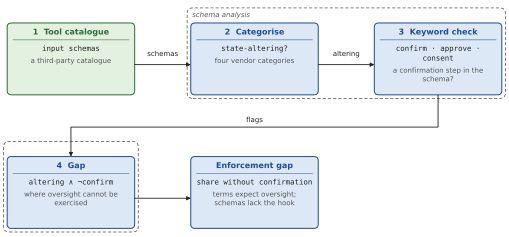
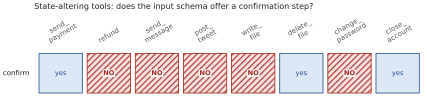

# Demo 43: Terms Coding

> **▶️ New here? Follow the step-by-step [Execution Instructions](INSTRUCTIONS.md)** — every command with expected output.

## Learning Objectives

- Explain what platform-terms coding is (reading accountability out of terms of service)
- Code 8 synthetic platform terms against 3 clauses: disclaim 5/8, monitoring 4/8, consent 3/8
- Show the accountability gradient (disclaimers common, delegation consent rare)
- Distinguish this teaching toy from the pending content analysis it illustrates

<!-- BEGIN generated: how-it-works (tools/figures/docs.py) -->
## How it works

**Figure 1.** Oversight that platform terms expect can only be exercised if the tool's schema offers a confirmation step. Numbered boxes are stages (role on top, rule or variable beneath, in monospace); dashed grey panels mark a trust domain or scope; a dashed red arrow marks where an adversary acts. Teaching schematic: it simplifies the research procedure and leaves out its corpora, models and thresholds.

### Step by step

1. **Tool catalogue** (`input schemas`). A third-party catalogue. In this demo: `fixtures/confirmation_gap.json`.
2. **Categorise** (`state-altering?`). Four vendor categories. In this demo: `student/confirmation_gap.py`.
3. **Keyword check** (`confirm · approve · consent`). A confirmation step in the schema? In this demo: `student/confirmation_gap.py`.
4. **Gap** (`altering ∧ ¬confirm`). Where oversight cannot be exercised. In this demo: `student/confirmation_gap.py`.
5. **Enforcement gap** (`share without confirmation`). Terms expect oversight; schemas lack the hook. Run `make demo` to print it.

**Figure 2.** Three of eight state-altering tools expose a confirmation parameter that the keyword rule finds; post_tweet's require_approval is missed by the rule itself. Values come from `make demo` on the synthetic fixture: they are illustrative and are not research results.

### New in this update (26 November 2026)

The research procedure for this topic has moved on since the demo was first written. A new step teaches the current procedure in simplified form: `student/confirmation_gap.py` (state-altering tool schemas checked for a confirmation step). `make demo` now runs it after the original exercise, and `tests/test_current_procedure.py` pins its behaviour.

### What the research version adds (withheld while under peer review)

- A large third-party catalogue of protocol tools
- Runtime verification affordances beside the schema keywords
- Terms coding (the toy's first part) as context

The study's data, exact protocol, thresholds and results are not part of this teaching demo. They will be linked here once the paper is published open access.

<!-- END generated: how-it-works -->

## Conceptual Explanation

Terms of service allocate responsibility between platform and deployer. Coding
8 hand-built platform records against 3 accountability clauses:

| Clause | Count |
|--------|-------|
| disclaims_autonomy | 5/8 |
| requires_monitoring | 4/8 |
| consent_for_delegation | 3/8 |

The lesson is the gradient: platforms disclaim autonomy more often than they
demand monitoring, and delegation consent is rarest — the accountability
burden slides downhill to the deployer.

## Safety Notice

⚠️ **This is a teaching demonstration using synthetic fixtures only.**
- No real platforms, terms of service, or credentials
- No network access (standard library only)
- All platforms, clauses and verdicts are hand-built toys
- Results demonstrate a mechanism; they are not evidence about real terms

## Reproducibility Metadata

| Field | Value |
|-------|-------|
| Seed | 43 (fixed; no randomness used) |
| Python | 3.11+ (stdlib only) |
| OS | Linux/macOS/Windows |
| Command | `make demo DEMO=43` |

## Research Connection

This demo illustrates the design question of a content analysis of
agent-platform terms. That analysis is
**pending**; every quantity there is `[RESULT PENDING]`. Nothing here
describes a publication, a venue result, or a measured effect size.

Provenance: distilled from `demo-43-agent-platform-terms-accountability-facct` (private research repo).
It shares no topic with Demo 38 (assurance claims): this demo codes
accountability TERMS; Demo 38 codes assurance claims against obligations.
Different sources, methods, and claims.

### Difference from the Research Study

| Aspect | Research study | This demo |
|--------|----------------|-----------|
| Data | Real platform terms corpus (pending) | 8 hand-built records |
| Method | Coded content analysis | Single fixed tally |
| Claims | Falsifiable accountability hypotheses | **No claims** — mechanism illustration only |
| Artefact | Coding protocol with reliability checks | One tiny tally function |
