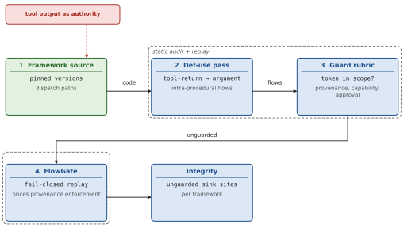
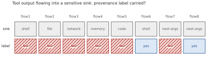

# Demo 44: Toolflow Taint

> **▶️ New here? Follow the step-by-step [Execution Instructions](INSTRUCTIONS.md)** — every command with expected output.

## Learning Objectives

- Explain what toolflow taint is (unlabelled data reaching a sensitive sink)
- Trace 8 synthetic toolflow edges and find 5/8 unlabelled flows into sensitive sinks
- Name the sensitive sinks (code, shell, file, network, memory) vs the non-sensitive one (next-args)
- Distinguish measured missing labels (this toy) from enforcement policy (Demo 04 AuthorityBound)

<!-- BEGIN generated: how-it-works (tools/figures/docs.py) -->
## How it works

**Figure 1.** A value that is data when a tool returns it becomes authority when it is copied into the next call. Numbered boxes are stages (role on top, rule or variable beneath, in monospace); dashed grey panels mark a trust domain or scope; a dashed red arrow marks where an adversary acts. Teaching schematic: it simplifies the research procedure and leaves out its corpora, models and thresholds.

### Step by step

1. **Framework source** (`pinned versions`). Dispatch paths. In this demo: `fixtures/`.
2. **Def-use pass** (`tool-return → argument`). Intra-procedural flows. In this demo: `student/taint.py`.
3. **Guard rubric** (`token in scope?`). Provenance, capability, approval. In this demo: `student/taint.py`.
4. **FlowGate** (`fail-closed replay`). Prices provenance enforcement. In this demo: `student/run_taint.py`.
5. **Integrity** (`unguarded sink sites`). Per framework. Run `make demo` to print it.

**Figure 2.** Five of eight flows reach a sensitive sink with no provenance label, so no guard could decide by origin. Values come from `make demo` on the synthetic fixture: they are illustrative and are not research results.

### What the research version adds (withheld while under peer review)

- Ten pinned frameworks and four profiled by control contracts
- An offline replay shim that prices enforcement
- Recorded dispatch cells

The study's data, exact protocol, thresholds and results are not part of this teaching demo. They will be linked here once the paper is published open access.

<!-- END generated: how-it-works -->

## Conceptual Explanation

Agents pipe tool outputs into new actions; without provenance labels, nobody
knows which input shaped a dangerous call. On 8 hand-built flow edges:

| Flow | Sink | Labelled? |
|------|------|-----------|
| flow1–flow5 | shell, file, network, memory, code | No (tainted) |
| flow6 | shell | Yes |
| flow7–flow8 | next-args | n/a (non-sensitive sink) |

The lesson: 5/8 flows reach sensitive sinks unlabelled. Counting the missing
labels is the measurement; deciding what to block is policy — and policy
lives elsewhere (Demo 04 AuthorityBound).

## Safety Notice

⚠️ **This is a teaching demonstration using synthetic fixtures only.**
- No real tool traces, systems, or credentials
- No network access (standard library only)
- All flows, sinks and verdicts are hand-built toys
- Results demonstrate a mechanism; they are not evidence about real agents

## Reproducibility Metadata

| Field | Value |
|-------|-------|
| Seed | 44 (fixed; no randomness used) |
| Python | 3.11+ (stdlib only) |
| OS | Linux/macOS/Windows |
| Command | `make demo DEMO=44` |

## Research Connection

This demo illustrates the design question of a toolflow-integrity
measurement study. That measurement is
**pending**; every quantity there is `[RESULT PENDING]`. Nothing here
describes a publication, a venue result, or a measured effect size.

Provenance: distilled from `demo-44-agent-toolflow-integrity-ccs` (private research repo).
It shares no enforcement topic with Demo 04 (AuthorityBound): this demo
MEASURES missing labels; AuthorityBound enforces a policy. Measurement here,
enforcement there.

### Difference from the Research Study

| Aspect | Research study | This demo |
|--------|----------------|-----------|
| Data | Agent toolflow traces (pending) | 8 hand-built edges |
| Method | Taint measurement over traces | Single fixed filter |
| Claims | Falsifiable integrity hypotheses | **No claims** — mechanism illustration only |
| Artefact | Measurement harness | One tiny filter function |
