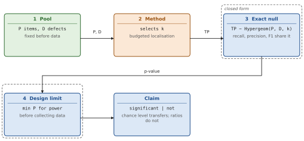
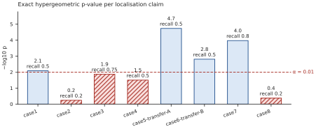

# Demo 45: Exact Nulls for Localisation Claims

> **▶️ New here? Follow the step-by-step [Execution Instructions](INSTRUCTIONS.md)** — every command with expected output.

## Learning Objectives

- Explain why recall / precision / F1 at a fixed budget share one exact null
- Compute a hypergeometric upper-tail p-value for 8 synthetic localisation attempts
- Name the design limit (budget too small means nothing can clear alpha)
- Distinguish comparable null quantiles from incomparable ratio-to-null lifts

<!-- BEGIN generated: how-it-works (tools/figures/docs.py) -->
## How it works

**Figure 1.** At a fixed budget, recall, precision and F1 rise with the same true-positive count, so one exact null serves all three. Numbered boxes are stages (role on top, rule or variable beneath, in monospace); dashed grey panels mark a trust domain or scope; a dashed red arrow marks where an adversary acts. Teaching schematic: it simplifies the research procedure and leaves out its corpora, models and thresholds.

### Step by step

1. **Pool** (`P items, D defects`). Fixed before data. In this demo: `fixtures/`.
2. **Method** (`selects k`). Budgeted localisation. In this demo: `fixtures/`.
3. **Exact null** (`TP ~ Hypergeom(P, D, k)`). Recall, precision, F1 share it. In this demo: `student/nulls.py`.
4. **Design limit** (`min P for power`). Before collecting data. In this demo: `student/run_nulls.py`.
5. **Claim** (`significant | not`). Chance level transfers; ratios do not. Run `make demo` to print it.

**Figure 2.** Similar recalls can be significant or not depending on pool, defect count and budget; the exact null decides. Values come from `make demo` on the synthetic fixture: they are illustrative and are not research results.

### What the research version adds (withheld while under peer review)

- Blind threat models from several models
- Real vulnerabilities in independent projects
- A proof that ratio-to-null statistics do not transfer

The study's data, exact protocol, thresholds and results are not part of this teaching demo. They will be linked here once the paper is published open access.

<!-- END generated: how-it-works -->

## Conceptual Explanation

A localisation claim says a method found the defective items at some budget.
At fixed pool `P`, defect count `D` and budget `k`, all three scores rise with
the same true-positive count, so every threshold event is `{TP >= t}` and the
null is hypergeometric — no resampling needed. On 8 hand-built cases:

| Case | Geometry P/D/k/TP | p-value | Verdict at 0.01 |
|------|-------------------|---------|-----------------|
| case1 | 45/10/8/5 | ~0.0083 | significant |
| case2 | 45/10/8/2 | chance-level | not significant |
| case5-transfer-A | 60/12/6/6 | ~1.8e-05 | significant |
| case6-transfer-B | 30/12/6/6 | ~0.0016 | significant but ~84x weaker |

The lesson: the two transfer cases share recall 0.50 yet live under different
nulls; their lifts (5.0 vs 2.5) are not comparable. Counting hits is the
measurement; the null decides what the count means.

## Safety Notice

⚠️ **This is a teaching demonstration using synthetic fixtures only.**
- No real vulnerabilities, systems, or credentials
- No network access (standard library only)
- All cases and verdicts are hand-built toys
- Results demonstrate a mechanism; they are not evidence about real agents

## Reproducibility Metadata

| Field | Value |
|-------|-------|
| Seed | 45 (fixed; no randomness used) |
| Python | 3.11+ (stdlib only) |
| OS | Linux/macOS/Windows |
| Command | `make demo DEMO=45` |

## Research Connection

This demo illustrates the measurement question of an exact-null
localisation study. That measurement is
**pending**; every quantity there is `[RESULT PENDING]`. Nothing here
describes a publication, a venue result, or a measured effect size.

Provenance: distilled from `demo-45-localisation-nulls` (private research repo,
split from Demo-1 PR #4). It shares no topic with Demo 01 (BlindVerification):
Demo 01 seals *how* assessors commit; this demo tests *whether* a hit count
means anything.
