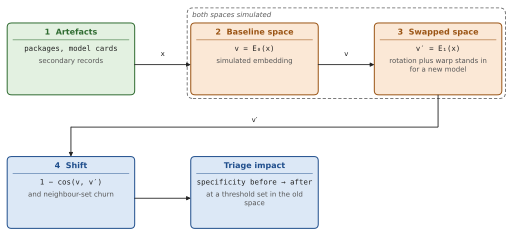
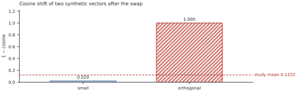

# Demo 46: Embedding-swap cosine shift

## Learning Objectives

- Compute cosine shift `1 - cosine(baseline, replacement)` for one artefact
- Compare a toy swap with a frozen study mean (0.1222)
- See that an orthogonal swap moves farther than that frozen mean

<!-- BEGIN generated: how-it-works (tools/figures/docs.py) -->
## How it works

**Figure 1.** Swapping the embedding model moves every vector at once; a threshold set in the old space no longer means the same thing. Numbered boxes are stages (role on top, rule or variable beneath, in monospace); dashed grey panels mark a trust domain or scope; a dashed red arrow marks where an adversary acts. Teaching schematic: it simplifies the research procedure and leaves out its corpora, models and thresholds.

### Step by step

1. **Artefacts** (`packages, model cards`). Secondary records. In this demo: `fixtures/`.
2. **Baseline space** (`v = E₀(x)`). Simulated embedding. In this demo: `student/drift.py`.
3. **Swapped space** (`v′ = E₁(x)`). Rotation plus warp stands in for a new model. In this demo: `student/drift.py`.
4. **Shift** (`1 − cos(v, v′)`). And neighbour-set churn. In this demo: `student/run_drift.py`.
5. **Triage impact** (`specificity before → after`). At a threshold set in the old space. Run `make demo` to print it.

**Figure 2.** A small rotation stays under the simulated study's mean shift; an orthogonal swap is far above it. Values come from `make demo` on the synthetic fixture: they are illustrative and are not research results.

### What the research version adds (withheld while under peer review)

- Malicious-package records and model cards as the artefact set
- A seeded rotation-plus-warp family
- Neighbour churn and specificity at a calibrated threshold

The study's data, exact protocol, thresholds and results are not part of this teaching demo. They will be linked here once the paper is published open access.

<!-- END generated: how-it-works -->

## Safety Notice

Synthetic 4-dimensional vectors only. No models, no network, no package corpus.
The frozen mean is a label copied from the simulated study so the comparison is reproducible. It is not a new measurement.

## Reproducibility Metadata

| Field | Value |
|-------|-------|
| Python | 3.11+ (stdlib only) |
| Command | `make demo DEMO=46` |

## Research Connection

Distilled from `radanliev/demo-46-simulated-embedding-drift-aibom` (private).
That study still uses simulated representation spaces. This folder teaches the shift formula on two hand-built vectors.
