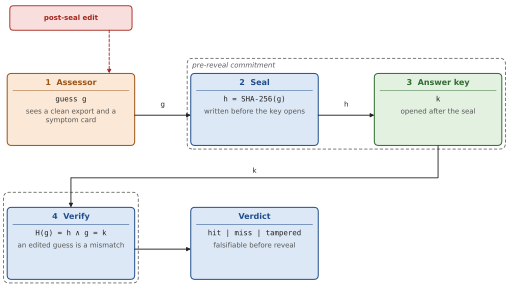
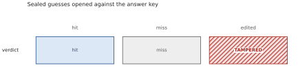

# Demo 47: Pre-reveal Seal

> **▶️ New here? Follow the step-by-step [Execution Instructions](INSTRUCTIONS.md)** — every command with expected output.

## Learning Objectives

- Hash a localisation commitment before any ground truth is read
- Chain each seal to the previous seal
- Refuse a commitment whose bytes no longer match the seal

<!-- BEGIN generated: how-it-works (tools/figures/docs.py) -->
## How it works

**Figure 1.** Sealing the guess before the key opens makes any later edit detectable. Numbered boxes are stages (role on top, rule or variable beneath, in monospace); dashed grey panels mark a trust domain or scope; a dashed red arrow marks where an adversary acts. Teaching schematic: it simplifies the research procedure and leaves out its corpora, models and thresholds.

### Step by step

1. **Assessor** (`guess g`). Sees a clean export and a symptom card. In this demo: `fixtures/`.
2. **Seal** (`h = SHA-256(g)`). Written before the key opens. In this demo: `student/seal.py`.
3. **Answer key** (`k`). Opened after the seal. In this demo: `fixtures/`.
4. **Verify** (`H(g) = h ∧ g = k`). An edited guess is a mismatch. In this demo: `student/run_seal.py`.
5. **Verdict** (`hit | miss | tampered`). Falsifiable before reveal. Run `make demo` to print it.

**Figure 2.** An edit after sealing is caught as a hash mismatch, whatever the edited guess says. Values come from `make demo` on the synthetic fixture: they are illustrative and are not research results.

### What the research version adds (withheld while under peer review)

- A benchmark of planted defects with sealed ground truth
- Command-line assessors run without access to the run identifier

The study's data, exact protocol, thresholds and results are not part of this teaching demo. They will be linked here once the paper is published open access.

<!-- END generated: how-it-works -->

## Conceptual Explanation

A blind evaluation writes the guessed defect id first, seals those bytes, and
only then opens the answer key. On three hand-built cases:

| Case | What happens | Verdict |
|------|----------------|---------|
| hit | sealed guess matches the key | hit |
| miss | sealed guess names a different component | miss |
| edited | bytes change after the seal, even if the new text would match the key | commitment_hash_mismatch |

The lesson: a later edit is not a new answer. Scoring never consults the key
until the sealed digest still matches.

## Safety Notice

⚠️ **This is a teaching demonstration using synthetic fixtures only.**
- No real vulnerabilities, systems, or credentials
- No network access (standard library only)
- All cases and verdicts are hand-built toys

## Reproducibility Metadata

| Field | Value |
|-------|-------|
| Seed | none (no randomness) |
| Python | 3.11+ (stdlib only) |
| OS | Linux/macOS/Windows |
| Command | `make demo DEMO=47` |

## Research Connection

This demo illustrates seal-before-reveal for a localisation commitment.
That study is **pending**. Nothing here describes a publication or a measured effect size.

Provenance: distilled from `demo-47-blind-verification-eval-sais` (private research repo).
The exercise is the seal, the chain link, and the rule that the answer key stays closed
until the digest matches.
