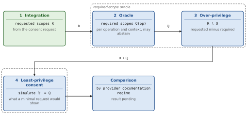
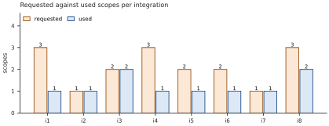

# Demo 48: OAuth Over-privilege

> **▶️ New here? Follow the step-by-step [Execution Instructions](INSTRUCTIONS.md)** — every command with expected output.

## Learning Objectives

- Explain scope creep (an integration requests strictly more OAuth scopes than it uses)
- Flag 5/8 synthetic integrations as over-privileged with a strict-superset rule
- Compute the least-privilege set as the sorted union of used scopes
- Distinguish OAuth scopes from declaration gaps (Demo 31) and delegation properties (Demo 24)
- Distinguish teaching demonstrations from validated research benchmarks

<!-- BEGIN generated: how-it-works (tools/figures/docs.py) -->
## How it works

**Figure 1.** Over-privilege is what an integration requests beyond what its operations require. Numbered boxes are stages (role on top, rule or variable beneath, in monospace); dashed grey panels mark a trust domain or scope; a dashed red arrow marks where an adversary acts. Teaching schematic: it simplifies the research procedure and leaves out its corpora, models and thresholds.

### Step by step

1. **Integration** (`requested scopes R`). From the consent request. In this demo: `fixtures/`.
2. **Oracle** (`required scopes Q(op)`). Per operation and context, may abstain. In this demo: `student/scopes.py`.
3. **Over-privilege** (`R ∖ Q`). Requested minus required. In this demo: `student/scopes.py`.
4. **Least-privilege consent** (`simulate R′ = Q`). What a minimal request would show. In this demo: `student/run_scopes.py`.
5. **Comparison** (`by provider documentation regime`). Result pending. Run `make demo` to print it.

**Figure 2.** 5 of 8 integrations request more scopes than they use. Values come from `make demo` on the synthetic fixture: they are illustrative and are not research results.

### What the research version adds (withheld while under peer review)

- Integrations across four identity providers
- A context-sensitive oracle with explicit abstention
- Registered amendments; confirmatory corpus not yet frozen

The study's data, exact protocol, thresholds and results are not part of this teaching demo. They will be linked here once the paper is published open access.

<!-- END generated: how-it-works -->

## Conceptual Explanation

Agent integrations often copy broad scope lists. This toy checks eight
hand-built integrations: over-privileged when `set(requested)` strictly
supersets `set(used)`.

| Check | Result |
|-------|--------|
| Over-privileged | 5/8 (i1, i4, i5, i6, i8) |
| Tight (equal) | 3/8 (i2, i3, i7) |
| Least-privilege | 8 scopes (union of all used) |

Equal requests such as `i2` (`read`/`read`) are tight; `i8` requesting
`drive.admin` it never uses is the classic creep case.

### Why using more does not fix creep

Adding a requested scope to the used list leaves every other unused request in
place: the verdict stays over-privileged while the least-privilege union grows.
Only requesting less removes creep. That asymmetry is the least-privilege lesson.

## Safety Notice

⚠️ **This is a teaching demonstration using synthetic fixtures only.**
- No real providers, tokens, or credentials
- No network access (standard library only)
- All integrations and scopes are hand-built toys
- Results demonstrate a mechanism; they are not evidence about real integrations

## Reproducibility Metadata

| Field | Value |
|-------|-------|
| Seed | none (no randomness) |
| Python | 3.11+ (stdlib only) |
| OS | Linux/macOS/Windows |
| Command | `make demo DEMO=48` |

## Research Connection

This demo illustrates scope creep in OAuth-authorised agent integrations.
That study is **pending**. Nothing here describes a publication or a measured effect size.

Provenance: distilled from `demo-48-scope-creep-oauth-overprivilege-tops` (private research repo).
The exercise is the strict-superset check and the least-privilege union.
