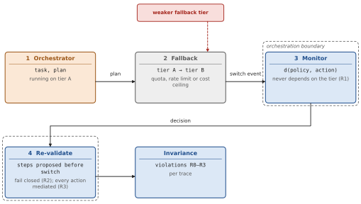
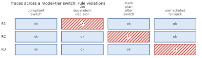

# Demo 49: Authority Invariance under Model Fallback

> **▶️ New here? Follow the step-by-step [Execution Instructions](INSTRUCTIONS.md)** — every command with expected output.

## Learning Objectives

- Explain why a model-tier change mid-task is a security event, not just a routing detail
- Check a recorded agent trace against three tier-agnostic properties (R1–R3)
- Distinguish a compliant fallback from a tier-dependent decision, a stale plan and an unmediated path
- Read a fail-closed reference monitor that re-validates pending steps after a switch
- Distinguish teaching demonstrations from validated research benchmarks

**Status (26 November 2026):** the research study behind this demo is in progress or under peer review; the demo was created on 6 November 2026. The repository holds an offline checker, synthetic
fixtures and tests. It holds no results; every empirical statement in a future paper is
[RESULT PENDING] until a committed analysis script derives it.

<!-- BEGIN generated: how-it-works (tools/figures/docs.py) -->
## How it works

<p align="center"></p>

**Figure 1.** Authority must not change when the model serving a task changes mid-way. Numbered boxes are stages (role on top, rule or variable beneath, in monospace); dashed grey panels mark a trust domain or scope; a dashed red arrow marks where an adversary acts. Teaching schematic: it simplifies the research procedure and leaves out its corpora, models and thresholds.

### Step by step

1. **Orchestrator** (`task, plan`). Running on tier A. In this demo: `fixtures/`.
2. **Fallback** (`tier A → tier B`). Quota, rate limit or cost ceiling. In this demo: `fixtures/`.
3. **Monitor** (`d(policy, action)`). Never depends on the tier (R1). In this demo: `student/tier_invariance`.
4. **Re-validate** (`steps proposed before switch`). Fail closed (R2); every action mediated (R3). In this demo: `student/run_tiers.py`.
5. **Invariance** (`violations R0–R3`). Per trace. Run `make demo` to print it.

<p align="center"></p>

**Figure 2.** Each failure mode breaks exactly one rule: a tier-dependent decision, a stale plan step, or an unmediated action. Values come from `make demo` on the synthetic fixture: they are illustrative and are not research results.

### What the research version adds (withheld while under peer review)

- Tier independence, re-validation and complete mediation stated as properties
- A fail-closed monitor costed for a fixed budget

The study's data, exact protocol, thresholds and results are not part of this teaching demo. They will be linked here once the paper is published open access.

<!-- END generated: how-it-works -->

## Research question

When an agent orchestrator changes the model serving a task part-way through (because a frontier
quota is exhausted, a rate limit is hit, a cost ceiling is reached, or execution moves to a local
model), does the authority granted to the agent's actions stay the same, and can a fail-closed
monitor at the orchestration boundary enforce that invariance at a cost that institutions with
fixed budgets can carry?

## Why it matters

Deployed agents increasingly route between a high-cost frontier tier, a cheaper high-throughput
tier and on-device execution. Controls that live inside one model (its refusals, its resistance to
instructions embedded in untrusted content, its self-checks) do not travel with the task when the
model changes, and a fallback path can bypass the mediation layer altogether. Published work on
tool-use security mostly fixes the model for the duration of a run [CITATION NEEDED: independent
sources on model routing and cascades, and on agent tool-use security].

## Properties under study

- **R1 tier independence:** the monitor's decision for an action depends only on the task policy
  and the action, never on which tier produced the request.
- **R2 fail-closed transition:** a plan step proposed before a tier switch is re-validated before
  it runs.
- **R3 complete mediation:** no action runs without a monitor decision, including on fallback
  paths.

The checker in `student/tier_invariance/core.py` tests recorded traces against these properties, and
`ReferenceMonitor` shows a minimal design that satisfies them by construction.

## What is here now

| Path | Contents |
|---|---|
| `student/tier_invariance/` | trace checker (R0 to R3) and a reference monitor |
| `fixtures/synthetic_traces.json` | four synthetic traces from a student-support triage task; placeholders, not measurements |
| `student/run_tiers.py` | prints the checker's findings and writes `results/tier_invariance.json` |
| `tests/` | unit tests (standard library `unittest`; also collected by pytest) |

```bash
python3 student/run_tiers.py
python3 -m pytest tests/ -v
```

Everything runs offline with the Python standard library. No API keys, no network access, no
real student or staff data.

## Safety Notice

⚠️ **This is a teaching demonstration using synthetic fixtures only.**
- No real agents, providers, tools, or credentials
- No network access (standard library only)
- All traces are hand-built toys
- Results demonstrate a mechanism; they are not evidence about real deployments

## Distinctness

- Demo 4 (AuthorityBound) binds tool-call authority with a single serving model; demo 49's new
  variable is the change of model mid-task.
- Demo 14 (conformal action gating) calibrates risk thresholds for one model; it does not treat
  model substitution as an event.
- Demo 24 (delegation checks) analyses authorisation between agents, not between model tiers.
- Demo 50 (budget-bounded delegation) treats cost as an authority dimension; demo 49 treats cost
  pressure as the cause of a tier change.

## Venue plan

Plan A (proposal): ACM AsiaCCS 2027 round 2, papers 11 December 2026 AoE, 12 pages excluding bibliography and appendices ([CFP](https://asiaccs2027.cityu.edu.mo/call-for-papers/index.html), checked 9 November 2026). Plan B: USENIX Security 2027 Cycle 2, registration 19 January 2027 and papers 26 January 2027, 13-page body ([CFP](https://www.usenix.org/conference/usenixsecurity27/call-for-papers), checked 9 November 2026). Plan C: IEEE CSF 2027 winter, papers 28 January 2027 ([CFP](https://csf2027.ieee-security.org/cfp.html); date as listed on this collection's venue table). ACM CCS 2027 and NDSS 2028 calls were not published at the time of checking.

## Reproducibility Metadata

| Field | Value |
|-------|-------|
| Seed | 49 (fixed; no randomness used unless a test says otherwise) |
| Python | 3.11+ (stdlib only) |
| OS | Linux/macOS/Windows |
| Command | `make demo DEMO=49` |

## Reproducibility

```bash
python3 -m pytest tests/ -v      # 7 tests
python3 student/run_tiers.py     # writes results/tier_invariance.json
```

Python 3.11 or newer, standard library only, fully offline and deterministic.

## Licence

MIT (see the repository [LICENSE](../../LICENSE)).
