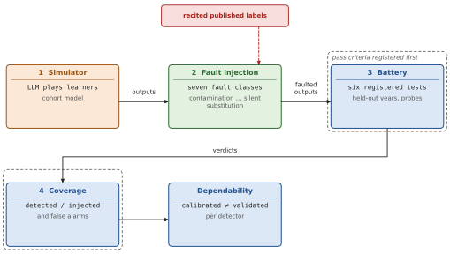
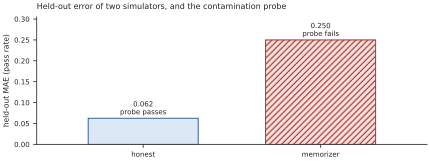

# Demo 52: LLM Simulation Validation

> **▶️ New here? Follow the step-by-step [Execution Instructions](INSTRUCTIONS.md)** — every command with expected output.

## Learning Objectives

- Explain why a calibrated simulator can still fail a held-out year or a renamed module
- Score two toy predictors on held-out pass and withdrawal rates
- Use a rename probe to catch a memorizer that recites published labels
- Distinguish teaching demonstrations from validated research benchmarks

<!-- BEGIN generated: how-it-works (tools/figures/docs.py) -->
## How it works

**Figure 1.** A simulator can match last year's rates for the wrong reason; injected faults test whether the checks would notice. Numbered boxes are stages (role on top, rule or variable beneath, in monospace); dashed grey panels mark a trust domain or scope; a dashed red arrow marks where an adversary acts. Teaching schematic: it simplifies the research procedure and leaves out its corpora, models and thresholds.

### Step by step

1. **Simulator** (`LLM plays learners`). Cohort model. In this demo: `fixtures/`.
2. **Fault injection** (`seven fault classes`). Contamination … silent substitution. In this demo: `fixtures/`.
3. **Battery** (`six registered tests`). Held-out years, probes. In this demo: `student/sim_validate.py`.
4. **Coverage** (`detected / injected`). And false alarms. In this demo: `student/run_sim.py`.
5. **Dependability** (`calibrated ≠ validated`). Per detector. Run `make demo` to print it.

**Figure 2.** The memorising simulator does worse on held-out years and fails to transfer when the module is renamed. Values come from `make demo` on the synthetic fixture: they are illustrative and are not research results.

### What the research version adds (withheld while under peer review)

- A seven-class fault model
- Detectors measured on a non-LLM cohort model and on stored LLM outputs

The study's data, exact protocol, thresholds and results are not part of this teaching demo. They will be linked here once the paper is published open access.

<!-- END generated: how-it-works -->

## Conceptual Explanation

A simulator of a learner cohort is not validated just because it matches last year's published rates. Held-out years ask whether the same regularities appear again. A contamination probe asks whether the simulator is reciting published labels: the same module is presented under a new name. An honest predictor transfers the original module's rates; a memorizer that keys on the printed name does not.

This demo runs both checks on two hand-built predictors and four synthetic module rows. No language model is called.

## Safety Notice

⚠️ **This is a teaching demonstration using synthetic fixtures only.**
- No real students, patients, institutions, credentials, or API keys
- No network access (standard library only)
- All cases and verdicts are hand-built toys
- Results demonstrate a mechanism; they are not evidence about real systems

## Reproducibility Metadata

| Field | Value |
|-------|-------|
| Seed | 52 (fixed; no randomness used) |
| Python | 3.11+ (stdlib only) |
| OS | Linux/macOS/Windows |
| Command | `make demo DEMO=52` |

## Research Connection

This demo illustrates verification-and-validation questions for LLM multi-agent simulations of distance-learning cohorts. The measurement in the research repository is **pending**; every quantity there is `[RESULT PENDING]`.

Nothing here describes a publication, a venue result, or a measured effect size.
