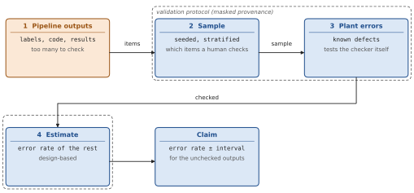
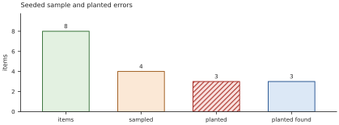

# Demo 53: Human Validation of Agent Outputs

> **▶️ New here? Follow the step-by-step [Execution Instructions](INSTRUCTIONS.md)** — every command with expected output.

## Learning Objectives

- Explain why an unchecked agent output is not a validated result
- Compute the share of planted errors that a declared sample would catch
- Estimate an error rate from the audited sample only
- Distinguish teaching demonstrations from validated research benchmarks

<!-- BEGIN generated: how-it-works (tools/figures/docs.py) -->
## How it works

**Figure 1.** Planted errors measure the validator; sampling measures the pipeline. Numbered boxes are stages (role on top, rule or variable beneath, in monospace); dashed grey panels mark a trust domain or scope; a dashed red arrow marks where an adversary acts. Teaching schematic: it simplifies the research procedure and leaves out its corpora, models and thresholds.

### Step by step

1. **Pipeline outputs** (`labels, code, results`). Too many to check. In this demo: `fixtures/`.
2. **Sample** (`seeded, stratified`). Which items a human checks. In this demo: `student/validate.py`.
3. **Plant errors** (`known defects`). Tests the checker itself. In this demo: `student/validate.py`.
4. **Estimate** (`error rate of the rest`). Design-based. In this demo: `student/run_validate.py`.
5. **Claim** (`error rate ± interval`). For the unchecked outputs. Run `make demo` to print it.

**Figure 2.** Every planted error fell in the sample, so the checker's sensitivity can be stated, not assumed. Values come from `make demo` on the synthetic fixture: they are illustrative and are not research results.

### What the research version adds (withheld while under peer review)

- Double validation and provenance masking
- Model-assisted and active-inference estimators
- A tested protocol on real agent outputs

The study's data, exact protocol, thresholds and results are not part of this teaching demo. They will be linked here once the paper is published open access.

<!-- END generated: how-it-works -->

## Conceptual Explanation

Agent pipelines can write more outputs than any person can check. A protocol therefore samples which items to inspect, plants known errors so the checker is tested, and reports how many of those planted errors the sample would have caught. Coverage here is planted-in-sample divided by planted-total; the sample error rate is the share of sampled items that carry a planted error.

The eight items and the four-item sample are hand-built. No live agent is queried.

## Safety Notice

⚠️ **This is a teaching demonstration using synthetic fixtures only.**
- No real students, patients, institutions, credentials, or API keys
- No network access (standard library only)
- All cases and verdicts are hand-built toys
- Results demonstrate a mechanism; they are not evidence about real systems

## Reproducibility Metadata

| Field | Value |
|-------|-------|
| Seed | 53 (fixed; no randomness used) |
| Python | 3.11+ (stdlib only) |
| OS | Linux/macOS/Windows |
| Command | `make demo DEMO=53` |

## Research Connection

This demo illustrates a sampled, provenance-aware validation protocol for agent-produced research outputs. The measurement in the research repository is **pending**; every quantity there is `[RESULT PENDING]`.

Nothing here describes a publication, a venue result, or a measured effect size.
