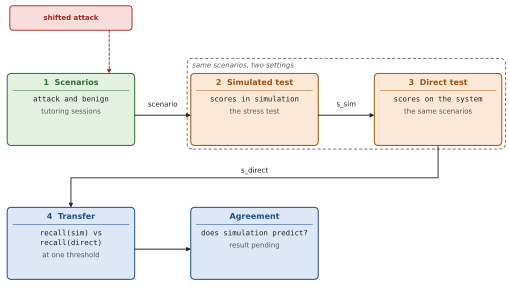
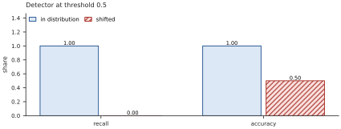

# Demo 54: Stress-Test Transfer

> **▶️ New here? Follow the step-by-step [Execution Instructions](INSTRUCTIONS.md)** — every command with expected output.

## Learning Objectives

- Explain why a stress test can look solved on the items it was tuned against
- Apply one threshold to an in-distribution set and a shifted set
- Report the recall drop as the transfer gap
- Distinguish teaching demonstrations from validated research benchmarks

<!-- BEGIN generated: how-it-works (tools/figures/docs.py) -->
## How it works

**Figure 1.** A stress test passed in simulation is evidence only if its result transfers to the direct test. Numbered boxes are stages (role on top, rule or variable beneath, in monospace); dashed grey panels mark a trust domain or scope; a dashed red arrow marks where an adversary acts. Teaching schematic: it simplifies the research procedure and leaves out its corpora, models and thresholds.

### Step by step

1. **Scenarios** (`attack and benign`). Tutoring sessions. In this demo: `fixtures/`.
2. **Simulated test** (`scores in simulation`). The stress test. In this demo: `student/transfer.py`.
3. **Direct test** (`scores on the system`). The same scenarios. In this demo: `student/transfer.py`.
4. **Transfer** (`recall(sim) vs recall(direct)`). At one threshold. In this demo: `student/run_transfer.py`.
5. **Agreement** (`does simulation predict?`). Result pending. Run `make demo` to print it.

**Figure 2.** A detector that is perfect in distribution misses both shifted attacks at the same threshold. Values come from `make demo` on the synthetic fixture: they are illustrative and are not research results.

### What the research version adds (withheld while under peer review)

- Agentic tutoring systems under both settings
- Model-identity logging and a scenario schema
- Design stage

The study's data, exact protocol, thresholds and results are not part of this teaching demo. They will be linked here once the paper is published open access.

<!-- END generated: how-it-works -->

## Conceptual Explanation

A detector with threshold 0.5 separates four in-distribution scores perfectly: attacks sit above 0.75 and benign cases sit below 0.25. On a shifted set the two attacks have been moved to 0.41 and 0.39, just under the same threshold, so recall falls from 1.0 to 0.0 while the false-positive rate stays zero. Passing the original stress set did not imply the test would transfer.

## Safety Notice

⚠️ **This is a teaching demonstration using synthetic fixtures only.**
- No real students, patients, institutions, credentials, or API keys
- No network access (standard library only)
- All cases and verdicts are hand-built toys
- Results demonstrate a mechanism; they are not evidence about real systems

## Reproducibility Metadata

| Field | Value |
|-------|-------|
| Seed | 54 (fixed; no randomness used) |
| Python | 3.11+ (stdlib only) |
| OS | Linux/macOS/Windows |
| Command | `make demo DEMO=54` |

## Research Connection

This demo illustrates transfer validity for simulated stress tests of agent behaviour. The measurement in the research repository is **pending**; every quantity there is `[RESULT PENDING]`.

Nothing here describes a publication, a venue result, or a measured effect size.
