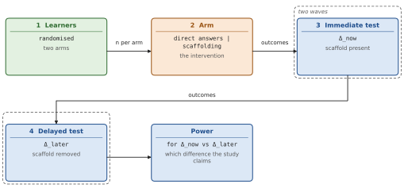
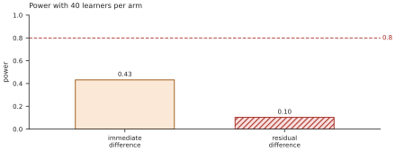

# Demo 55: Scaffolding Retention Power

> **▶️ New here? Follow the step-by-step [Execution Instructions](INSTRUCTIONS.md)** — every command with expected output.

## Learning Objectives

- Separate an immediate performance difference from a residual (retention) difference
- Compute two-sample power from n, sd and a planned difference, with no live data
- See that the same sample size can be well powered for a large immediate effect and weak for a smaller residual
- Distinguish teaching demonstrations from validated research benchmarks

<!-- BEGIN generated: how-it-works (tools/figures/docs.py) -->
## How it works

**Figure 1.** Power depends on which difference the study claims; the residual difference is usually much smaller. Numbered boxes are stages (role on top, rule or variable beneath, in monospace); dashed grey panels mark a trust domain or scope; a dashed red arrow marks where an adversary acts. Teaching schematic: it simplifies the research procedure and leaves out its corpora, models and thresholds.

### Step by step

1. **Learners** (`randomised`). Two arms. In this demo: `fixtures/`.
2. **Arm** (`direct answers | scaffolding`). The intervention. In this demo: `fixtures/`.
3. **Immediate test** (`Δ_now`). Scaffold present. In this demo: `student/power.py`.
4. **Delayed test** (`Δ_later`). Scaffold removed. In this demo: `student/run_power.py`.
5. **Power** (`for Δ_now vs Δ_later`). Which difference the study claims. Run `make demo` to print it.

**Figure 2.** The same sample is underpowered for both contrasts, and far more so for the residual one. Values come from `make demo` on the synthetic fixture: they are illustrative and are not research results.

### What the research version adds (withheld while under peer review)

- A two-wave experiment with adult distance learners
- Cognitive load and error detection as secondary outcomes
- Design stage

The study's data, exact protocol, thresholds and results are not part of this teaching demo. They will be linked here once the paper is published open access.

<!-- END generated: how-it-works -->

## Conceptual Explanation

A two-arm study that compares generative-AI scaffolding against a control can show a large immediate difference and a much smaller difference once the scaffold is removed. Power is not a single number: it depends on which difference the study claims to detect. This demo uses the usual normal approximation for two equal arms and a fixed standard deviation, on a hand-built plan (n = 40 per arm, sd = 1, differences 0.4 and 0.15). No participant data are present.

## Safety Notice

⚠️ **This is a teaching demonstration using synthetic fixtures only.**
- No real students, patients, institutions, credentials, or API keys
- No network access (standard library only)
- All cases and verdicts are hand-built toys
- Results demonstrate a mechanism; they are not evidence about real systems

## Reproducibility Metadata

| Field | Value |
|-------|-------|
| Seed | 55 (fixed; no randomness used) |
| Python | 3.11+ (stdlib only) |
| OS | Linux/macOS/Windows |
| Command | `make demo DEMO=55` |

## Research Connection

This demo illustrates the sample-size question for a generative-AI scaffolding retention trial. The trial itself has not been run; every empirical quantity in the research repository is `[RESULT PENDING]`.

Nothing here describes a publication, a venue result, or a measured effect size.
