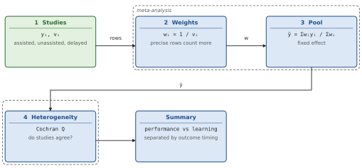
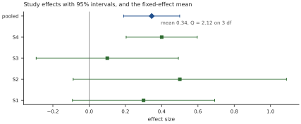

# Demo 56: Learning Performance Meta-analysis

> **▶️ New here? Follow the step-by-step [Execution Instructions](INSTRUCTIONS.md)** — every command with expected output.

## Learning Objectives

- Compute an inverse-variance weighted mean
- See that a more precise study pulls the mean more than a noisier one
- Read Cochran Q as a heterogeneity check, not as a quality badge
- Distinguish teaching demonstrations from validated research benchmarks

<!-- BEGIN generated: how-it-works (tools/figures/docs.py) -->
## How it works

**Figure 1.** A meta-analysis weights each study by its precision rather than averaging headlines. Numbered boxes are stages (role on top, rule or variable beneath, in monospace); dashed grey panels mark a trust domain or scope; a dashed red arrow marks where an adversary acts. Teaching schematic: it simplifies the research procedure and leaves out its corpora, models and thresholds.

### Step by step

1. **Studies** (`yᵢ, vᵢ`). Assisted, unassisted, delayed. In this demo: `fixtures/`.
2. **Weights** (`wᵢ = 1 / vᵢ`). Precise rows count more. In this demo: `student/learning_meta.py`.
3. **Pool** (`ȳ = Σwᵢyᵢ / Σwᵢ`). Fixed effect. In this demo: `student/learning_meta.py`.
4. **Heterogeneity** (`Cochran Q`). Do studies agree? In this demo: `student/run_meta.py`.
5. **Summary** (`performance vs learning`). Separated by outcome timing. Run `make demo` to print it.

**Figure 2.** Precise studies pull the pooled mean; Cochran's Q gives no sign that the studies disagree. Values come from `make demo` on the synthetic fixture: they are illustrative and are not research results.

### What the research version adds (withheld while under peer review)

- A systematic search and registered protocol
- Experiments that separate assisted, unassisted and delayed outcomes
- Design stage

The study's data, exact protocol, thresholds and results are not part of this teaching demo. They will be linked here once the paper is published open access.

<!-- END generated: how-it-works -->

## Conceptual Explanation

A meta-analysis does not average published headlines. Each synthetic study contributes an effect `yi` and a variance `vi`; the fixed-effect mean weights each row by `1/vi`, so a precise row moves the mean more than a noisy one. Cochran Q asks whether the rows scatter more than that weighting would expect.

The four rows are hand-built. They are not taken from any paper, and the mean is not a literature estimate.

## Safety Notice

⚠️ **This is a teaching demonstration using synthetic fixtures only.**
- No real students, patients, institutions, credentials, or API keys
- No network access (standard library only)
- All cases and verdicts are hand-built toys
- Results demonstrate a mechanism; they are not evidence about real systems

## Reproducibility Metadata

| Field | Value |
|-------|-------|
| Seed | 56 (fixed; no randomness used) |
| Python | 3.11+ (stdlib only) |
| OS | Linux/macOS/Windows |
| Command | `make demo DEMO=56` |

## Research Connection

This demo illustrates the estimator that a systematic review of generative-AI effects on learning performance would use. No studies have been coded yet; every empirical quantity in the research repository is `[RESULT PENDING]`.

Nothing here describes a publication, a venue result, or a measured effect size.
