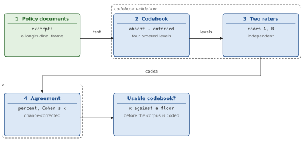
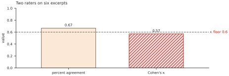

# Demo 57: HE Governance Corpus Coding

> **▶️ New here? Follow the step-by-step [Execution Instructions](INSTRUCTIONS.md)** — every command with expected output.

## Learning Objectives

- Validate codes against a closed codebook
- Compute percent agreement between two raters
- Compute Cohen's kappa and see why it is lower than raw agreement
- Distinguish teaching demonstrations from validated research benchmarks

<!-- BEGIN generated: how-it-works (tools/figures/docs.py) -->
## How it works

**Figure 1.** A corpus is only as usable as its codebook; chance-corrected agreement tests the codebook first. Numbered boxes are stages (role on top, rule or variable beneath, in monospace); dashed grey panels mark a trust domain or scope; a dashed red arrow marks where an adversary acts. Teaching schematic: it simplifies the research procedure and leaves out its corpora, models and thresholds.

### Step by step

1. **Policy documents** (`excerpts`). A longitudinal frame. In this demo: `fixtures/`.
2. **Codebook** (`absent … enforced`). Four ordered levels. In this demo: `student/coding.py`.
3. **Two raters** (`codes A, B`). Independent. In this demo: `student/coding.py`.
4. **Agreement** (`percent, Cohen's κ`). Chance-corrected. In this demo: `student/run_coding.py`.
5. **Usable codebook?** (`κ against a floor`). Before the corpus is coded. Run `make demo` to print it.

**Figure 2.** Two-thirds raw agreement shrinks to a kappa below the floor once chance agreement is removed. Values come from `make demo` on the synthetic fixture: they are illustrative and are not research results.

### What the research version adds (withheld while under peer review)

- A population frame of institutions
- Web-archive captures over time
- Design stage

The study's data, exact protocol, thresholds and results are not part of this teaching demo. They will be linked here once the paper is published open access.

<!-- END generated: how-it-works -->

## Conceptual Explanation

A corpus of institutional AI-governance documents is only as usable as its codebook. Two raters label each of six synthetic excerpts as absent, mentioned, specified or enforced. Percent agreement counts exact matches. Cohen's kappa subtracts the agreement expected if both raters used the same category frequencies by chance, so it sits below the raw rate whenever some categories are common.

## Safety Notice

⚠️ **This is a teaching demonstration using synthetic fixtures only.**
- No real students, patients, institutions, credentials, or API keys
- No network access (standard library only)
- All cases and verdicts are hand-built toys
- Results demonstrate a mechanism; they are not evidence about real systems

## Reproducibility Metadata

| Field | Value |
|-------|-------|
| Seed | 57 (fixed; no randomness used) |
| Python | 3.11+ (stdlib only) |
| OS | Linux/macOS/Windows |
| Command | `make demo DEMO=57` |

## Research Connection

This demo illustrates reliability checks for a UK higher-education AI-governance corpus. No documents have been sampled from the live frame yet; every empirical quantity in the research repository is `[RESULT PENDING]`.

Nothing here describes a publication, a venue result, or a measured effect size.
