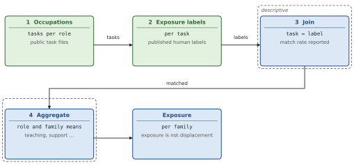
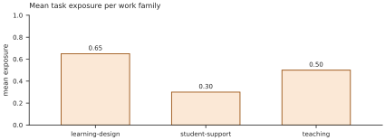

# Demo 58: Education Work AI Exposure

> **▶️ New here? Follow the step-by-step [Execution Instructions](INSTRUCTIONS.md)** — every command with expected output.

## Learning Objectives

- Average published-style exposure labels within an occupation
- Roll those means up to a work family
- Report the share of tasks that would require an AI system to act rather than write
- Distinguish teaching demonstrations from validated research benchmarks

<!-- BEGIN generated: how-it-works (tools/figures/docs.py) -->
## How it works

**Figure 1.** Exposure scores summarise overlap between tasks and what models can do; they do not measure displacement. Numbered boxes are stages (role on top, rule or variable beneath, in monospace); dashed grey panels mark a trust domain or scope; a dashed red arrow marks where an adversary acts. Teaching schematic: it simplifies the research procedure and leaves out its corpora, models and thresholds.

### Step by step

1. **Occupations** (`tasks per role`). Public task files. In this demo: `fixtures/`.
2. **Exposure labels** (`per task`). Published human labels. In this demo: `fixtures/`.
3. **Join** (`task ↔ label`). Match rate reported. In this demo: `student/exposure.py`.
4. **Aggregate** (`role and family means`). Teaching, support …. In this demo: `student/run_exposure.py`.
5. **Exposure** (`per family`). Exposure is not displacement. Run `make demo` to print it.

**Figure 2.** Learning design is the most exposed family in the toy; exposure says nothing about displacement. Values come from `make demo` on the synthetic fixture: they are illustrative and are not research results.

### What the research version adds (withheld while under peer review)

- Occupation and task files joined to public exposure labels
- Six educational role families with Wilson intervals

The study's data, exact protocol, thresholds and results are not part of this teaching demo. They will be linked here once the paper is published open access.

<!-- END generated: how-it-works -->

## Conceptual Explanation

Occupational exposure scores summarise how far a role's tasks overlap with what language models can write or do. This demo takes three synthetic higher-education roles, each with two tasks, and reports the mean exposure per role, the mean per work family, and the share of tasks tagged as agentic (the system would have to act, not just draft).

Exposure is not a forecast of job loss. The numbers are hand-built.

## Safety Notice

⚠️ **This is a teaching demonstration using synthetic fixtures only.**
- No real students, patients, institutions, credentials, or API keys
- No network access (standard library only)
- All cases and verdicts are hand-built toys
- Results demonstrate a mechanism; they are not evidence about real systems

## Reproducibility Metadata

| Field | Value |
|-------|-------|
| Seed | 58 (fixed; no randomness used) |
| Python | 3.11+ (stdlib only) |
| OS | Linux/macOS/Windows |
| Command | `make demo DEMO=58` |

## Research Connection

This demo illustrates the measurement layout for a task-level exposure study of higher- and distance-education work. No O*NET release has been joined yet; every empirical quantity in the research repository is `[RESULT PENDING]`.

Nothing here describes a publication, a venue result, or a measured effect size.
