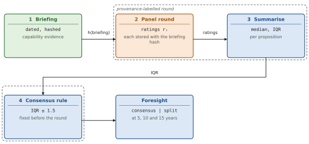
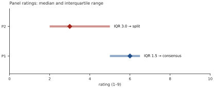

# Demo 59: Provenance-labelled Foresight

> **▶️ New here? Follow the step-by-step [Execution Instructions](INSTRUCTIONS.md)** — every command with expected output.

## Learning Objectives

- Summarise a small panel with the median and inter-quartile range
- Flag consensus when the IQR is at most 1.5 on a 1-7 scale
- Keep every summary attached to the briefing hash the (synthetic) panellists saw
- Distinguish teaching demonstrations from validated research benchmarks

<!-- BEGIN generated: how-it-works (tools/figures/docs.py) -->
## How it works

**Figure 1.** Every rating is bound to the briefing it answered, so later rounds can be compared fairly. Numbered boxes are stages (role on top, rule or variable beneath, in monospace); dashed grey panels mark a trust domain or scope; a dashed red arrow marks where an adversary acts. Teaching schematic: it simplifies the research procedure and leaves out its corpora, models and thresholds.

### Step by step

1. **Briefing** (`dated, hashed`). Capability evidence. In this demo: `fixtures/`.
2. **Panel round** (`ratings rᵢ`). Each stored with the briefing hash. In this demo: `student/delphi.py`.
3. **Summarise** (`median, IQR`). Per proposition. In this demo: `student/delphi.py`.
4. **Consensus rule** (`IQR ≤ 1.5`). Fixed before the round. In this demo: `student/run_delphi.py`.
5. **Foresight** (`consensus | split`). At 5, 10 and 15 years. Run `make demo` to print it.

**Figure 2.** P1 meets the IQR ≤ 1.5 rule; P2 is split. Both ratings are bound to the same briefing hash. Values come from `make demo` on the synthetic fixture: they are illustrative and are not research results.

### What the research version adds (withheld while under peer review)

- A Delphi panel and experiential scenarios
- Ethics approval and recruitment pending

The study's data, exact protocol, thresholds and results are not part of this teaching demo. They will be linked here once the paper is published open access.

<!-- END generated: how-it-works -->

## Conceptual Explanation

A Delphi round that opens with a dated briefing should store every rating with the hash of that briefing. This demo summarises two synthetic propositions: P1 is tightly grouped around 6 and meets the IQR <= 1.5 consensus rule; P2 is split by a single 7 among otherwise low ratings, so it does not. No panellists were recruited.

## Safety Notice

⚠️ **This is a teaching demonstration using synthetic fixtures only.**
- No real students, patients, institutions, credentials, or API keys
- No network access (standard library only)
- All cases and verdicts are hand-built toys
- Results demonstrate a mechanism; they are not evidence about real systems

## Reproducibility Metadata

| Field | Value |
|-------|-------|
| Seed | 59 (fixed; no randomness used) |
| Python | 3.11+ (stdlib only) |
| OS | Linux/macOS/Windows |
| Command | `make demo DEMO=59` |

## Research Connection

This demo illustrates the summary layer of a provenance-labelled Delphi. No panel has been recruited and no ethics application has been filed; every empirical quantity in the research repository is `[RESULT PENDING]`.

Nothing here describes a publication, a venue result, or a measured effect size.
