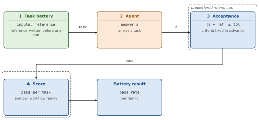
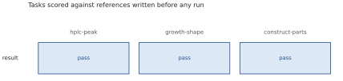

# Demo 60: Engineering-Biology Analysis Battery

> **▶️ New here? Follow the step-by-step [Execution Instructions](INSTRUCTIONS.md)** — every command with expected output.

## Learning Objectives

- Score a toy HPLC-like series by its peak time
- Label a short growth curve as flat or changing
- Check that a construct string contains each required part, against a reference written before scoring
- Distinguish teaching demonstrations from validated research benchmarks

<!-- BEGIN generated: how-it-works (tools/figures/docs.py) -->
## How it works

**Figure 1.** An analysis battery is fair only if every reference answer was written before any model ran. Numbered boxes are stages (role on top, rule or variable beneath, in monospace); dashed grey panels mark a trust domain or scope; a dashed red arrow marks where an adversary acts. Teaching schematic: it simplifies the research procedure and leaves out its corpora, models and thresholds.

### Step by step

1. **Task battery** (`inputs, reference`). Reference written before any run. In this demo: `fixtures/`.
2. **Agent** (`answer a`). Analysis task. In this demo: `student/battery.py`.
3. **Acceptance** (`|a − ref| ≤ tol`). Criteria fixed in advance. In this demo: `student/battery.py`.
4. **Score** (`pass per task`). And per workflow family. In this demo: `student/run_battery.py`.
5. **Battery result** (`pass rate`). Per family. Run `make demo` to print it.

**Figure 2.** All three synthetic tasks match their predeclared reference answers. Values come from `make demo` on the synthetic fixture: they are illustrative and are not research results.

### What the research version adds (withheld while under peer review)

- About forty engineering-biology tasks
- Domain-scientist acceptance criteria

The study's data, exact protocol, thresholds and results are not part of this teaching demo. They will be linked here once the paper is published open access.

<!-- END generated: how-it-works -->

## Conceptual Explanation

An analysis battery is useful only if each task has a reference answer written before any model is run. This demo scores three synthetic tasks: the time of a peak in a five-point series, whether a short curve is flat, and whether a construct string contains PROM, RBS, GENE and TERM in any recorded order. The references are in the fixture. No biological sample, instrument file or live model is used.

## Safety Notice

⚠️ **This is a teaching demonstration using synthetic fixtures only.**
- No real students, patients, institutions, credentials, or API keys
- No network access (standard library only)
- All cases and verdicts are hand-built toys
- Results demonstrate a mechanism; they are not evidence about real systems

## Reproducibility Metadata

| Field | Value |
|-------|-------|
| Seed | 60 (fixed; no randomness used) |
| Python | 3.11+ (stdlib only) |
| OS | Linux/macOS/Windows |
| Command | `make demo DEMO=60` |

## Research Connection

This demo illustrates the scoring layer of a frontier-agent analysis battery for engineering-biology tasks. The research repository is a skeleton; every empirical quantity there is `[RESULT PENDING]`.

Nothing here describes a publication, a venue result, or a measured effect size.
