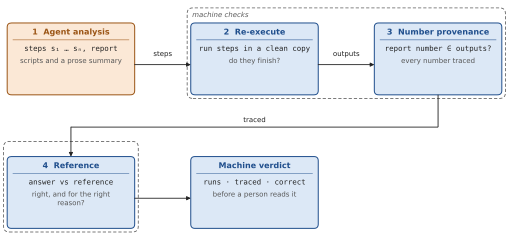
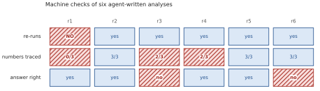

# Demo 61: Re-execution Checks

  
  
  

> **▶️ New here? Follow the step-by-step [Execution Instructions](INSTRUCTIONS.md)** — every command with expected output.

## Learning Objectives

- Re-run an agent-written analysis in a clean namespace
- Trace every number in a report back to a computed output
- Separate a right answer from a right analysis

<!-- BEGIN generated: how-it-works (tools/figures/docs.py) -->
## How it works

**Figure 1.** Before anyone reads an agent-written analysis, a machine can re-run it and trace every number in the report. Numbered boxes are stages (role on top, rule or variable beneath, in monospace); dashed grey panels mark a trust domain or scope; a dashed red arrow marks where an adversary acts. Teaching schematic: it simplifies the research procedure and leaves out its corpora, models and thresholds.

### Step by step

1. **Agent analysis** (`steps s₁ … sₙ, report`). Scripts and a prose summary. In this demo: `fixtures/fixtures.json`.
2. **Re-execute** (`run steps in a clean copy`). Do they finish? In this demo: `student/reexec.py`.
3. **Number provenance** (`report number ∈ outputs?`). Every number traced. In this demo: `student/reexec.py`.
4. **Reference** (`answer vs reference`). Right, and for the right reason? In this demo: `student/reexec.py`.
5. **Machine verdict** (`runs · traced · correct`). Before a person reads it. Run `make demo` to print it.

**Figure 2.** Answer-only scoring would accept r1 and r4; re-execution and number tracing show one does not re-run and the other states an untraceable number. Values come from `make demo` on the synthetic fixture: they are illustrative and are not research results.

### What the research version adds (withheld while under peer review)

- Public engineering-biology tasks run by open-weight configurations, five times each
- Deterministic, zero-GPU checks

The study's data, exact protocol, thresholds and results are not part of this teaching demo. They will be linked here once the paper is published open access.

<!-- END generated: how-it-works -->

## Conceptual Explanation

Agents now write analyses as well as answers. An answer can be right for the wrong reason, or wrong while looking precise. Before anyone reads the report, a machine can establish three things: whether the steps re-run in a clean copy, whether every number in the report traces to an output of those steps, and whether the final answer matches a reference written beforehand.

## Safety Notice

⚠️ **Teaching demonstration only.**
- Synthetic fixtures (`fixtures/fixtures.json`); every name, value and verdict is invented
- No network access, no credentials, standard library only
- Results demonstrate a mechanism; they are not evidence about real systems

## Reproducibility Metadata

| Field | Value |
|-------|-------|
| Randomness | none (deterministic) |
| Python | 3.10+ (standard library only) |
| Command | `make demo` then `make test` |
| Output | `results/reexecution.json` |

## Research Connection

This demo distils, in simplified form, the procedure of a study in the author's research programme that is in progress or under peer review. All scenarios, numbers and verdicts here are synthetic and describe no publication.

## Exercise

Change `r4` so that it computes the ratio it reports. Which reading does it move to? Then add a run whose steps re-run and trace but use the wrong input column.
