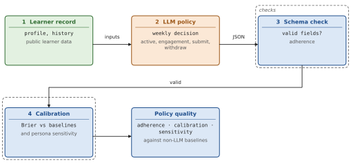
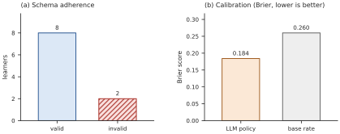

# Demo 62: LLM Learner Policy Checks

  
  
  

> **▶️ New here? Follow the step-by-step [Execution Instructions](INSTRUCTIONS.md)** — every command with expected output.

## Learning Objectives

- Check a model's structured output against a schema
- Compare a probabilistic policy with a base-rate baseline using the Brier score
- Probe sensitivity to an equivalent rewording of the input

<!-- BEGIN generated: how-it-works (tools/figures/docs.py) -->
## How it works

**Figure 1.** An LLM learner policy is compared with simple baselines on adherence, calibration and sensitivity to persona wording. Numbered boxes are stages (role on top, rule or variable beneath, in monospace); dashed grey panels mark a trust domain or scope; a dashed red arrow marks where an adversary acts. Teaching schematic: it simplifies the research procedure and leaves out its corpora, models and thresholds.

### Step by step

1. **Learner record** (`profile, history`). Public learner data. In this demo: `fixtures/fixtures.json`.
2. **LLM policy** (`weekly decision`). Active, engagement, submit, withdraw. In this demo: `student/policy_checks.py`.
3. **Schema check** (`valid fields?`). Adherence. In this demo: `student/policy_checks.py`.
4. **Calibration** (`Brier vs baselines`). And persona sensitivity. In this demo: `student/policy_checks.py`.
5. **Policy quality** (`adherence · calibration · sensitivity`). Against non-LLM baselines. Run `make demo` to print it.

**Figure 2.** Two of ten outputs break the schema; the policy beats the base rate, and 2 learners' predictions move under an equivalent persona rewording. Values come from `make demo` on the synthetic fixture: they are illustrative and are not research results.

### What the research version adds (withheld while under peer review)

- Presentations of a public learner dataset
- Free models on a cloud machine
- Design stage

The study's data, exact protocol, thresholds and results are not part of this teaching demo. They will be linked here once the paper is published open access.

<!-- END generated: how-it-works -->

## Conceptual Explanation

A language model used as a simulated learner returns a weekly decision as structured fields. Three checks come before any claim about realism: does every output follow the schema; is the predicted withdrawal probability better calibrated than simply predicting the base rate; and does an equivalent rewording of the learner's persona change the prediction?

## Safety Notice

⚠️ **Teaching demonstration only.**
- Synthetic fixtures (`fixtures/fixtures.json`); every name, value and verdict is invented
- No network access, no credentials, standard library only
- Results demonstrate a mechanism; they are not evidence about real systems

## Reproducibility Metadata

| Field | Value |
|-------|-------|
| Randomness | none (deterministic) |
| Python | 3.10+ (standard library only) |
| Command | `make demo` then `make test` |
| Output | `results/policy_checks.json` |

## Research Connection

This demo distils, in simplified form, the procedure of a study in the author's research programme that is in progress or under peer review. All scenarios, numbers and verdicts here are synthetic and describe no publication.

## Exercise

Set `l08`'s reworded prediction to 0.85. How many learners remain persona-sensitive? What Brier score would a policy that always predicts 0.4 obtain?
