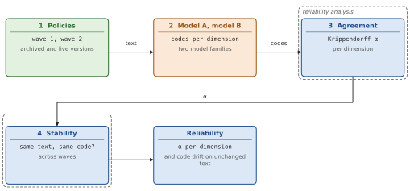
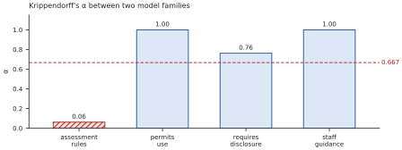

# Demo 63: Policy-Coding Reliability

  
  
  

> **▶️ New here? Follow the step-by-step [Execution Instructions](INSTRUCTIONS.md)** — every command with expected output.

## Learning Objectives

- Compute Krippendorff's alpha for two coders on nominal data
- Report reliability per dimension rather than as one number
- Detect code drift on text that did not change

<!-- BEGIN generated: how-it-works (tools/figures/docs.py) -->
## How it works

**Figure 1.** Two model families coding the same policies agree on some dimensions and not others. Numbered boxes are stages (role on top, rule or variable beneath, in monospace); dashed grey panels mark a trust domain or scope; a dashed red arrow marks where an adversary acts. Teaching schematic: it simplifies the research procedure and leaves out its corpora, models and thresholds.

### Step by step

1. **Policies** (`wave 1, wave 2`). Archived and live versions. In this demo: `fixtures/fixtures.json`.
2. **Model A, model B** (`codes per dimension`). Two model families. In this demo: `fixtures/fixtures.json`.
3. **Agreement** (`Krippendorff α`). Per dimension. In this demo: `student/reliability.py`.
4. **Stability** (`same text, same code?`). Across waves. In this demo: `student/reliability.py`.
5. **Reliability** (`α per dimension`). And code drift on unchanged text. Run `make demo` to print it.

**Figure 2.** Agreement is high on three dimensions and near chance on assessment rules; one policy's codes changed although its text did not. Values come from `make demo` on the synthetic fixture: they are illustrative and are not research results.

### What the research version adds (withheld while under peer review)

- An eleven-dimension codebook on a random sample of institutions
- A web-archive wave and a live wave

The study's data, exact protocol, thresholds and results are not part of this teaching demo. They will be linked here once the paper is published open access.

<!-- END generated: how-it-works -->

## Conceptual Explanation

Two language models of different families code the same institutional AI policies on four dimensions. Agreement is computed per dimension with Krippendorff's alpha, which corrects for agreement expected by chance. Re-coding policies whose text did not change between two archive waves shows whether a model is stable.

## Safety Notice

⚠️ **Teaching demonstration only.**
- Synthetic fixtures (`fixtures/fixtures.json`); every name, value and verdict is invented
- No network access, no credentials, standard library only
- Results demonstrate a mechanism; they are not evidence about real systems

## Reproducibility Metadata

| Field | Value |
|-------|-------|
| Randomness | none (deterministic) |
| Python | 3.10+ (standard library only) |
| Command | `make demo` then `make test` |
| Output | `results/reliability.json` |

## Research Connection

This demo distils, in simplified form, the procedure of a study in the author's research programme that is in progress or under peer review. All scenarios, numbers and verdicts here are synthetic and describe no publication.

## Exercise

Make model B agree with model A on `assessment_rules` for u2 and u3. How far does alpha rise? Why does a dimension where almost every code is 1 give a fragile alpha?
