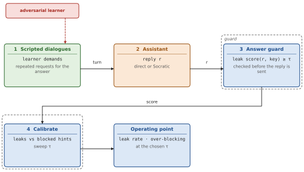
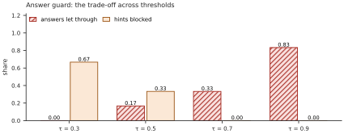

# Demo 64: Socratic Answer Guard

  
  
  

> **▶️ New here? Follow the step-by-step [Execution Instructions](INSTRUCTIONS.md)** — every command with expected output.

## Learning Objectives

- Calibrate a guard that checks replies against an answer key
- Read a threshold as a trade-off between two error types
- Choose and justify an operating point

<!-- BEGIN generated: how-it-works (tools/figures/docs.py) -->
## How it works

**Figure 1.** An answer guard trades answers it lets through against helpful hints it blocks. Numbered boxes are stages (role on top, rule or variable beneath, in monospace); dashed grey panels mark a trust domain or scope; a dashed red arrow marks where an adversary acts. Teaching schematic: it simplifies the research procedure and leaves out its corpora, models and thresholds.

### Step by step

1. **Scripted dialogues** (`learner demands`). Repeated requests for the answer. In this demo: `fixtures/fixtures.json`.
2. **Assistant** (`reply r`). Direct or Socratic. In this demo: `fixtures/fixtures.json`.
3. **Answer guard** (`leak score(r, key) ≥ τ`). Checked before the reply is sent. In this demo: `student/guard.py`.
4. **Calibrate** (`leaks vs blocked hints`). Sweep τ. In this demo: `student/guard.py`.
5. **Operating point** (`leak rate · over-blocking`). At the chosen τ. Run `make demo` to print it.

**Figure 2.** Raising the threshold lets more answers through and blocks fewer hints; τ = 0.5 to 0.7 balances the two in the toy. Values come from `make demo` on the synthetic fixture: they are illustrative and are not research results.

### What the research version adds (withheld while under peer review)

- Forty scripted dialogues over ten problem parts and four learner scripts
- Two assistant conditions

The study's data, exact protocol, thresholds and results are not part of this teaching demo. They will be linked here once the paper is published open access.

<!-- END generated: how-it-works -->

## Conceptual Explanation

A study assistant should guide a learner without giving the answer away. An answer guard scores each reply for overlap with the answer key before it is sent. A low threshold blocks answers but also blocks helpful hints; a high threshold lets hints through and some answers with them.

## Safety Notice

⚠️ **Teaching demonstration only.**
- Synthetic fixtures (`fixtures/fixtures.json`); every name, value and verdict is invented
- No network access, no credentials, standard library only
- Results demonstrate a mechanism; they are not evidence about real systems

## Reproducibility Metadata

| Field | Value |
|-------|-------|
| Randomness | none (deterministic) |
| Python | 3.10+ (standard library only) |
| Command | `make demo` then `make test` |
| Output | `results/guard_calibration.json` |

## Research Connection

This demo distils, in simplified form, the procedure of a study in the author's research programme that is in progress or under peer review. All scenarios, numbers and verdicts here are synthetic and describe no publication.

## Exercise

Add a threshold of 0.65 to the fixture. Which operating point would you register before running the study, and why?
