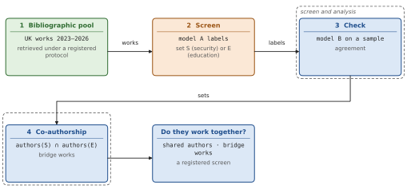
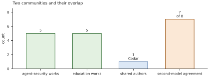

# Demo 65: Security–Education Bibliometrics

  
  
  

> **▶️ New here? Follow the step-by-step [Execution Instructions](INSTRUCTIONS.md)** — every command with expected output.

## Learning Objectives

- Screen a bibliographic pool into two communities with one model and check it with another
- Measure collaboration through shared authors
- State what a bibliometric screen can and cannot show

<!-- BEGIN generated: how-it-works (tools/figures/docs.py) -->
## How it works

**Figure 1.** Two research communities are tested for collaboration by the authors and works they share. Numbered boxes are stages (role on top, rule or variable beneath, in monospace); dashed grey panels mark a trust domain or scope; a dashed red arrow marks where an adversary acts. Teaching schematic: it simplifies the research procedure and leaves out its corpora, models and thresholds.

### Step by step

1. **Bibliographic pool** (`UK works 2023–2026`). Retrieved under a registered protocol. In this demo: `fixtures/fixtures.json`.
2. **Screen** (`model A labels`). Set S (security) or E (education). In this demo: `fixtures/fixtures.json`.
3. **Check** (`model B on a sample`). Agreement. In this demo: `student/bibliometrics.py`.
4. **Co-authorship** (`authors(S) ∩ authors(E)`). Bridge works. In this demo: `student/bibliometrics.py`.
5. **Do they work together?** (`shared authors · bridge works`). A registered screen. Run `make demo` to print it.

**Figure 2.** One author bridges the two sets; the second model disagrees with the first on one sampled work. Values come from `make demo` on the synthetic fixture: they are illustrative and are not research results.

### What the research version adds (withheld while under peer review)

- A registered retrieval from an open bibliographic index
- A second model of another family on a stratified sample

The study's data, exact protocol, thresholds and results are not part of this teaching demo. They will be linked here once the paper is published open access.

<!-- END generated: how-it-works -->

## Conceptual Explanation

Are two research communities working together? A registered screen labels each work as agent security, AI in education, or neither; a second model of another family re-labels a sample. Collaboration is then measured by the authors who appear in both sets.

## Safety Notice

⚠️ **Teaching demonstration only.**
- Synthetic fixtures (`fixtures/fixtures.json`); every name, value and verdict is invented
- No network access, no credentials, standard library only
- Results demonstrate a mechanism; they are not evidence about real systems

## Reproducibility Metadata

| Field | Value |
|-------|-------|
| Randomness | none (deterministic) |
| Python | 3.10+ (standard library only) |
| Command | `make demo` then `make test` |
| Output | `results/bibliometrics.json` |

## Research Connection

This demo distils, in simplified form, the procedure of a study in the author's research programme that is in progress or under peer review. All scenarios, numbers and verdicts here are synthetic and describe no publication.

## Exercise

Relabel `w06` as the second model did. Does the shared-author count change? What would a single bridging author mean for a claim that the communities are separate?
