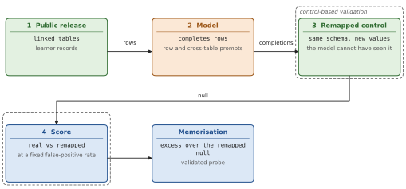
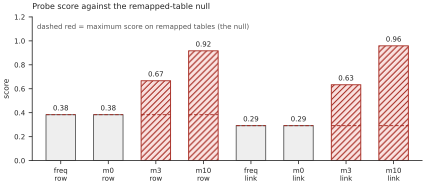

# Demo 67: Does a Language Model Remember a Linked Learner-Records Release? Validating a Multi-Table Memorisation Probe against Remapped Controls

> **▶️ New here? Follow the step-by-step [Execution Instructions](INSTRUCTIONS.md)** — every command with expected output.

**Status (19 November 2026):** design stage. A teaching toy with labelled synthetic fixtures runs offline and its tests pass. **No pilot data have been collected and no results exist.** Every study quantity is `[RESULT PENDING]`.

## Research question

Can a memorisation probe for a public, multi-table learner-records dataset be validated, in the sense of a measured false-positive rate on remapped copies that no model can have seen and a measured detection rate on a model known to have seen the tables, and do cross-table (join-key) completion tests detect exposure that single-table row-completion tests miss?

## Why it matters

LLM simulations of learners are increasingly calibrated against public learning-analytics data. If a model can reproduce that data from memory, a close fit is not evidence of a valid simulator. Existing tabular memorisation tests address single tables; linked releases add join structure that a probe can exploit and that a remapping control must preserve.

## Design of the pilot study

| Arm or control | What it is |
|---|---|
| Published tables | the probe scores each model on the tables as released |
| Remapped tables | identifiers and category codes replaced by a consistent bijection, keeping frequencies and joins; their scores form the null |
| Positive control | a model given the tables a known number of times (fine-tuning or, in the pilot, repeated in-context exposure); the teaching toy uses a synthetic memoriser |

**Outcomes**
- primary: detection of the positive control at the registered false-positive rate (5 per cent) on the remapped null
- secondary: detection rate by exposure count; agreement between row-completion and cross-table tests; scores of open-weight models of unknown exposure

**How the pilot runs.** The Open University Learning Analytics Dataset (OULAD; Kuzilek, Hlosta and Zdrahal, 2017, Scientific Data 4, 170171, doi:10.1038/sdata.2017.171; CC BY 4.0), 2013 presentations only. Header, row-completion, feature-completion and cross-table completion tests; at least 40 remapped copies per test; open-weight models run locally; the positive control in the pilot is repeated in-context exposure, which is a weaker stand-in for fine-tuning and is reported as such. The steps are in [`ZCODE_PROMPT.md`](ZCODE_PROMPT.md); the study is registered in `docs/` before the first real run.

**Data.** Synthetic linked tables in the toy; OULAD (CC BY 4.0) in the pilot.

## The teaching toy

`student/memprobe.py` implements the measurement on `fixtures/linked_tables.json`; `student/run_memprobe.py` prints one line per case and writes `results/memprobe.json`. Every number it prints belongs to the toy fixture and is not evidence about any real system, dataset or population.

## Learning Objectives

- State the measurement question and the registered primary outcome
- Run the offline procedure on the labelled synthetic fixture
- Explain which control or baseline makes the outcome interpretable
- Distinguish the teaching output from a confirmatory research result

<!-- BEGIN generated: how-it-works (tools/figures/docs.py) -->
## How it works

**Figure 1.** A memorisation probe is validated by how it scores on remapped tables the model cannot have seen. Numbered boxes are stages (role on top, rule or variable beneath, in monospace); dashed grey panels mark a trust domain or scope; a dashed red arrow marks where an adversary acts. Teaching schematic: it simplifies the research procedure and leaves out its corpora, models and thresholds.

### Step by step

1. **Public release** (`linked tables`). Learner records. In this demo: `fixtures/`.
2. **Model** (`completes rows`). Row and cross-table prompts. In this demo: `student/memprobe.py`.
3. **Remapped control** (`same schema, new values`). The model cannot have seen it. In this demo: `fixtures/`.
4. **Score** (`real vs remapped`). At a fixed false-positive rate. In this demo: `student/run_memprobe.py`.
5. **Memorisation** (`excess over the remapped null`). Validated probe. Run `make demo` to print it.

**Figure 2.** Only models exposed to the release score above the remapped null; a frequency guesser never does. Values come from `make demo` on the synthetic fixture: they are illustrative and are not research results.

### What the research version adds (withheld while under peer review)

- A public multi-table learner dataset
- Design stage

The study's data, exact protocol, thresholds and results are not part of this teaching demo. They will be linked here once the paper is published open access.

<!-- END generated: how-it-works -->

## Venues

| Option | Venue | Dates and rules |
|---|---|---|
| A | <a href="https://2027.aclweb.org/calls/main/" target="_blank" rel="noopener noreferrer">ACL 2027 through ACL Rolling Review (ARR)</a> | ARR submission 4 Jan 2027 (11:59 pm AoE); ACL commitment and notification dates to be announced. long paper through ARR on OpenReview; since October 2026 ARR guarantees review only to submissions with a qualified service contributor (others enter a lottery), and caps first-author submissions at five; page limits UNVERIFIED (re-read the ARR call). ICML 2027 was not used: the collection already lists six ICML 2027 papers and ICML's call limits an author who does not meet its reciprocal-reviewer criteria to two submissions |
| B | <a href="https://jmlr.org/tmlr/" target="_blank" rel="noopener noreferrer">Transactions on Machine Learning Research (TMLR)</a> | rolling submission. use only after the ACL 2027 decision (date to be announced) |
| C | <a href="https://iclr.cc/" target="_blank" rel="noopener noreferrer">ICLR 2028</a> | call not yet published (UNVERIFIED). use only after TMLR's decision; record the official call before relying on any date |

B and C are sequential fallbacks: each is used only after the previous option's official notification, so the same work is never under review in two places. Paste-ready fields are in `submission/option-A/`, `option-B/` and `option-C/` (`REGISTRATION.md`).

**Risks for the venue plan**
- ARR's sustainable-reviewing policy (from October 2026) guarantees review only when a submission names a qualified service contributor; without one, the paper enters a review lottery.

## Safety Notice

⚠️ **This is a teaching demonstration using synthetic fixtures only.**
- No real people, credentials, production systems or provider accounts
- No network access in the toy (standard library only)
- Results demonstrate a mechanism; they are not evidence about real deployments

## Reproducibility metadata

| Field | Value |
|-------|-------|
| Seed | 67 where randomness is used |
| Python | 3.11+ (standard library only) |
| Command | `make demo DEMO=67` |

## Author

Petar Radanliev, The Open University (ORCID [0000-0001-5629-6857](https://orcid.org/0000-0001-5629-6857)).
