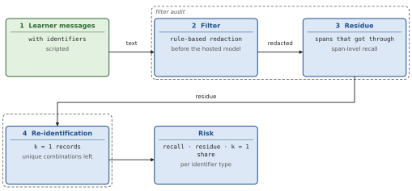
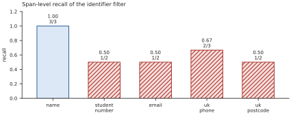

# Demo 68: What Gets Past the Filter? Identifier Residue and Re-identification Risk in Learner Text Sent to Hosted Language Models

> **▶️ New here? Follow the step-by-step [Execution Instructions](INSTRUCTIONS.md)** — every command with expected output.

**Status (19 November 2026):** design stage. A teaching toy with labelled synthetic fixtures runs offline and its tests pass. **No pilot data have been collected and no results exist.** Every study quantity is `[RESULT PENDING]`.

## Research question

When typed learner text passes through an identifier filter before it reaches a hosted language model, which identifiers get through, at what rate by type and phrasing, and how often do the quasi-identifiers that remain single out one person in a roster?

## Why it matters

Study assistants built on hosted models send what learners type to a third party. Filtering common identifiers before text leaves the institution is a standard safeguard, but its residue is rarely measured, and redacting direct identifiers does not remove the combinations of attributes that can identify someone.

## Design of the pilot study

| Arm or control | What it is |
|---|---|
| Rule filter | regular expressions for e-mail addresses, UK telephone numbers, UK postcodes and a student-number format, plus a name list |
| Rule filter with a local model | the same rules followed by a local open-weight model asked to mark remaining identifiers (pilot only) |
| Re-identification check | remaining quasi-identifiers matched against a synthetic roster; a message is flagged when exactly one entry matches |

**Outcomes**
- primary: span-level recall per identifier type on scripted messages written to include ordinary, obfuscated and case-varied identifiers
- secondary: precision (false redaction of subject content such as numbers in statistics problems); share of messages whose remaining quasi-identifiers single out one roster entry

**How the pilot runs.** Scripted messages and a synthetic roster written for this check only; no participants and no real learner text. The local model, if used, runs on the machine through Ollama and its tag and digest are logged. The steps are in [`ZCODE_PROMPT.md`](ZCODE_PROMPT.md); the study is registered in `docs/` before the first real run.

**Data.** Scripted synthetic messages, hand-labelled spans and a synthetic roster.

## The teaching toy

`student/idfilter.py` implements the measurement on `fixtures/messages.json`; `student/run_idfilter.py` prints one line per case and writes `results/idfilter.json`. Every number it prints belongs to the toy fixture and is not evidence about any real system, dataset or population.

## Learning Objectives

- State the measurement question and the registered primary outcome
- Run the offline procedure on the labelled synthetic fixture
- Explain which control or baseline makes the outcome interpretable
- Distinguish the teaching output from a confirmatory research result

<!-- BEGIN generated: how-it-works (tools/figures/docs.py) -->
## How it works

**Figure 1.** What gets past an identifier filter is measured span by span, then as re-identification risk. Numbered boxes are stages (role on top, rule or variable beneath, in monospace); dashed grey panels mark a trust domain or scope; a dashed red arrow marks where an adversary acts. Teaching schematic: it simplifies the research procedure and leaves out its corpora, models and thresholds.

### Step by step

1. **Learner messages** (`with identifiers`). Scripted. In this demo: `fixtures/`.
2. **Filter** (`rule-based redaction`). Before the hosted model. In this demo: `student/idfilter.py`.
3. **Residue** (`spans that got through`). Span-level recall. In this demo: `student/idfilter.py`.
4. **Re-identification** (`k = 1 records`). Unique combinations left. In this demo: `student/run_idfilter.py`.
5. **Risk** (`recall · residue · k = 1 share`). Per identifier type. Run `make demo` to print it.

**Figure 2.** Names are caught; obfuscated e-mail addresses, student numbers and postcodes get through. Values come from `make demo` on the synthetic fixture: they are illustrative and are not research results.

### What the research version adds (withheld while under peer review)

- Scripted learner messages at scale
- Design stage

The study's data, exact protocol, thresholds and results are not part of this teaching demo. They will be linked here once the paper is published open access.

<!-- END generated: how-it-works -->

## Venues

| Option | Venue | Dates and rules |
|---|---|---|
| A | <a href="https://www.petsymposium.org/cfp27.php" target="_blank" rel="noopener noreferrer">Proceedings on Privacy Enhancing Technologies (PoPETs) 2027, Issue 4</a> | submission 28 Feb 2027 (firm, AoE); rebuttal 10 to 16 Apr 2027; notification 1 May 2027; revision deadline 1 Jun 2027. at most four submissions per author per issue; rejected papers must skip a full issue; page limit not read (UNVERIFIED). Issue 3 (30 Nov 2026) is nearer but leaves eleven days and no data, so it is not used |
| B | <a href="https://dl.acm.org/journal/tops" target="_blank" rel="noopener noreferrer">ACM Transactions on Privacy and Security (TOPS)</a> | rolling submission. use only after PoPETs' notification on 1 May 2027 |
| C | <a href="https://signalprocessingsociety.org/publications-resources/ieee-transactions-information-forensics-and-security" target="_blank" rel="noopener noreferrer">IEEE Transactions on Information Forensics and Security (TIFS)</a> | rolling submission. use only after ACM TOPS' decision; page limit and fees UNVERIFIED |

B and C are sequential fallbacks: each is used only after the previous option's official notification, so the same work is never under review in two places. Paste-ready fields are in `submission/option-A/`, `option-B/` and `option-C/` (`REGISTRATION.md`).

**Risks for the venue plan**
- None recorded beyond the UNVERIFIED items above.

## Safety Notice

⚠️ **This is a teaching demonstration using synthetic fixtures only.**
- No real people, credentials, production systems or provider accounts
- No network access in the toy (standard library only)
- Results demonstrate a mechanism; they are not evidence about real deployments

## Reproducibility metadata

| Field | Value |
|-------|-------|
| Seed | 68 where randomness is used |
| Python | 3.11+ (standard library only) |
| Command | `make demo DEMO=68` |

## Author

Petar Radanliev, The Open University (ORCID [0000-0001-5629-6857](https://orcid.org/0000-0001-5629-6857)).
